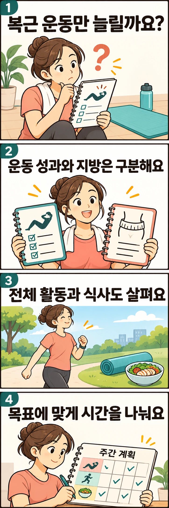

## 복근 운동을 더 하면 배부터 빠질까요?

뱃살을 줄이기 위해 복근 운동만 계속 늘리는 계획은 권하기 어렵습니다. 복근을 반복해서 쓰는 능력이 좋아져도 그 위의 지방이 같은 비율로 줄어든다고 볼 수는 없기 때문입니다. **복근 운동은 남기되, 배의 지방을 줄이는 유일한 수단으로 삼지 않는 것**이 현실적인 출발점입니다.

특정 부위를 운동해 바로 그 주변 지방을 더 줄이려는 생각을 ‘부분 감량’이라고 합니다. 관련 연구 결과를 읽을 때도 복근 운동을 잘하게 됐는지와 지방량이 변했는지를 따로 보셔야 합니다.

## 복근은 더 잘 쓰게 됐는데 지방은 그대로였던 시험

2011년 발표된 무작위시험에는 평소 운동하지 않던 건강한 성인 24명이 참여했습니다. 연구진은 참가자를 복부 운동군과 대조군으로 나눴습니다. 운동군은 6주 동안 주 5일, 일곱 가지 복부 운동을 각각 10회씩 두 세트 수행했고, 두 집단 모두 섭취 열량을 유지했습니다.

운동군은 상체를 말아 올리는 컬업 동작의 반복 능력이 대조군보다 좋아졌습니다. 반면 체중·체지방률·복부 둘레·복부 지방 관련 측정에서는 복부 운동의 유의한 효과가 나타나지 않았습니다. 복근 운동의 성과가 있었지만, 그것을 뱃살 감소라고 부를 수는 없었던 셈입니다. [연구 초록](https://pubmed.ncbi.nlm.nih.gov/21804427/)

인원이 적고 6주로 짧은 시험입니다. 식사 조절과 다른 운동까지 결합한 장기 감량 프로그램을 시험한 것도 아닙니다. 따라서 ‘복근 운동은 쓸모없다’거나 ‘운동으로 복부 지방은 줄지 않는다’는 결론으로 넓혀서는 안 됩니다. 확인된 범위는 이 조건의 복부 운동만으로는 지방 감소가 확인되지 않았다는 데 있습니다.

## 부분 감량 연구는 모두 같은 결론일까요?

2022년 메타분석은 한쪽 팔다리를 훈련하고 반대쪽과 비교한 연구 13편을 모았습니다. 종합 결과에서는 훈련한 부위의 지방이 더 줄어드는 효과가 확인되지 않았습니다. 다만 팔다리 비교를 중심으로 한 분석이므로 모든 복부 운동 방식에 대한 최종 판정으로 볼 수는 없습니다. [메타분석](https://hummov.awf.wroc.pl/A-proposed-model-to-test-the-hypothesis-of-exercise-induced-localized-fat-reduction,143162,0,2.html)

다른 결과도 있습니다. 2023년 과체중 남성 16명을 대상으로 한 10주 시험에서는 달리기에 복부 지구력 운동을 더한 집단이 달리기만 한 집단보다 몸통 지방을 더 줄였다고 보고했습니다. 그러나 복합 운동군은 한 번에 총 84분, 달리기군은 45분을 운동했습니다. 연구진이 운동 에너지 소비를 맞추려 설계했더라도 시간과 운동 구성이 같은 비교는 아닙니다. 지방을 측정한 몸통 영역에는 배뿐 아니라 가슴과 등도 포함됐습니다. 집에서 복근 운동 몇 회를 추가하는 상황과도 차이가 큽니다. [연구 전문](https://physoc.onlinelibrary.wiley.com/doi/10.14814/phy2.15853)

이 결과들을 함께 보면 ‘부분 감량은 어떤 조건에서도 절대 불가능하다’고 단정할 필요는 없습니다. 그렇다고 ‘원하는 곳을 운동하면 그곳만 빠진다’는 약속이 뒷받침되는 것도 아닙니다. 일반 독자가 계획을 세울 때에는 특정 부위의 선택적 감량을 기대하며 복근 운동량에만 시간을 더 투자하지 않는 편이 합리적입니다.

## 운동 시간이 한정돼 있다면 무엇을 바꿀까요?

예를 들어 운동할 수 있는 30분을 전부 복근 운동에 쓰고 있는데, 배의 변화가 없어 횟수를 더 늘리려는 상황을 생각해 보세요. 먼저 목표를 두 가지로 나눠 적어 보시면 좋습니다.

- **복근을 더 잘 쓰고 싶습니다:** 통증 없이 조절할 수 있는 동작을 남기고, 같은 자세로 수행할 수 있는 범위를 기록해 보세요. 지방 변화와 별개로 평가할 운동 목표입니다.
- **체지방을 줄이고 싶습니다:** 복근 운동 횟수를 추가하기 전에 전체 활동과 식사 패턴을 함께 살펴보세요. 복근 운동이 다른 활동을 전부 밀어내고 있다면 시간을 일부 나눠 쓰는 계획을 시험해 볼 수 있습니다.

구체적으로는 익숙한 복근 운동을 짧게 남긴 뒤, 나머지 시간을 걷기나 자신이 이어갈 수 있는 전신 활동에 배분하는 방식입니다. 이는 특정 비율이 정답이라는 처방이 아니라 운동 선택을 바꾸는 예시입니다. 새 운동을 무리하게 더하기보다 현재 시간 안에서 배분부터 바꿔 보세요.

식사 역시 복근 운동을 한 날과 안 한 날을 벌주거나 보상하는 기준으로 삼지 마세요. 평소 식사에서 무엇을 얼마나 먹고 있는지 살펴보고, 조정할 부분이 있다면 지속할 수 있는 한 가지를 선택하시면 됩니다. 복근 운동 횟수만으로 식사 조절의 필요 여부를 판단하지 않는 것이 핵심입니다.

## 기록도 두 칸으로 나누어 보세요

운동 기록에는 ‘같은 자세로 복근 운동을 얼마나 수행했는지’를, 몸의 변화 기록에는 ‘같은 조건에서 비교한 체중과 허리둘레’를 따로 남겨 보세요. 허리둘레를 비교할 때는 줄자를 대는 위치와 측정 시간을 일정하게 정해 두시면 좋습니다. 둘레만으로 복부 지방의 종류나 양을 정확히 알 수 있다고 해석하지는 마세요.

복근 운동은 더 수월해졌는데 허리둘레가 그대로라면, 근육을 쓰는 능력과 지방 변화의 기록이 다르게 나온 것입니다. 그때 곧바로 복근 운동을 두 배로 늘리기보다 전체 계획을 다시 살펴보세요. 반대로 둘레가 줄었다고 특정 복근 동작이 그 부위 지방만 없앴다고 결론 내릴 수도 없습니다.

뱃살이 목표여도 복근 운동을 포기할 필요는 없습니다. 다만 복근 운동에는 움직임의 목표를, 체지방 관리에는 활동과 식사를 함께 보는 목표를 맡겨 보세요. 두 목표를 구분하면 배가 달라지지 않는다는 이유만으로 운동의 모든 성과를 놓치거나, 한 동작의 횟수에만 매달리는 일을 줄일 수 있습니다.

## 참고 자료

- Vispute 외, 2011. [The effect of abdominal exercise on abdominal fat](https://pubmed.ncbi.nlm.nih.gov/21804427/)
- Ramirez-Campillo 외, 2022. [부분 감량 가설에 관한 체계적 문헌고찰·메타분석](https://hummov.awf.wroc.pl/A-proposed-model-to-test-the-hypothesis-of-exercise-induced-localized-fat-reduction,143162,0,2.html)
- Brobakken 외, 2023. [Abdominal aerobic endurance exercise reveals spot reduction exists](https://physoc.onlinelibrary.wiley.com/doi/10.14814/phy2.15853)
