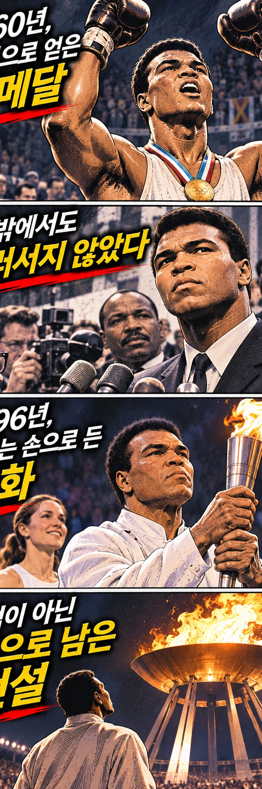

1996년 애틀랜타 올림픽 개회식에서 성화대에 불을 붙인 사람은 무하마드 알리였습니다. 그가 로마 올림픽 복싱에서 금메달을 딴 뒤 36년이 지난 때였습니다. 새 승패가 기록되는 경기는 아니었지만, 복싱 역사에서 이 모습을 빼놓기는 어렵습니다. 왜 우승과 다른 종류의 순간이 오래 남았을까요?

## 금메달리스트가 성화를 들기까지 무엇이 달라졌을까요?

알리는 캐시어스 클레이라는 이름으로 출전한 1960년 로마 올림픽에서 라이트헤비급 금메달을 땄습니다. 1996년에는 메달을 놓고 겨루는 선수가 아니라, 대회의 시작을 알리는 역할로 돌아왔습니다. [알리 센터의 올림픽 역사](https://alicenter.org/muhammad-ali-an-olympic-life/)

이 차이가 이야기의 출발점입니다. 경기에서는 상대보다 좋은 결과를 내야 승자가 됩니다. 그러나 개회식에서 성화를 든 인물은 앞으로 열릴 경기들의 의미를 대표합니다. 알리의 등장을 읽는 한 가지 방법은, 올림픽이 한 복서의 성적뿐 아니라 그가 남긴 삶의 무게를 함께 불러낸 순간으로 보는 것입니다.

당시 알리는 파킨슨병을 앓고 있었습니다. 알리 센터는 1984년 진단 이후 건강이 악화되면서 공개 활동이 줄었다고 설명합니다. 성화 점화가 질병의 극복이나 회복을 뜻하는 것은 아닙니다. 그날의 역할 수행과 질병의 경과는 별개의 문제입니다.

## 깜짝 등장은 어떻게 준비됐을까요?

알리 센터의 후대 전시 설명에 따르면, NBC 스포츠의 딕 에버솔이 알리의 성화 점화를 제안했습니다. 그는 알리의 운동선수로서의 상징성과 인도주의 활동을 이유로 들었습니다. 알리의 아내 로니와 사진가 하워드 빙엄 등이 참여 가능성을 논의했고, 대회 조직 책임자 빌리 페인도 설득하는 과정이 있었습니다. [알리 센터의 성화 점화 전시](https://alicenter.org/ali-takes-the-torch/)

같은 자료는 개막 약 일주일 전 알리가 애틀랜타에서 리허설을 했으며, 준비진이 그가 안전하게 플랫폼에 도달할 수 있는지 확인했다고 전합니다. 당일의 등장은 관중에게는 놀라움이었지만, 준비하는 사람들에게는 이동과 참여 가능성을 점검하는 일이기도 했습니다.

이 뒷이야기는 영웅담의 초점을 조금 바꿉니다. 유명한 선수라면 무조건 해낼 것이라는 기대만으로 행사가 완성된 것은 아니었습니다. 참여자의 몸 상태를 고려한 준비가 상징적인 순간을 뒷받침했다고 해석할 수 있습니다. 구체적인 준비 과정은 당시의 실시간 보도가 아니라 알리 센터가 정리한 회고 자료라는 점도 함께 읽어야 합니다.

## 링의 승자와 성화의 주인공은 어떻게 달랐을까요?

수영 선수 재닛 에번스에게서 불꽃이 이어졌고 알리는 성화대를 밝혔습니다. 알리 센터는 그의 등장을 관중 대부분이 예상하지 못했던 순간으로 설명합니다. 이 대목에서 중요한 것은 펀치의 속도나 상대를 쓰러뜨리는 능력이 아닙니다. 한때 링에서 경쟁했던 인물이 다른 종목 선수에게 불꽃을 받아 대회의 시작에 참여했다는 사실입니다. [올림픽 여정 자료](https://alicenter.org/muhammad-ali-an-olympic-life/)

복싱을 볼 때 우리는 흔히 누가 누구를 이겼는지부터 묻습니다. 애틀랜타의 알리는 다른 질문을 남깁니다. 선수가 경쟁의 중심에서 물러난 뒤에도 사람들은 무엇을 기억할까요? 이 글에서는 성화 점화를, 선수의 가치를 현재의 신체 능력이나 마지막 경기 결과만으로 판단하지 않는 장면으로 읽고자 합니다.

그렇다고 하나의 의식이 알리의 생애에 있었던 갈등을 모두 해결했다고 볼 수는 없습니다. 관중의 환영과 한 사람의 복잡한 역사는 함께 존재할 수 있습니다. 개회식의 감동을 인정하되, 그 순간만으로 생애 전체를 매끈한 성공담으로 정리하지 않는 편이 그의 유산을 더 넓게 이해하는 길입니다.

## 불꽃이 꺼진 뒤에는 무엇이 남았을까요?

IOC는 이후 알리가 애틀랜타에서 사용한 원래의 성화봉을 버니 에클레스턴이 IOC에 기증했다고 발표했습니다. 행사에 쓰인 물건이 보존할 유산으로 다뤄진 것입니다. [IOC의 성화봉 기증 발표](https://www.olympics.com/ioc/news/muhammad-ali-s-original-atlanta-1996-olympic-torch-donated-to-the-ioc)

경기 기록은 순위와 결과를 남깁니다. 성화봉은 그와 다른 기억을 붙잡습니다. 복싱 금메달로 올림픽 무대에 섰던 사람이 오랜 시간이 흐른 뒤에도 대회의 상징이 될 수 있었다는 기억입니다. 이는 성화 점화가 복싱 규칙이나 선수 선발 제도를 바꿨다는 이야기는 아닙니다. 선수의 경력을 어떤 모습으로 기억하고 전할 것인가에 관한 문화적 유산입니다.

처음의 질문으로 돌아가면, 알리의 성화 점화가 오래 남는 이유는 새로운 우승을 보탰기 때문이 아닙니다. 승부가 끝난 뒤에도 한 선수가 스포츠의 의미를 전달할 수 있음을 보여 주었기 때문이라고 해석할 수 있습니다. 알리를 기억하는 장면에 링 밖의 불빛이 함께 있는 이유입니다.

## 참고 자료

- [무하마드 알리 센터: 올림픽 여정](https://alicenter.org/muhammad-ali-an-olympic-life/) — 로마 금메달, 건강 배경, 에번스와 성화 점화의 관계.
- [무하마드 알리 센터: 성화를 든 알리](https://alicenter.org/ali-takes-the-torch/) — 제안과 준비 과정에 관한 후대 전시·회고 자료.
- [IOC: 애틀랜타 성화봉 기증](https://www.olympics.com/ioc/news/muhammad-ali-s-original-atlanta-1996-olympic-torch-donated-to-the-ioc) — 사용 성화봉의 기증과 보존.
