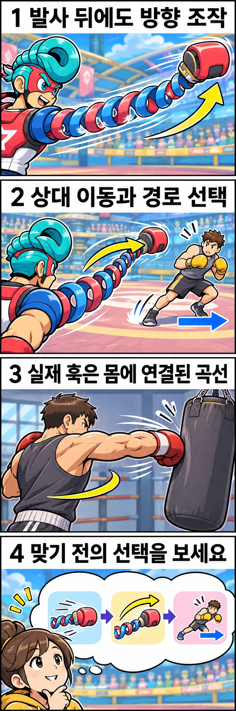

멀리 있는 상대를 향해 주먹을 보냈는데, 팔이 쭉 늘어나면서 옆으로 휘어집니다. 닌텐도의 격투 게임 **ARMS**를 특징짓는 설정입니다. 직선으로 내민 주먹이 곡선을 그린다면 복싱의 훅과 같은 것일까요? 겉모양보다 흥미로운 차이는 **어느 순간까지 공격 방향을 선택할 수 있느냐**에 있습니다.

## 주먹이 나간 다음에도 조작이 이어집니다

닌텐도의 공식 안내는 조이콘을 양손에 세워 쥐는 방식에서 손을 앞으로 내밀어 펀치하고, **펀치한 뒤 조이콘을 비틀어 캐릭터의 팔을 휘게 할 수 있다**고 설명합니다. 다른 조작 방식에서는 왼쪽 스틱으로 펀치를 휘게 할 수 있다고도 안내합니다. 단순히 처음부터 옆으로 치는 동작 하나를 고르는 것과는 다른 조작입니다. [닌텐도 공식 ARMS 기초 안내](https://www.nintendo.com/en-gb/News/2017/August/Get-fighting-fit-with-our-ARMS-101-1249313.html)

이 설정을 공격의 시간으로 읽어 보겠습니다. 공격자는 주먹을 내보내는 순간에 이어, 뻗어 가는 경로에도 관여합니다. 방어자는 처음 나온 방향만 볼 것이 아니라 이후 경로도 고려해야 합니다. 이는 공식 설명의 조작 특성을 바탕으로 한 해석이며, 제작자가 실제 복싱을 그대로 구현했다고 밝힌 뜻은 아닙니다.

공격이 빗나갔다면 처음 겨냥한 곳만 따지기보다, 상대가 어느 쪽으로 움직였고 자신이 어느 쪽으로 휘게 했는지를 함께 볼 수 있습니다. 길게 늘어나는 팔은 두 선택이 만나는 공간을 눈에 띄게 보여 줍니다.

## 실제 훅과는 곡선이 생기는 조건이 다릅니다

복싱에서 훅은 주먹이 옆에서 돌아 들어가는 펀치입니다. 실제 팔은 어깨와 팔꿈치를 통해 몸에 연결되어 있으므로 주먹의 경로는 관절 움직임과 몸의 위치가 허용하는 범위 안에서 만들어집니다. 게임처럼 팔이 길게 늘어나 멀리 있는 상대 주변을 돌아가는 구조는 아닙니다.

그렇다고 실제 펀치를 출발 순간부터 전혀 바꿀 수 없는 물체처럼 생각할 필요도 없습니다. 동작 중에도 팔과 몸은 움직입니다. 다만 **펀치가 곡선을 그린다는 사실과, 멀리 보낸 주먹의 진행 방향을 조작한다는 규칙은 서로 다른 이야기**입니다. ARMS의 조작을 따라 손목을 비트는 것을 실제 훅의 요령으로 받아들이지는 마세요.

이 비교의 초점은 훅을 치는 자세가 아닙니다. 같은 곡선처럼 보이는 표현도 실제 신체의 움직임인지, 플레이어에게 추가 선택을 주는 게임 규칙인지 구별하면 화면을 더 풍부하게 읽을 수 있습니다.

## 상대가 비킨 자리까지 공격은 따라갈까요?

예를 들어 상대가 옆으로 이동한다고 가정해 보겠습니다. 게임에서는 공격을 휘게 하는 선택과 상대가 이동하는 선택의 관계를 살펴볼 수 있습니다. 이것은 특정 경기 장면의 재현이 아니라, 공식 조작을 이해하기 위한 가상 상황입니다. 휘는 펀치가 언제나 상대를 따라가거나 반드시 명중한다는 뜻도 아닙니다.

실제 복싱에서 같은 질문을 던지면 살펴볼 대상이 달라집니다. 상대가 옆으로 움직였을 때 공격자가 몸의 방향을 바꾸었는지, 발로 위치를 옮겼는지, 처음 펀치를 거두고 다른 공격을 선택했는지를 구분해 볼 수 있습니다. 주먹 끝의 곡선 하나로 모든 대응을 설명할 수는 없습니다.

따라서 게임과 실제 복싱을 연결하는 관전 질문은 “저 팔처럼 내 주먹도 휘게 할 수 있을까요?”보다 **“상대가 자리를 바꾼 뒤 공격자는 무엇을 바꾸었을까요?”**가 더 유용합니다. 게임에서는 진행 중인 팔의 경로가 두드러지고, 실제 경기에서는 몸의 위치와 다음 행동까지 보게 됩니다.

## 명중 직전보다 조금 앞을 보세요

ARMS의 공방을 다시 볼 때는 한 번의 공격에서 출발 방향, 이후 휘는 방향, 상대의 이동 방향을 나누어 살펴보세요. 맞은 순간만 보면 한 번의 타격이지만, 그전에는 서로 다른 방향 선택이 오가고 있습니다. 직접 플레이한다면 같은 방향으로만 휘게 했을 때와 상대의 이동을 보고 선택했을 때를 비교해 보는 것도 좋습니다. 이는 승리를 보장하는 공략이 아니라 조작의 의미를 알아보는 관찰 방법입니다.

복싱 경기를 볼 때도 명중 장면 직전에 상대의 위치가 어떻게 달라졌는지 눈여겨보세요. 게임 속 늘어나는 팔을 현실에서 재현할 필요는 없습니다. **한 번의 공격이 끝나기 전에도 상대와 나의 관계가 달라진다**는 질문을 가져오면, 주먹이 닿는 순간까지 이어지는 공방 자체가 새롭게 보입니다.

## 참고 자료

- [닌텐도 — Get fighting fit with our ARMS 101](https://www.nintendo.com/en-gb/News/2017/August/Get-fighting-fit-with-our-ARMS-101-1249313.html): 늘어나는 팔을 사용하는 게임의 설정과 펀치 후 곡선 조작, 조작 방식별 입력 안내를 참고했습니다.
