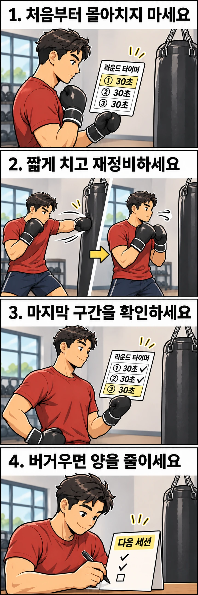

샌드백 앞에서 신나게 연타를 시작했는데, 라운드 중간부터는 남은 시간만 보고 있나요? 이럴 때는 다음 라운드도 같은 방식으로 시작하기보다 **한 번에 치는 양을 미리 정하는 연습**을 해 보세요.

아래는 잽과 원투를 배웠고 가벼운 샌드백 타격에 익숙한 분을 위한 연습 제안입니다. 잽은 앞손으로 뻗는 직선 펀치이고, 원투는 앞손과 뒷손의 직선 펀치를 잇는 조합입니다. 실험으로 효과를 입증한 프로그램이 아니라, 자신의 타격 배분을 관찰하기 위한 예시입니다.

## 오늘은 무엇을 끝까지 유지할까요?

먼저 목표를 좁혀 보세요. 오늘은 강한 펀치나 최대 타격 수를 시험하지 않고, **정해 둔 짧은 조합을 마지막 구간에도 무리 없이 반복하는지** 확인합니다. 계속 펀치를 내는 것을 성공 기준으로 삼지 않습니다. 타격 사이의 재정비도 계획에 포함합니다.

준비물은 평소 쓰는 타격 장비, 샌드백, 구간을 알 수 있는 타이머입니다. 체육관의 공용 타이머를 임의로 바꾸지 말고 개인 타이머 사용과 연습 공간을 먼저 확인하세요. 샌드백 타격을 아직 배우지 않았다면 이 계획보다 기본 사용법을 먼저 안내받으세요.

익숙한 준비운동 뒤, 가볍게 몇 차례 타격해 오늘의 움직임을 확인합니다. 시작 전부터 통증이 있거나 몸 상태가 좋지 않다면 배분 시험을 진행하지 마세요.

## 90초를 세 구간으로 나누어 보세요

첫 시도는 90초 한 라운드로 제안합니다. 30초씩 세 구간으로 나누되 **구간이 바뀌어도 속도를 올리지 않는 것**이 규칙입니다. 이 시간은 경기 규정이나 필수 운동량이 아니라 관찰을 위한 설정입니다.

각 구간에서는 다음 흐름을 반복하세요.

1. 익숙한 원투를 한 번 가볍게 칩니다.
2. 손을 가드로 되돌리고 다음 타격을 준비합니다.
3. 서두르지 않고 다시 한 번 칩니다. 아직 준비되지 않았다면 기다립니다.

처음에는 구간마다 원투 세 묶음 이내로 시작해 보세요. 세 묶음을 빨리 끝내고 더 치는 방식이 아니라, 30초 안에 여유 있게 나누어 배치합니다. 숫자를 채우려고 마지막에 몰아치지 않습니다. 부담스럽다면 잽 한 번을 한 묶음으로 바꾸거나 60초를 20초씩 나누어 진행하세요.

샌드백을 따라 급히 움직이거나 자세를 수습하느라 바쁘다면 타격 묶음을 줄이세요. 재정비 시간은 빠진 횟수를 만회하는 시간이 아닙니다. 이번 연습에서는 강한 마무리 연타도 추가하지 않습니다.

## 마지막 구간을 보고 두 번째 라운드를 결정하세요

한 라운드를 마쳤다면 최소 90초를 쉬고 상태를 살펴보세요. 시간이 지났다는 이유만으로 바로 재개하지 않습니다. 여전히 숨이 몹시 차거나 움직임을 편하게 다시 시작하기 어렵다면 더 쉬거나 그날의 관찰을 마칩니다. 첫날은 한 라운드만으로도 계획을 조정할 자료가 됩니다.

| 마지막 구간에서 확인한 모습 | 다음 선택 |
| --- | --- |
| 첫 구간과 같은 조합을 서두르지 않고 마쳤습니다 | 충분히 쉰 뒤 같은 설정으로 한 라운드만 더 해 봅니다 |
| 타격을 몰아치거나 정해 둔 조합을 이어 가기 어려웠습니다 | 두 번째 라운드는 생략하고, 다음에는 구간당 묶음을 줄입니다 |
| 손목·어깨 등에 통증이 있거나 어지럽습니다 | 타격을 중단합니다. 반복 여부보다 상태 확인이 먼저입니다 |

숨이 찬 느낌과 특정 부위의 통증을 같은 실패 표시로 묶지 마세요. 통증을 단순히 페이스 조절 문제라고 판단해 횟수만 줄여 계속 치지 않습니다.

## 기록은 ‘총 몇 대’보다 ‘어느 구간에서 달라졌는지’입니다

끝나면 구간별로 실제 수행한 묶음 수와 계획을 벗어난 순간을 적어 보세요. 예를 들어 **“3·3·2묶음, 마지막에 횟수를 채우려고 서둘렀습니다”**처럼 남길 수 있습니다. 이는 기록 형식의 예시이며 실제 참가자의 결과는 아닙니다.

원투를 두 대로 세는지 한 묶음으로 세는지도 처음에 정하세요. 다음 연습과 비교할 때는 같은 조합, 타격 세기, 라운드 시간과 휴식을 유지합니다. 조건을 바꿨다면 함께 기록합니다. 하루의 성공만으로 체력이 늘었다고 결론 내릴 필요는 없습니다.

같은 설정을 서로 다른 날에 여유 있게 수행했다면 다음에는 **묶음 수 또는 라운드 시간 중 하나만** 조금 늘려 보세요. 예를 들어 구간당 세 묶음을 네 묶음으로 바꾸되 타격 세기와 시간은 유지합니다. 늘린 뒤 후반에 몰아치게 된다면 이전 설정으로 돌아갑니다. 연습 경험이 많아도 관찰 목적이라면 처음부터 최대 속도를 시험할 필요는 없습니다.

## 끝까지 이어 가려면 첫 구간의 여유부터 남겨 보세요

오늘 샌드백에서 확인할 질문은 “얼마나 많이 쳤나요?”보다 “마지막에도 정해 둔 방식으로 칠 수 있었나요?”입니다. 첫 구간부터 짧게 나누어 치고, 계획을 지키기 어려워진 지점을 다음 연습량에 반영해 보세요.

레드복싱에서 연습할 때도 “후반에 조합을 이어 가기 어려운데, 이번에는 타격 묶음을 이만큼 줄여 봐도 될까요?”처럼 구체적인 계획을 놓고 상의해 보세요. 끝까지 버티는 횟수 경쟁보다 자신에게 맞는 출발 속도를 찾는 데 초점을 맞출 수 있습니다.
