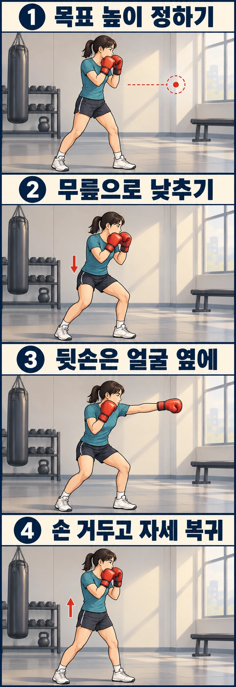

상대의 얼굴을 향해 잽을 치는 것은 익숙한데, 몸통을 노리면 자세가 어색해지는 경우가 있습니다. 주먹만 아래로 내리거나 허리를 깊게 숙이면서 균형이 무너지기도 하죠.

**바디 잽은 앞손으로 상대의 몸통을 향해 뻗는 직선 펀치**입니다. 기본기를 익힐 때는 팔만 아래로 보내기보다 무릎을 굽혀 몸의 높이를 함께 낮추는 것이 좋습니다. 그래야 주먹을 자연스럽게 뻗으면서도 다음 동작을 준비할 수 있습니다.

## 바디 잽을 칠 때 왜 무릎을 굽힐까요?

얼굴 높이에서 몸통을 향해 주먹만 아래로 뻗으면 펀치가 크게 아래쪽으로 향합니다. 상황에 따라 이런 공격도 가능하지만, 바디 잽의 기본 동작을 배울 때는 **무릎을 굽혀 앞어깨를 목표 높이에 가깝게 낮추는 방법**부터 익혀 보세요.

허리만 숙이면 머리와 상체가 상대 쪽으로 지나치게 쏠리기 쉽습니다. 그러면 균형을 잡기 어렵고, 펀치를 치고 난 뒤 다시 자세를 회복하는 데도 시간이 걸릴 수 있습니다.

무릎을 굽혀 몸 전체의 높이를 낮추면 상체를 과하게 숙이지 않고도 몸통을 향해 잽을 뻗을 수 있습니다. 다만 허리를 완전히 세워야 한다는 뜻은 아닙니다. 실제 동작에서는 상체가 자연스럽게 기울 수 있으며, 중요한 것은 **앞으로 쓰러지지 않고 두 발로 균형을 유지하는 것**입니다.

AIBA 코치 매뉴얼에서도 몸통을 향한 앞손 직선 펀치를 지도할 때 무릎을 굽혀 앞어깨의 높이를 목표에 맞추도록 설명합니다.

## 얼마나 낮아져야 할까요?

바디 잽을 칠 때마다 깊이 앉을 필요는 없습니다. 상대의 키와 겨냥하는 부위에 따라 필요한 높이가 달라지기 때문입니다.

처음에는 편안하게 무릎을 굽혀 닿을 수 있는 몸통 높이를 목표로 잡아 보세요. 자세를 낮춘 상태에서도 균형을 유지할 수 있어야 합니다. 발을 다시 디뎌야 겨우 버틸 수 있다면 너무 깊게 내려간 것일 수 있습니다.

또한 **몸을 낮추더라도 시선은 상대에게 두고, 뒷손은 얼굴을 보호하는 위치에 유지**하세요. 바디를 친다고 상대의 몸통만 내려다보거나 양손을 함께 내리면 상대의 움직임에 대응하기 어려워집니다.

## 바디 잽을 단계별로 연습해 보세요

사람이나 기구에 닿지 않을 만큼 충분한 공간을 확보한 뒤, 평소 복싱 자세에서 시작하세요.

1. 양손 가드를 올리고 상대의 몸통 높이에 가상의 목표를 정합니다.
2. 무릎을 가볍게 굽혀 몸의 높이를 낮춥니다. 이때 허리만 앞으로 접지 않고 두 발로 균형을 유지합니다.
3. 앞손을 목표를 향해 곧게 뻗습니다. 뒷손은 얼굴 옆에 두고 시선도 상대에게 유지합니다.
4. 앞손을 가드로 회수하면서 기본 자세로 돌아옵니다. 갑자기 몸을 일으켜 균형이 흔들리지 않도록 주의하세요.

처음에는 자세를 낮추는 동작과 잽을 뻗는 동작을 나눠 연습해도 좋습니다. 익숙해지면 **몸을 낮추는 움직임과 펀치를 하나로 연결**해 보세요. 실제 바디 잽을 칠 때마다 자세를 낮춘 채 멈췄다가 펀치를 뻗어야 하는 것은 아닙니다.

## 바디 잽을 칠 때 자주 나오는 실수

| 흔한 실수 | 원인으로 살펴볼 점 | 교정 방법 |
| --- | --- | --- |
| 주먹만 아래로 내려갑니다 | 몸의 높이는 그대로인데 팔만 낮추는지 | 펀치를 빼고 무릎을 굽혀 앞어깨 높이부터 조절하기 |
| 머리가 앞으로 크게 쏠립니다 | 무릎 대신 허리만 숙이거나 목표가 너무 먼지 | 자세를 낮춘 상태에서 균형을 확인하고 거리 조절하기 |
| 펀치 후 몸이 휘청거립니다 | 필요 이상으로 깊이 내려가거나 체중이 한쪽으로 쏠리는지 | 낮추는 깊이를 줄이고 두 발의 지지 확인하기 |
| 뒷손까지 아래로 내려갑니다 | 바디를 겨냥하면서 가드도 함께 내리는지 | 뒷손을 얼굴 옆에 둔 채 자세 낮추기 |
| 펀치를 친 뒤 고개를 급히 듭니다 | 상대를 내려다보거나 복귀를 서두르는지 | 시선을 유지하고 가드와 균형을 갖추며 복귀하기 |

목표가 너무 멀어서 몸을 숙이는 경우라면 무릎을 더 굽히는 것만으로 해결되지 않습니다. 먼저 거리를 확인해 보세요. [샌드백 시작 거리 확인법](/articles/boxing-heavy-bag-distance.html)도 함께 참고할 수 있습니다.

## 세 단계로 동작을 연결해 보세요

처음부터 빠르게 반복하기보다 아래 순서로 연습해 보세요.

- **1단계:** 펀치 없이 무릎을 굽혀 몸을 낮춥니다. 뒷손 가드와 시선이 유지되는지 확인합니다.
- **2단계:** 낮춘 자세에서 바디 잽을 천천히 뻗고 회수합니다.
- **3단계:** 몸을 낮추고 잽을 뻗은 뒤 기본 자세로 돌아오는 동작을 자연스럽게 연결합니다.

각 단계는 세 번 정도만 반복해도 좋습니다. 횟수를 늘리는 것보다 **바디 잽을 친 뒤에도 다음 공격이나 방어를 할 수 있는 자세가 남아 있는지** 확인하는 것이 중요합니다.

실제 상대를 향해 바디 잽을 사용할 때는 거리와 타이밍도 함께 고려해야 합니다. 몸을 낮췄다는 이유만으로 상대의 반격을 피할 수 있는 것은 아닙니다. 미트 훈련에서는 코치와 목표 높이와 타격 강도를 맞춰 연습하세요.

무릎이나 허리, 어깨에 통증이 생긴다면 연습을 중단하고 무리하게 깊이를 늘리지 마세요.

레드복싱에서는 **바디 잽을 위한 높이 조절부터 뒷손 가드, 타격 후 자세 복귀까지** 함께 점검할 수 있습니다. 허리만 숙이게 되거나 펀치를 치고 난 뒤 균형이 흔들린다면 코치에게 동작을 보여 주고 교정받아 보세요.

## 참고 자료

- [AIBA 코치 매뉴얼, 44쪽: 몸통을 향한 앞손 직선 펀치](https://www.iba.sport/wp-content/uploads/2019/01/AIBA-Coach-Regulations-Manual_WEB_2019_01-1.pdf): 무릎을 이용한 목표 높이 조절, 시선, 뒷손 가드와 자세 복귀의 기본형을 참고했습니다.
