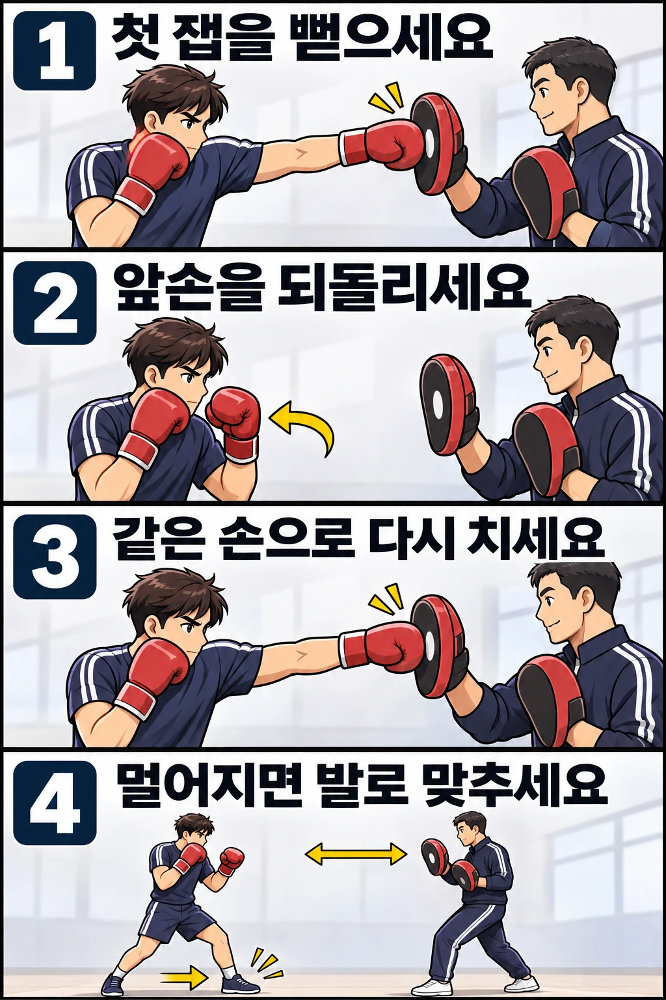

잽 한 번은 잘 뻗는데 두 번 이어 치면 두 번째 주먹이 앞에서 맴도나요? 더블 잽은 **앞손 잽을 연속해서 두 번 내는 조합**입니다. 두 번째가 짧아 보일 때는 팔의 움직임이 작아진 것인지, 표적이 멀어진 것인지부터 구분하면 연습 방향을 잡기 쉽습니다.

## 두 번째 잽은 어떤 역할을 하나요?

첫 잽에 상대가 가드를 올리거나 뒤로 움직였다면, 다음 잽은 달라진 위치를 향해 이어질 수 있습니다. 앞손 공격이 한 번으로 끝날 때와 두 번 이어질 때는 상대가 대응해야 하는 타이밍도 달라집니다. 다만 두 번 친다고 반드시 맞거나 반격을 막을 수 있는 것은 아닙니다.

Boxing Canada의 입문 지도 자료는 더블 잽을 첫 잽, 빠른 회수, 두 번째 잽, 상황에 따른 거리 조절로 설명합니다. 여기서는 그 기본 흐름을 바탕으로 **같은 높이의 표적에 두 잽을 연결하는 연습**을 다룹니다.

실전에서는 첫 잽을 가볍게 쓰거나 두 잽의 길이와 박자를 달리할 수 있습니다. 처음부터 그런 차이를 흉내 내기보다, 원하면 두 번째 잽도 충분히 뻗을 수 있는지 확인해 보세요.

## 앞손이 다시 나갈 준비가 되었는지 보세요

원투는 앞손 다음에 뒷손이 나가지만, 더블 잽은 방금 뻗었던 앞손을 다시 써야 합니다. 첫 잽이 뻗어진 상태에서 팔꿈치만 조금 굽혔다 펴면 두 번째 움직임이 짧은 밀기가 되기 쉽습니다.

처음에는 평소의 앞손 가드 위치로 돌아오는 경로를 확인한 뒤 다시 잽을 뻗어 보세요. 손을 얼굴 뒤까지 당겨 반동을 만들 필요는 없습니다. 앞손이 되돌아오는 동안 앞어깨도 다음 잽을 낼 수 있도록 자연스럽게 돌아옵니다. 몸통을 크게 좌우로 흔들어 준비하지 마세요.

학습을 위해 나누면 **뻗기 → 되돌리기 → 다시 뻗기**입니다. 실제로 연결할 때는 회수한 자리에서 오래 멈추지 않고 방향을 바꿔 두 번째 잽으로 이어 갑니다. 뒷손은 그동안 얼굴 가까이에서 가드를 유지합니다.

## 제자리에서도 짧은가요, 표적이 움직일 때만 짧은가요?

우선 주변에 닿을 물건이 없는 곳에서 제자리 섀도복싱을 해 보세요. 섀도복싱은 상대나 기구를 치지 않고 허공에 동작을 연습하는 방법입니다. 정면에 가상의 표적을 정하고 느린 더블 잽을 연결합니다. 두 잽 모두 목표를 향해 정상적으로 팔을 뻗되 팔꿈치를 끝에서 세게 튕기지 않습니다.

옆에서 본 영상이나 코치의 관찰로 두 잽의 끝 위치를 비교해 보세요. 두 번째만 눈에 띄게 짧다면, 첫 잽의 회수가 끝나기 전에 다시 밀어 내는지 확인합니다. 속도를 낮춰도 차이가 남으면 어깨가 뒤로 빠지거나 몸이 뒤로 물러나는지도 살펴보세요. 팔을 억지로 더 펴는 것으로 해결하려 하지 마세요.

제자리에서는 비슷하게 뻗는데 미트에서는 두 번째만 닿지 않는다면 거리를 따로 봐야 합니다. 첫 잽 뒤 코치의 미트가 뒤로 이동하면, 같은 자리에서 같은 길이로 뻗어도 표적까지 남는 거리가 생깁니다. 이때는 팔 동작이 짧아진 것과 구분해야 합니다.

## 멀어진 표적은 상체만 뻗어 쫓지 마세요

거리가 조금 늘었다면 발로 거리를 좁히며 잽을 연결할 수 있습니다. 전진할 때는 앞발이 나가고 뒷발이 따라와 원래의 발 간격을 회복하는 기본 이동을 사용합니다. 두 잽마다 반드시 한 걸음씩 밟아야 하는 것은 아닙니다. 처음 거리와 표적의 이동에 맞춰 스텝의 필요 여부를 판단합니다.

코치와는 먼저 미트를 고정한 더블 잽을 연습하고, 그다음 첫 잽 뒤 미트를 조금 물리는 조건으로 바꿔 보세요. 어느 잽에 전진을 연결할지는 시작 전에 정합니다. 첫 잽 뒤 거리를 확인하고 전진하며 두 번째 잽을 내는 식으로 천천히 맞춘 다음, 익숙해지면 동작을 이어 갑니다.

표적이 너무 멀어졌거나 발이 따라가지 못했다면 두 번째 잽을 억지로 맞히지 않아도 됩니다. 가드를 회복하고 거리를 다시 잡으세요. 미트를 향해 허리부터 기울이면 손은 가까워져도 다음 이동과 방어가 어려워질 수 있습니다.

## 빨리 칠수록 짧아진다면 박자를 바꿔 보세요

두 잽을 한꺼번에 서두르다 보면 첫 잽을 끝내기도 전에 다음 잽을 시작할 수 있습니다. 처음에는 첫 잽의 회수까지 알아볼 수 있는 속도로 연결하세요. 두 번의 뻗기가 구분되면서도 중간에 불필요한 정지가 줄어들면 조금씩 속도를 높입니다.

반대로 매번 가드로 돌아온 뒤 자세 전체를 새로 잡으면 단발 잽 두 개처럼 끊어집니다. 이때는 두 번째 잽을 더 세게 치기보다, 앞손이 돌아온 자리에서 곧바로 다시 출발하는 흐름을 연습해 보세요. 어깨와 팔을 계속 강하게 굳히고 있다면 힘을 조금 덜어 동작이 이어지는지 비교합니다.

빠르기만으로 성공 여부를 판단하지 마세요. 두 번째 잽 뒤 앞손이 가드로 돌아오고, 양발로 균형을 유지하며 다음 지시에 맞춰 움직일 수 있어야 합니다.

## 연습 조건을 하나씩 바꾸면 원인이 보입니다

혼자서는 제자리에서 두 잽의 길이와 연결을 확인하고, 코치와는 고정 미트와 움직이는 미트를 비교해 보세요. 고정 표적에서는 되는데 이동 표적에서만 안 된다면 회수 속도만 반복해서 고치기보다 발의 이동과 두 번째 잽의 타이밍을 함께 살펴볼 수 있습니다.

타격 연습은 코치와 강도·표적·이동 범위를 정한 뒤 진행하세요. 사람의 얼굴을 표적으로 삼아 혼자 시험하지 마세요. 손목·팔꿈치·어깨에 통증이 생기면 중단하고, 통증을 참고 속도를 올리지 마세요.

레드복싱에서 더블 잽을 배울 때는 “두 번째 잽의 팔 동작이 짧아지나요, 아니면 거리가 멀어지나요?”라고 코치에게 확인해 보세요. 어느 조건에서 달라지는지 알면 다음 연습에서 살펴볼 지점도 구체적이 됩니다.

## 참고 자료

- [Boxing Canada 입문 지도 자료](https://boxingcanada.org/wp-content/uploads/2025/01/Instruction-Beginners-Reference-Manual-EN.pdf): 60쪽, 5.12절의 더블 잽 순서와 상황에 따른 거리 조절을 참고했습니다. 본문의 조건 비교 연습은 이를 바탕으로 구성한 연습 제안입니다.
