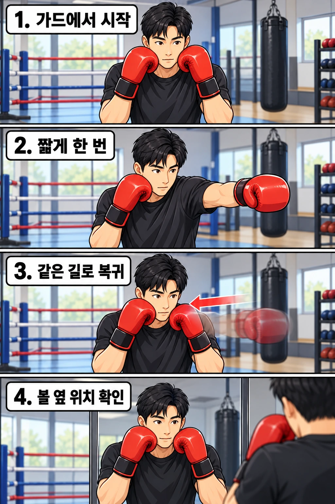

펀치를 칠 때는 주먹을 뻗는 데 집중하다 보니, 정작 손을 되돌리는 동작은 놓치기 쉽습니다. 특히 잽이나 스트레이트를 친 뒤 손이 아래로 떨어지거나, 팔을 뻗은 채 잠깐 멈추는 경우가 많습니다.

하지만 **펀치는 치고 끝나는 동작이 아닙니다. 뻗었던 손을 가드로 되돌려야 다음 공격과 방어를 준비할 수 있습니다.** 이번 글에서는 펀치를 충분히 뻗으면서도 가드를 빠르게 회복하는 방법을 알아보겠습니다.

## 펀치를 친 뒤 가드가 내려가면 왜 위험할까요?

펀치를 뻗는 동안에는 그 손이 얼굴을 보호하던 자리에서 벗어납니다. 이때 상대가 반격하면 빈틈이 생길 수 있죠. 특히 주먹을 뻗은 뒤 손이 아래로 떨어지면 얼굴이 노출되는 시간이 길어집니다.

그래서 복싱에서는 **주먹을 빠르게 뻗는 것뿐 아니라, 빠르게 회수하는 것**도 중요합니다. 가드 복귀는 단순히 자세를 예쁘게 만드는 동작이 아니라 상대의 반격에 대비하는 기본적인 방어 습관입니다.

물론 펀치를 칠 때마다 두 손이 항상 얼굴에 붙어 있을 수는 없습니다. 중요한 것은 공격하는 손을 필요한 만큼 뻗고, 공격이 끝나면 지체하지 않고 가드로 되돌리는 것입니다.

## 먼저 가드 위치부터 확인하세요

기본 자세에서 양손을 얼굴 가까이에 두고 턱을 가볍게 당겨 보세요. 주먹을 볼에 세게 누르거나 어깨를 잔뜩 올릴 필요는 없습니다. 코치에게 배운 자세를 기준으로 편안하게 가드를 유지하면 됩니다.

가드의 높이와 팔꿈치 위치는 체형이나 상황에 따라 달라질 수 있습니다. 처음에는 **내가 펀치를 뻗은 뒤 돌아올 위치를 일정하게 유지하는 것**부터 연습하세요.

거울을 보거나 코치에게 자세를 확인받으면 손이 원래 위치로 돌아오는지 알아보기 쉽습니다.

## 펀치를 충분히 뻗고 빠르게 회수하세요

가드 복귀를 연습한다고 펀치를 짧게 끊을 필요는 없습니다. 목표를 향해 주먹을 충분히 뻗되, 팔을 뻗은 상태로 오래 머물거나 아래로 떨어뜨리지 않는 것이 핵심입니다.

처음에는 잽 하나로 다음 순서를 연습해 보세요.

1. 기본 자세에서 양손 가드를 올립니다.
2. 앞손 잽을 목표를 향해 곧게 뻗습니다. 반대손은 얼굴을 보호합니다.
3. 주먹을 뻗은 뒤 아래로 내리지 않고 곧바로 얼굴 옆으로 회수합니다.
4. 가드와 균형이 유지되는지 확인한 뒤 다시 잽을 뻗습니다.

동작이 익숙해지면 뒷손 스트레이트도 같은 방식으로 연습해 보세요. 펀치를 뻗은 뒤 손을 내리거나 크게 돌아서 가져오는 대신, **불필요한 움직임 없이 빠르게 가드로 복귀하는 것**을 목표로 합니다.

## 연타 중에는 가드를 어떻게 유지할까요?

원투처럼 펀치를 연결할 때는 매번 양손을 가드에 완전히 모으고 멈출 필요는 없습니다. 하지만 한 손이 공격하는 동안 다른 손은 얼굴을 보호해야 하고, 공격을 마친 손도 다음 동작을 준비할 수 있는 위치로 돌아와야 합니다.

예를 들어 잽을 뻗을 때는 뒷손 가드를 유지하고, 이어서 스트레이트를 칠 때는 앞손을 회수해 얼굴을 보호합니다. 이 과정이 자연스럽게 이어져야 공격하면서도 방어 자세를 유지할 수 있습니다.

처음에는 **잽 → 가드 복귀 → 스트레이트 → 가드 복귀** 순서로 천천히 연습하세요. 익숙해지면 동작 사이에 불필요하게 멈추지 않고 원투로 연결해 보세요.

## 가드가 자꾸 내려간다면 확인해 보세요

| 연습 중 나타나는 모습 | 확인할 부분 | 교정 방법 |
| --- | --- | --- |
| 펀치 후 주먹이 아래로 떨어집니다 | 회수하는 대신 팔의 힘을 풀어 버리는지 | 주먹을 뻗은 뒤 바로 얼굴 옆으로 가져오기 |
| 펀치를 뻗은 채 잠깐 멈춥니다 | 타격 후 회수 동작이 늦어지는지 | 느린 잽으로 뻗기와 회수를 연결하기 |
| 한 손을 칠 때 반대손도 내려갑니다 | 공격하지 않는 손의 가드를 놓치는지 | 한 손씩 뻗으며 반대손 위치 확인하기 |
| 연타할수록 양손이 아래로 내려갑니다 | 속도가 빨라지면서 자세가 흐트러지는지 | 원투를 천천히 반복한 뒤 속도 높이기 |
| 주먹을 크게 돌려서 회수합니다 | 가드로 돌아오는 경로가 길어지는지 | 펀치 후 손을 불필요하게 떨어뜨리지 않고 되돌리기 |

혼자 연습할 때는 거울이나 짧은 촬영 영상을 활용해 보세요. 다만 거울을 보느라 시선과 자세가 흐트러지지 않도록 주의해야 합니다.

## 잽부터 원투까지 단계별로 연습해 보세요

처음부터 빠른 연타를 반복하기보다 다음 순서로 연습하는 것이 좋습니다.

- **1단계:** 잽을 한 번 뻗고 가드로 되돌리는 동작을 천천히 반복합니다.
- **2단계:** 뒷손 스트레이트도 같은 방식으로 연습하며 앞손 가드를 유지합니다.
- **3단계:** 잽과 스트레이트를 연결합니다. 공격하지 않는 손이 얼굴을 보호하고 있는지 확인하세요.
- **4단계:** 가드가 유지된다면 조금씩 속도를 높입니다. 손이 내려가기 시작하면 다시 속도를 낮춥니다.

여기서 중요한 것은 횟수보다 **펀치를 치는 동안과 친 직후에 가드가 어떻게 움직이는지**입니다. 펀치를 강하게 치려고 어깨와 팔에 지나치게 힘을 주기보다는 자연스럽게 뻗고 회수하는 동작부터 익혀 보세요.

손목이나 팔꿈치, 어깨에 통증이 생기면 연습을 멈추고 무리하게 반복하지 마세요.

레드복싱 행신점에서는 잽과 스트레이트를 배우면서 **펀치의 길이, 회수 속도, 반대손 가드**를 함께 점검할 수 있습니다. 펀치를 친 뒤 손이 자꾸 내려간다면 코치에게 자세를 보여 주고 교정받아 보세요.
