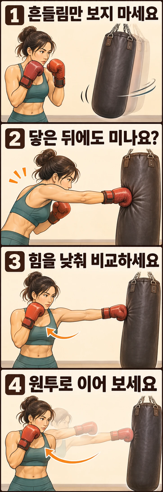

샌드백을 힘껏 쳤는데 주먹이 백에 붙은 채 어깨까지 앞으로 따라가나요? 이번에는 백을 얼마나 멀리 보냈는지보다 **닿은 다음에도 계속 밀고 있는지**를 확인해 보세요. 여기서는 제자리에서 직선 펀치를 연습할 때 나타나는 밀어치기를 다룹니다.

## 충분히 뻗는 것과 계속 미는 것은 어떻게 다를까요?

직선 펀치는 목표까지 팔을 충분히 뻗어 타격하는 동작입니다. 몸통의 회전과 어깨의 움직임도 함께 이어집니다. 백 표면에 닿자마자 놀라서 손을 빼거나 팔을 짧게 접을 필요는 없습니다.

점검할 부분은 **타격이 끝난 뒤에도 글러브를 붙인 채 팔을 더 펴거나 몸을 앞으로 보내는 동작**입니다. 처음 닿는 순간과 그 뒤에 백을 밀어내는 움직임을 나눠 보세요. 주먹을 되돌려야 할 때 계속 누르고 있다면 다음 펀치를 시작하기도 어려워집니다.

“백 안쪽을 향해 치세요”라는 설명을 들었다면, 백을 끝까지 밀고 걸어 들어가라는 뜻으로 받아들이지 마세요. 목표를 향해 충분히 뻗는 감각을 설명한 것인지 코치에게 확인하면 좋습니다. 펀치 종류와 지도 목적에 따라 강조점은 달라질 수 있습니다.

## 백의 흔들림보다 접촉 뒤 어깨를 보세요

샌드백의 무게와 매달린 방식, 이미 움직이던 방향이 다르면 같은 동작에도 백의 움직임이 달라질 수 있습니다. 따라서 크게 흔들리면 실패, 작게 흔들리면 성공이라는 기준은 쓰지 않는 편이 좋습니다. 소리의 크기만을 목표로 삼지도 마세요.

옆에서 동작을 보거나 짧게 촬영해 **글러브가 닿기 전부터 떨어진 뒤까지** 이어서 살펴보세요. 한 장의 사진만 보면 정상적인 타격 순간도 밀어치는 모습처럼 보일 수 있습니다.

- 글러브가 닿은 뒤에 어깨가 다시 한 번 앞으로 나가는지 봅니다.
- 팔이 거의 펴진 뒤에도 백을 따라 누르며 상체가 이동하는지 봅니다.
- 글러브를 떼기 위해 몸부터 뒤로 빼야 하는지 살핍니다.

이 모습들은 확인할 단서이지 하나만으로 내리는 판정은 아닙니다. 특히 앞으로 이동하며 치는 연습에서는 의도한 전진과 불필요한 밀기를 코치와 구분해야 합니다.

## 힘을 낮춘 단발로 원인을 나눠 보세요

핸드랩과 타격에 적합한 글러브를 착용하고, 기본 타격 지도를 받은 범위에서 연습하세요. 잉글랜드 복싱의 지도서도 초보자의 백 훈련에 앞서 기본 펀치 지도가 필요하다고 안내합니다. 아래 순서는 접촉 뒤 동작을 비교하기 위한 연습 예시입니다.

먼저 백의 흔들림이 잦아들었을 때 평소의 직선 펀치 거리에서 자세를 잡습니다. 익숙한 잽이나 뒷손 스트레이트 중 하나만 골라 가볍게 치세요. 목표까지 충분히 뻗고, 타격 뒤에는 백을 더 밀려는 동작을 덧붙이지 않고 손을 가드로 되돌립니다. 반대 손은 얼굴 옆에 둡니다.

그다음에는 무엇을 바꾸었을 때 차이가 나는지 살펴보세요.

**가볍게 칠 때는 괜찮고 힘을 주면 미는 경우:** 백을 멀리 보내려고 마지막에 어깨를 한 번 더 내미는지 확인합니다. 팔의 길이를 억지로 줄이기보다, 그 추가 동작 없이 칠 수 있는 강도로 돌아오세요.

**가볍게 쳐도 접촉 뒤 팔을 계속 펴는 경우:** 시작 위치가 너무 가까워 팔이 많이 접힌 상태로 닿는지 확인합니다. 그렇다면 위치를 조정해 비교하세요. 거리 조정은 원인을 확인하는 수단이며, 무조건 멀리 서는 것이 해결책은 아닙니다.

**손은 떨어지지만 몸이 백 쪽으로 계속 넘어가는 경우:** 손만 빨리 당기려 하지 말고 타격 뒤 자세를 확인합니다. 백에 기대지 않고 다음 동작을 할 수 있는지 보세요. 상체가 과하게 따라간다면 강도를 낮추고 몸통 회전과 팔 뻗기가 함께 끝나도록 코치와 맞춰 봅니다.

## 단발에서 원투로 이어 보세요

단발의 접촉과 회수가 자연스러워지면 원투, 즉 앞손 잽과 뒷손 스트레이트를 이어 보세요. 잽을 친 손이 백에 머물러 뒷손 출발을 막는지, 뒷손 타격 뒤 다시 백을 누르는지 살핍니다. 두 펀치 사이에 일부러 긴 정지를 넣을 필요는 없습니다.

연결했을 때만 밀기가 나타난다면 속도와 힘을 함께 올리지 말고, 가벼운 원투로 돌아가세요. **백을 밀어 놓고 다음 손을 준비하는 대신, 한 손의 회수와 다음 손의 출발이 이어지는지** 확인합니다. 마지막 펀치 뒤에도 가드와 균형을 갖춰 움직일 수 있어야 합니다.

연습의 성공 기준은 백이 멀리 날아가거나 전혀 움직이지 않는 것이 아닙니다. 충분히 타격한 뒤 추가로 누르지 않고, 다음 펀치나 이동으로 이어갈 수 있는지를 기준으로 삼으세요.

손목을 꺾어 글러브를 튕겨 내거나 팔꿈치를 세게 잠가 짧은 타격감을 만들려고 하지는 마세요. 통증이 생기면 멈추고 자세와 장비를 확인하세요. 강도를 높일 때 같은 습관이 되풀이되면, 코치에게 “닿은 다음에 제가 어깨로 한 번 더 미는지 봐 주세요”라고 요청하면 점검할 순간이 분명해집니다.

## 참고 자료

- [잉글랜드 복싱 코칭 핸드북 Part 1](https://www.englandboxing.org/wp-content/uploads/2022/03/EB_Boxing-Coaching-Handbook-Part-1_v8-002.pdf): ‘Coaching the use of punch bags’의 기본 지도와 백 훈련 감독에 관한 권고를 참고했습니다. 접촉 뒤 동작을 비교하는 연습은 이 글에서 구성했습니다.
