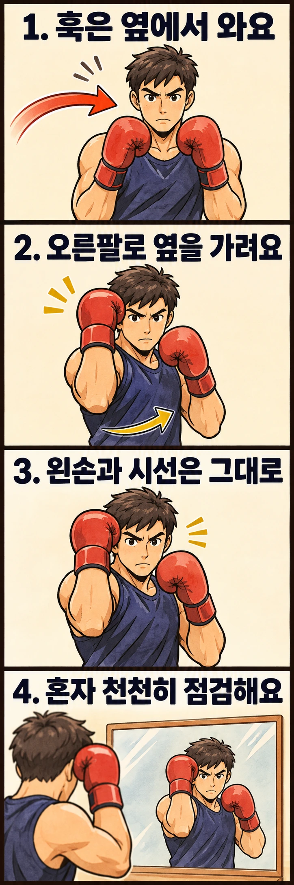

두 손을 얼굴 앞에 올렸는데도 옆에서 오는 훅을 어떻게 막아야 할지 헷갈리나요? **손이 얼마나 높은지만 보지 말고, 펀치가 들어오는 길에 팔이 놓이는지** 확인해 보세요. 여기서는 두 사람 모두 왼발을 앞에 둔 자세에서, 상대의 왼손 훅을 내 오른팔로 막는 기본 동작을 다룹니다.

## 정면을 가리는 것과 옆을 막는 것은 다릅니다

훅은 팔을 굽힌 채 옆으로 돌아오는 펀치입니다. 두 글러브를 코 앞에 모으기만 하면 정면은 가려져도 얼굴 옆으로 들어오는 경로가 남을 수 있습니다. 그래서 훅 방어에서는 공격이 오는 쪽의 팔뚝, 즉 팔꿈치와 손목 사이 부분을 올려 그 경로를 가로막습니다. 이를 이 글에서는 **뒷팔 블록**이라고 부르겠습니다.

[AIBA 코치 매뉴얼의 뒷팔 블록 설명](https://www.iba.sport/wp-content/uploads/2019/01/AIBA-Coach-Regulations-Manual_WEB_2019_01-1.pdf)은 몸을 앞손 쪽으로 조금 돌리고, 뒷팔의 팔뚝을 올려 지탱하며, 앞손과 시선을 유지하도록 안내합니다. 상대 앞손 훅의 머리 공격에 대응하는 동작입니다.

패링이 손으로 펀치의 방향을 살짝 바꾸는 방어라면, 여기서 연습하는 블록은 팔을 공격 경로에 놓는 방어입니다. 상대 주먹을 멀리서 쳐내려고 오른손을 뻗는 동작과 구분하세요. 다만 팔로 막는다고 충격이 없어지는 것은 아닙니다. 가드가 완성됐는지 확인하려고 머리 쪽으로 강한 펀치를 받아 볼 필요는 없습니다.

## 상대의 왼손 훅은 내 오른쪽으로 옵니다

마주 선 사람의 왼손은 내 기준으로 오른쪽에 있습니다. 이번 예시에서는 내 오른쪽 얼굴 옆으로 들어오는 훅을 오른팔로 막습니다. 다른 손이나 몸통을 향한 공격까지 같은 동작 하나로 해결하려 하지 마세요.

처음에는 상대 없이 아래 순서로 움직여 보세요.

1. 왼발을 앞에 두고 평소 배운 가드를 잡습니다. 무릎은 편안하게 굽히고 턱을 살짝 내립니다.
2. 내 오른쪽으로 훅이 들어온다고 상상합니다. 오른쪽 글러브를 얼굴 옆으로 올리면서 팔뚝을 세워 옆면을 가립니다. 손목을 꺾어 글러브만 귀 쪽으로 기울이지 않습니다.
3. 몸통을 내 왼쪽으로 조금 돌리는 움직임을 함께 맞춰 봅니다. 오른팔만 멀리 벌리거나 머리를 따로 왼쪽으로 던지지 않습니다.
4. 왼손은 가드에 남기고 앞을 봅니다. 두 손으로 눈을 덮거나 상대에게 등을 보일 만큼 돌지 않습니다.
5. 기본 자세로 돌아와 같은 동작을 한 번 더 할 수 있는지 확인합니다.

팔꿈치는 굽힌 채 팔뚝이 방어할 옆면에 놓이도록 조절합니다. 팔꿈치를 옆으로 높이 들어 올리는 것 자체가 목표는 아닙니다. 글러브의 정확한 높이와 팔 각도는 체형, 평소 가드, 훅의 높이에 따라 달라지므로 코치에게 옆에서도 확인해 달라고 요청하세요.

## 몸을 조금 돌리는 이유는 팔과 자세를 함께 맞추기 위해서입니다

오른팔을 올리려다 어깨만 뒤로 빠지면 팔과 몸이 따로 움직일 수 있습니다. 작은 몸통 회전을 함께 연습하면 팔을 세운 상태에서도 정면을 보고 균형을 유지하는지 살펴보기 좋습니다. 이번 연습에서는 회전 속도나 각도를 크게 만드는 것보다 **막는 팔, 반대손, 시선이 함께 유지되는지**가 우선입니다.

몸을 돌린 뒤 체중이 한 발 바깥으로 쏠리거나 멈추기 위해 발을 급히 옮겨야 한다면 회전 폭을 줄여 보세요. 발을 바닥에 억지로 고정하고 무릎만 비틀지도 않습니다. 편안한 범위에서 움직이고, 무릎이나 어깨가 불편하면 멈춥니다.

몸을 더 많이 돌릴수록 방어가 좋아지는 것은 아닙니다. 많이 돌아 상대를 보기 어렵다면 다음 공격을 확인하기도 어려워집니다. 혼자 하는 자세 점검으로는 실제 훅의 거리와 타이밍까지 익힐 수 없다는 점도 기억하세요.

## 같은 빈틈도 원인은 다를 수 있습니다

아래 항목은 혼자 동작을 관찰할 때 쓸 수 있는 점검 예시입니다. 모습 하나만 보고 원인을 확정하지 말고, 천천히 움직이며 한 항목씩 비교하세요.

| 보이는 모습 | 확인할 부분 | 바꿔 볼 방법 |
| --- | --- | --- |
| 오른손은 높은데 얼굴 옆이 비어 있음 | 글러브가 계속 코 앞에만 있는지 | 오른팔의 위치를 정면과 옆에서 각각 확인하기 |
| 손목만 접히고 팔뚝 방향은 그대로임 | 글러브 끝만 옆으로 옮기려 하는지 | 손목을 편안히 곧게 두고 팔 전체의 위치 조절하기 |
| 오른팔을 올릴 때 왼손이 내려감 | 두 팔을 동시에 반대로 움직이는지 | 왼손 가드를 남긴 채 오른팔만 느리게 움직여 보기 |
| 막는 순간 앞이 보이지 않음 | 글러브가 눈을 덮거나 고개가 돌아가는지 | 시선이 남는 범위로 손 위치와 회전 폭 줄이기 |
| 자세는 맞는데 파트너 동작에 늦음 | 출발 거리와 공격 신호가 일정한지 | 속도를 올리기 전에 코치와 거리·시작 조건 다시 정하기 |

팔에 힘을 완전히 풀어 두는 것과 온몸을 계속 굳히는 것도 구분해야 합니다. 팔의 위치를 지탱하되 목과 어깨까지 과하게 긴장하지 않는지 살펴보세요. 실제 접촉을 견딜 만큼 지탱되는지는 혼자 추측하지 말고 지도받으며 확인할 부분입니다.

## 혼자서는 모양을, 지도받을 때는 타이밍을 연습하세요

먼저 글러브를 낀 상태에서 **기본 가드 → 오른팔 블록 → 기본 가드**를 천천히 세 번 해 보세요. 첫 번째는 오른팔 위치, 두 번째는 왼손, 세 번째는 시선과 균형을 봅니다. 세 번이라는 횟수는 점검을 나누기 위한 예시이며 정해진 훈련량은 아닙니다.

그다음에는 코치에게 공격 방향을 손짓으로 보여 달라고 요청하고, 닿지 않는 거리에서 같은 동작을 맞춰 볼 수 있습니다. 미리 정한 훅 하나에만 대응하고, 놓쳤다면 멈춰 다시 준비합니다. 예고 없이 여러 펀치를 섞거나 친구에게 얼굴을 때려 보라고 하며 시험하지 않습니다.

접촉 연습으로 넘어갈지와 그 강도·장비·진행 방식은 지도자와 정하세요. 통증이나 머리 충격이 생기면 연습을 중단합니다. 처음부터 훅을 받아 내며 버티는 연습을 할 필요는 없습니다.

## 블록 뒤에도 상대를 볼 수 있는지가 기준입니다

이번 동작은 머리로 오는 상대 앞손 훅 하나를 다루는 출발점입니다. 몸통 공격이나 다른 궤도의 펀치에는 방어 위치가 달라지며, 실제 상황에서는 거리 조절이나 다른 방어도 필요합니다. 한 번 막은 뒤 팔을 내리고 쉬는 대신 앞을 보며 다음 동작을 준비하세요.

레드복싱 행신점이나 을지로점에 방문해 기술을 상담할 때는 “상대 왼손 훅을 막을 때 제 오른팔이 어느 위치에 있어야 하나요?”처럼 구체적인 동작을 보여 주며 질문해 보세요. 손의 높이뿐 아니라 옆면의 빈틈과 몸통 회전까지 함께 확인할 수 있는 질문입니다.

## 참고 자료

- [AIBA 코치 매뉴얼, 책자 56쪽과 59쪽](https://www.iba.sport/wp-content/uploads/2019/01/AIBA-Coach-Regulations-Manual_WEB_2019_01-1.pdf): 기본 방어의 지도 순서와 흔한 오류, 상대 앞손 훅에 대한 뒷팔 블록. 본문의 관찰표와 세 번의 비접촉 점검은 이 글에서 제안한 연습 예시입니다.
