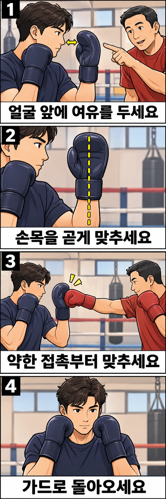

잽이 글러브에는 닿았는데, 그 글러브가 뒤로 밀려 내 코까지 건드리나요? 손을 더 세게 버티기 전에 **어디에서 받았는지, 손목과 팔꿈치는 어떻게 놓였는지, 연습 강도가 적절했는지**를 나눠 보세요. 이 글에서는 두 사람 모두 왼발을 앞에 둔 자세에서 상대의 왼손 잽을 오른손으로 받는 기본 캐치를 설명합니다.

## 캐치는 잽을 옆으로 쳐내는 동작과 다릅니다

캐치는 글러브의 손바닥 쪽을 들어오는 펀치 앞에 놓아 받아 막는 손 방어입니다. 코치에 따라 뒷손 블록이라고 부르기도 합니다. 펀치의 방향을 틀어 지나가게 하는 [패링](/articles/boxing-parry-small-movement.html)과 달리, 여기서는 글러브가 펀치의 진행을 가로막습니다. 상대 주먹을 움켜잡거나 손가락을 펴서 붙잡는 동작은 아닙니다.

이 방어를 익히면 잽을 받은 뒤 앞손을 쓸 준비를 이어 갈 수 있습니다. 다만 캐치 한 번으로 연타 전체를 막을 수는 없습니다. 상대가 다시 잽을 내거나 다른 손으로 공격할 수 있으므로, 받는 손만 바라보지 말고 상대와 거리를 계속 살펴야 합니다.

## 얼굴에 붙여 받지도, 팔을 뻗어 마중 나가지도 않습니다

잉글랜드 복싱의 코칭 안내서는 뒷손을 가드에서 짧게 움직여 들어오는 펀치 앞에 놓도록 설명합니다. 손을 너무 멀리 내미는 것과 얼굴에 너무 가까이 대어 충격 때 자기 손이 얼굴에 닿는 것을 모두 오류로 짚습니다.

핵심은 **접촉 순간 글러브와 얼굴 사이에 여유가 있고, 팔이 그 위치를 지지할 수 있는가**입니다. 글러브를 코에 붙여 놓으면 조금만 밀려도 얼굴에 닿습니다. 반대로 팔을 길게 뻗어 받으면 가드가 비고 속임 동작에 손이 끌려가기 쉽습니다.

정해진 몇 센티미터를 모든 사람에게 적용하기는 어렵습니다. 팔 길이와 글러브 두께, 가드 모양에 따라 코치와 접촉 위치를 맞추세요. 여유 공간을 만들려고 턱을 들거나 고개를 뒤로 젖히지는 않습니다.

## 손바닥 방향과 팔의 지지를 함께 맞춰 보세요

먼저 상대 없이 천천히 모양을 만들어 보세요. 오른손만 멀리 내밀기보다 기본 가드에서 필요한 만큼 움직입니다.

1. 시선을 앞에 두고 턱을 가볍게 당깁니다. 왼손은 가드를 유지합니다.
2. 오른쪽 글러브의 손바닥 쪽이 정면에서 오는 잽을 향하도록 팔을 조금 돌립니다. 손바닥을 보이려고 손목만 뒤로 꺾지 않습니다.
3. 손목과 아래팔이 꺾이지 않게 맞추고, 오른 팔꿈치는 옆으로 들지 않습니다. 받는 순간에는 팔에 필요한 긴장을 주어 글러브가 쉽게 접히지 않도록 합니다.
4. 가상의 접촉이 끝나면 오른손을 기본 가드로 돌립니다. 어깨의 과한 힘을 풀고 다음 동작을 준비합니다.

팔을 지지한다는 말은 팔꿈치를 곧게 펴 잠그라는 뜻이 아닙니다. 팔꿈치는 굽힌 상태로 두고, 손목이 접히거나 팔 전체가 무너지지 않게 받습니다. 몸통과 발도 함께 안정되어야 손의 위치를 유지하기 쉽습니다.

## 밀리는 모습이 같아도 점검할 곳은 다릅니다

**닿기 전부터 글러브가 얼굴에 붙어 있다면 접촉 위치부터 바꿔 보세요.** 힘을 더 주어도 시작 위치의 여유가 생기지는 않습니다. 비접촉 자세에서 받는 손과 얼굴 사이를 옆에서 확인한 다음, 코치와 약한 접촉으로 다시 맞춥니다.

**글러브가 뒤로 젖혀진다면 손목 방향을 살펴보세요.** 손바닥을 상대에게 보이려다 손목만 꺾었거나, 접촉이 글러브 가장자리에 치우쳤을 수 있습니다. 힘을 높이지 말고 손목과 아래팔의 선, 상대 잽이 닿는 면을 먼저 조정합니다.

**손목은 곧은데 팔 전체가 밀린다면 팔의 지지와 강도를 따로 확인하세요.** 팔꿈치가 벌어지거나 받는 순간 힘이 풀리는지 코치에게 봐 달라고 요청하세요. 자세를 유지할 수 없는 속도나 힘으로 연습하고 있을 수도 있습니다. 이를 악물고 더 강한 잽을 버티는 방식으로 확인하지 않습니다.

**몸까지 뒤로 흔들린다면 손만 고치지 마세요.** 두 발의 균형, 상체를 미리 뒤로 뺀 자세, 상대가 너무 가까이 들어온 상황도 함께 살펴야 합니다. 캐치가 모든 거리와 공격에 알맞은 방어는 아닙니다.

## 접촉 위치를 정한 뒤, 움직이는 잽에 맞춰 보세요

혼자서는 손의 모양과 복귀를 익힐 수 있지만 충격이나 타이밍을 확인할 수는 없습니다. 다음 연습은 코치의 통제 아래 적절한 글러브와 보호장비를 갖추고 진행하세요. 맨손으로 서로의 얼굴을 겨냥해 시험하지 않습니다.

처음에는 공격자가 잽을 천천히 뻗어 **정한 접촉 위치에서 가볍게 멈추는 연습**을 해 보세요. 방어자는 오른손의 손바닥 쪽으로 받고, 상대는 즉시 회수합니다. 계속 밀어붙이는 힘겨루기가 되지 않도록 합니다. 코치가 옆에서 얼굴과의 여유, 손목 정렬, 팔꿈치를 확인하면 접촉 위치 문제를 구분하기 좋습니다.

그 위치가 안정되면 미리 정한 잽 하나를 느리고 약하게 주고받습니다. 이때는 손을 먼저 내놓고 기다리기만 하지 않고, 가드에서 출발해 들어오는 잽에 맞춰 받습니다. 글러브가 얼굴에 닿거나 시선이 끊기면 속도를 낮추고 앞 단계로 돌아갑니다. 손목 통증이나 머리에 충격이 생기면 즉시 중단하세요.

마지막에는 **캐치 → 오른손 가드 복귀 → 다음 행동**을 하나의 흐름으로 이어 봅니다. 코치와 정한 방향으로 거리를 벌리거나, 별도로 제시한 미트에 앞손 잽을 뻗는 식입니다. 처음부터 파트너 얼굴로 반격할 필요는 없습니다. 방어 후에도 시선과 균형이 남는지 확인하는 연습입니다.

레드복싱에서 잽 방어를 배울 때도 “받는 순간 제 글러브가 얼굴에 닿는지 옆에서 봐 주세요”라고 동작을 보여 주세요. 막았는지 여부와 함께 **어떤 위치에서 받았고 다음 행동을 할 수 있었는지**를 살피면 교정할 지점이 더 분명해집니다.

## 참고 자료

- [잉글랜드 복싱 코칭 안내서, 책자 80~81쪽](https://www.englandboxing.org/wp-content/uploads/2022/03/EB_Boxing-Coaching-Handbook-Part-1_v8-002.pdf): 뒷손 블록의 기본 동작과 접촉 위치 오류, 패링과의 구분을 참고했습니다. 원인별 점검과 단계별 연습은 이를 바탕으로 구성한 지도 예시입니다.
