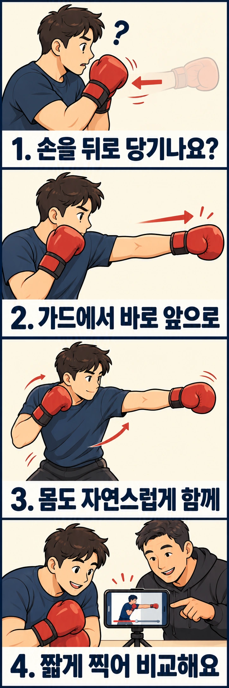

잽을 내려고 할 때 앞손을 살짝 뒤로 당겼다가 뻗고 있지는 않나요? 본인은 한 번에 친다고 느껴도, 옆에서 보면 주먹이 뒤로 갔다가 앞으로 나오는 두 동작이 보일 수 있습니다. 먼저 속도를 높이기보다 **잽이 출발하기 직전의 손 경로**를 확인해 보세요.

## 손을 당겼다가 뻗으면 무엇이 달라질까요?

잽은 앞에 둔 손으로 뻗는 직선 펀치입니다. 여기서는 얼굴 높이로 뻗는 기본 잽을 다룹니다. 왼발이 앞이라면 왼손, 오른발이 앞이라면 오른손이 앞손입니다.

가드에 있던 주먹을 몸 쪽으로 당겼다가 뻗으면, 곧장 목표로 향할 때보다 손이 이동하는 경로가 늘어납니다. 그 당김이 매번 반복되면 상대는 펀치가 나오기 전에 공격을 예상할 단서를 얻을 수 있습니다. 공격 전에 무심코 드러나는 이런 준비 움직임을 **예비 동작**이라고 부릅니다.

잉글랜드 복싱 코칭 안내서는 앞손 직선 펀치의 흔한 오류로 손을 미리 당겨 공격을 알리는 행동과 어깨의 과도한 긴장을 꼽습니다. 다만 손 경로를 줄인다고 모든 잽이 빨라지거나 반드시 적중하는 것은 아닙니다. 거리와 타이밍, 상대의 반응도 영향을 줍니다.

## 상대가 잽을 읽는 순간은 주먹이 나가기 전입니다

상대는 주먹이 앞으로 나오는 순간만 보는 것이 아닙니다. 잽 직전에 손이 뒤로 빠지거나 아래로 떨어지는 움직임이 반복되면, 상대는 그 동작을 공격의 신호로 학습할 수 있습니다.

예를 들어 앞손을 당겼다가 잽을 치는 사람은 실제로 주먹이 뻗기 전에 **당김 → 전진**이라는 두 단계가 나타납니다. 상대가 첫 번째 움직임을 알아차리면 뒤로 빠지거나 가드를 올릴 시간을 얻을 수 있습니다. 반면 가드에서 바로 뻗는 잽은 불필요한 준비 신호를 줄입니다.

그렇다고 손을 절대 움직이지 말라는 뜻은 아닙니다. **의도적으로 상대의 반응을 끌어내는 페인트**와 무의식적으로 매번 반복되는 예비 동작은 다릅니다. 먼저 기본 잽을 깔끔하게 익힌 다음, 목적을 갖고 변화를 주는 편이 좋습니다.

## 주먹을 뒤로 당기지 않으면 펀치가 약해지지 않을까요?

강하게 때리려고 할수록 주먹을 뒤로 당겼다가 앞으로 던지는 동작이 나오기 쉽습니다. 뒤로 당기는 거리가 길수록 더 큰 힘을 낼 수 있을 것처럼 느껴지기 때문입니다. 하지만 복싱에서는 그 준비 동작이 상대에게 공격을 미리 알리는 신호가 될 수 있습니다.

그렇다면 **가드에서 곧바로 주먹을 뻗으면 타격이 약해지는 것 아닐까요?** 팔만 따로 움직여 때린다면 강한 타격을 만들기 어려울 수 있습니다. 그래서 복싱에서는 팔을 크게 뒤로 빼는 대신 **발의 지지, 다리의 움직임, 체중 이동, 골반과 몸통의 회전**을 펀치와 연결합니다.

발로 바닥을 지지하고 다리와 몸통의 움직임이 팔까지 이어지면, 주먹을 미리 뒤로 당기지 않고도 타격에 힘을 실을 수 있습니다. 중요한 것은 '팔에 힘을 주는 것'과 '전신의 움직임을 주먹에 전달하는 것'의 차이입니다. 다만 모든 펀치가 같은 크기의 회전이나 체중 이동을 사용하는 것은 아닙니다.

**빠른 견제용 잽은 작은 움직임으로도 충분합니다.** 반면 더 강하게 치는 잽이나 뒷손 스트레이트는 상황에 맞는 발의 지지와 체중 이동, 몸통 회전을 적극적으로 활용할 수 있습니다. 어느 경우든 주먹을 뒤로 당겨 상대에게 미리 알려 줄 필요는 없습니다.

## 몸까지 멈춘 채 팔만 뻗으라는 뜻은 아닙니다

손을 뒤로 당기지 않으려다 어깨와 몸통을 굳히기 쉽습니다. 하지만 잽에도 몸의 작은 회전과 지지가 연결됩니다. 앞손이 앞으로 나가는 동안 어깨가 자연스럽게 따라가는 움직임과, 펀치 전에 주먹부터 뒤로 빼는 움직임은 구분해야 합니다.

기본 연습에서는 **주먹을 뒤로 당겨 힘을 모으지 않고, 발의 지지와 몸통 움직임을 손의 전진에 연결하는 감각**을 찾아보세요. 골반을 몇 도 돌려야 하는지, 체중을 몇 퍼센트 옮겨야 하는지 혼자 숫자로 맞출 필요는 없습니다. 제자리 잽인지 스텝을 넣은 잽인지에 따라서도 움직임은 달라집니다.

처음에는 발을 옮기지 않는 가벼운 잽으로 출발만 살핍니다. 손 경로가 정리되면 코치와 함께 이동을 더하세요. 이때도 발로 바닥을 지지하는 감각은 남기되, 몸을 뒤로 실었다가 던지는 큰 반동을 새로 만들지 않습니다.

## 옆에서 찍고, 첫 전진 직전을 살펴보세요

혼자 느낌으로 판단하기 어렵다면 짧은 영상이 도움이 됩니다. 촬영이 허용된 공간에서 주변 사람이 찍히지 않도록 하고, 기기는 펀치가 닿지 않는 곳에 둡니다. 거울이나 벽을 목표물처럼 가까이 두지 마세요.

1. 상체를 옆에서 볼 수 있게 촬영하고, 평소처럼 가벼운 잽을 세 번만 뻗습니다. 촬영 중에는 카메라를 보려고 고개를 돌리지 않습니다.
2. 재생을 멈춘 뒤 주먹이 처음 앞으로 나오는 순간을 찾습니다.
3. 그 직전으로 조금 돌아가 주먹이 뒤로 갔는지, 아래로 내려갔는지 확인합니다. 얼굴과 주먹의 간격도 함께 봅니다.
4. 어깨와 몸 전체가 움직여 그렇게 보인 것인지, 주먹이 몸에 대해 따로 뒤로 이동한 것인지 구분합니다.

한 번의 정지 화면만으로 잘못을 확정하지 마세요. 앞뒤 흐름을 보고, 같은 움직임이 여러 번 나타나는지 비교합니다. 출발 직전에 손이 내려가는 경우도 곧장 위로 끌어올려 때리기보다, 편안한 시작 가드를 다시 잡은 뒤 앞쪽으로 나가는 경로부터 연습해 보세요.

## 같은 당김도 원인을 나눠서 고칩니다

| 관찰한 모습 | 확인해 볼 가능성 | 다음 시도에서 바꿀 것 |
| --- | --- | --- |
| 세게 치려고 할 때만 손이 뒤로 감 | 손을 당겨 힘을 모으려는 습관 | 강도를 낮추고 가드에서 곧장 출발하기 |
| 제자리에서도 손과 어깨가 먼저 뒤로 감 | 몸을 감았다 푸는 준비가 잽 앞에 붙음 | 큰 반동을 줄이고 손의 전진과 작은 몸 회전을 연결하기 |
| 앞손이 너무 멀리 나와 있다가 얼굴 쪽으로 돌아옴 | 다음 잽 전에 시작 자세부터 재정리함 | 편안한 가드를 먼저 잡고, 자세 정리와 잽 출발을 나눠 보기 |
| 천천히 할 때는 괜찮지만 빠르게 하면 당김 | 속도를 올릴 때 익숙한 동작이 다시 나옴 | 경로가 유지되는 속도로 낮춰 짧게 비교하기 |

이 표는 원인을 찾기 위한 단서입니다. 특히 앞손을 길게 내미는 자세 자체가 언제나 오류인 것은 아닙니다. 이번 연습은 코치와 정한 기본 가드에서 시작하는 잽에 한정합니다. 다른 자세에서의 잽을 같은 기준으로 억지로 바꾸지 마세요.

## 잽을 뻗는 것만큼 가드로 돌아오는 것도 중요합니다

예비 동작을 없애는 데 집중하다 보면 잽을 뻗은 뒤 앞손을 그대로 두는 경우가 있습니다. 하지만 잽은 **출발과 회수**가 하나의 동작입니다.

앞손을 가드에서 목표 방향으로 뻗었다면, 불필요하게 멈춰 있지 않고 원래 가드 위치로 돌아오도록 연습하세요. 앞손이 나가는 동안 뒷손은 얼굴을 보호하고, 펀치를 치면서 턱이 들리거나 상체가 크게 앞으로 넘어가지 않도록 합니다.

잽을 회수할 때도 손을 아래로 떨어뜨려 크게 원을 그리지 않도록 주의하세요. **앞으로 나가는 경로와 돌아오는 경로를 함께 점검**해야 다음 공격이나 방어를 준비할 수 있습니다.

## 힘을 빼고 한 번씩, 두 차례 비교해 보세요

아래 순서는 예비 동작을 관찰하기 위한 비접촉 연습 예시입니다. 횟수는 훈련량 처방이 아니라 비교하기 쉬운 작은 묶음입니다.

**첫 묶음은 느린 잽 다섯 번입니다.** 주변 공간을 확보하고 기본 자세를 잡습니다. 어깨를 과하게 으쓱하지 않은 상태에서 앞손을 목표 방향으로 내보내세요. 팔꿈치를 끝에서 세게 잠그지 않고 편안한 범위까지만 뻗은 뒤 돌아옵니다. 매번 잠깐 쉬면서 다음 출발을 준비합니다.

이때 확인할 질문은 하나입니다. “내 앞손이 처음 간 방향은 앞쪽이었나?” 반대 손은 얼굴 가까이에 두고, 손을 바로 보내려고 턱을 들어 올리거나 상체를 앞으로 던지지 않습니다.

**두 번째 묶음은 조금 더 자연스러운 속도로 다섯 번입니다.** 첫 묶음에서 손이 뒤로 가지 않았다면 속도만 조금 높입니다. 힘과 스텝은 동시에 추가하지 않습니다. 다시 짧게 찍어 출발 직전의 손 경로를 비교해 보세요. 당김이 돌아오면 앞 묶음의 속도로 낮추면 됩니다.

팔만 억지로 밀어 어깨가 뻣뻣해지거나, 손목·팔꿈치·어깨가 아프다면 멈춥니다. 공중에 최대 힘으로 내지르며 교정하지 마세요. 타격 연습으로 옮길 때는 코치와 거리와 자세를 확인하고 강도를 정합니다.

## 잽이 정리되면 원투로 연결해 보세요

기본 잽에서 손을 당기는 습관이 줄었다면 다음 단계는 **잽을 회수하면서 뒷손 스트레이트를 연결하는 원투**입니다. 뒷손 스트레이트에서는 다리의 지지와 골반·몸통 회전을 연결하는 차이를 더 분명하게 느낄 수 있습니다.

처음에는 미트 없이 가볍게 연습합니다. 앞손을 뒤로 당기지 않고 잽을 뻗은 다음, 앞손이 가드로 돌아오는 흐름에 맞춰 뒷손 스트레이트를 냅니다. 뒷손을 치려고 앞손부터 다시 크게 당기거나 상체를 뒤로 젖히지 않는지 확인하세요.

원투에서는 첫 번째 잽이 상대의 거리와 반응을 확인하는 역할도 합니다. 따라서 두 펀치를 무조건 빠르게 이어 치기보다 **잽의 정확한 출발·회수와 뒷손의 연결 타이밍**을 먼저 익히는 것이 중요합니다. 이후 코치의 미트 지도에서 거리와 실제 타격 타이밍을 확인할 수 있습니다.

## 페인트와 무의식적인 준비 동작을 구분하세요

상대의 반응을 유도하려고 일부러 공격처럼 보이는 움직임을 주는 것을 페인트라고 합니다. 따라서 경기에서 보이는 모든 사전 움직임을 없애야 한다고 해석할 필요는 없습니다.

이번에 줄이려는 것은 **곧장 잽을 내려고 했는데 매번 붙는 무의식적인 당김**입니다. 혼자 연습하며 경로가 정리됐더라도 실제 상대에게 읽히는지는 별도 문제입니다. 맞는지 시험하려고 사람에게 갑자기 펀치를 뻗지 말고, 코치가 정한 미트 연습 등에서 확인하세요.

강한 펀치를 만들기 위해 주먹을 뒤로 당기는 습관은 흔하지만, 복싱에서는 그 대신 발과 몸통의 움직임을 주먹에 연결하는 법을 익힙니다. 혼자서는 손이 뒤로 움직이는 습관을 발견해도, 실제 상대에게 잽이 얼마나 읽히는지 판단하기 어렵습니다. 레드복싱 행신점과 을지로점에서는 가드에서 출발하는 잽부터 원투의 연결까지 코치와 함께 연습할 수 있습니다. **잽을 내기 전에 손이 먼저 움직이는지, 뻗은 손이 가드로 제대로 돌아오는지**를 확인하며 기본기를 다져 보세요.

## 참고 자료

- [잉글랜드 복싱 코칭 안내서 1부, 책자 73쪽](https://www.englandboxing.org/wp-content/uploads/2022/03/EB_Boxing-Coaching-Handbook-Part-1_v8-002.pdf): 앞손 직선 펀치의 몸 회전과 팔의 연결, 어깨 긴장과 손을 미리 당기는 오류. 본문의 영상 비교 순서와 두 묶음 연습은 해당 원리를 스스로 살피기 위한 연습 예시입니다.
