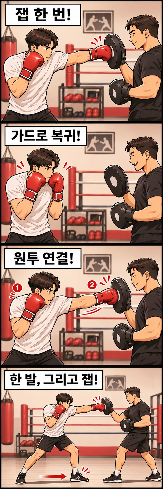

코치가 미트를 들어 올렸을 때 바로 펀치를 내야 할까요? 처음 미트를 치는 사람이라면 어느 손으로 쳐야 하는지, 얼마나 멀리 뻗어야 하는지, 다음 펀치는 언제 내야 하는지 한꺼번에 헷갈릴 수 있습니다.

미트 트레이닝은 코치가 손에 착용한 표적을 향해 펀치를 내는 연습입니다. 샌드백과 달리 표적의 위치와 타이밍이 바뀌기 때문에 **펀치의 정확도뿐 아니라 거리 판단, 반응, 자세 복원**까지 함께 훈련할 수 있습니다.

처음에는 코치와 시작 신호를 맞추고, 하나의 표적을 정확하게 친 뒤 가드로 돌아오는 것부터 익히면 됩니다.

## 미트가 보인다고 무조건 치는 것은 아닙니다

미트를 드는 동작에는 여러 의미가 있습니다. 타격할 위치를 보여주는 경우도 있고, 코치가 자세를 설명하거나 표적을 옮기는 중일 수도 있습니다.

처음에는 **말로 알려주는 신호에 칠지, 미트를 제시하는 동작을 보고 칠지** 확인하세요. 같은 미트 연습이라도 한 번씩 반응하는 훈련과 미리 정한 원투를 연속으로 치는 훈련은 진행 방식이 다릅니다.

중요한 것은 코치의 손을 무작정 따라가는 것이 아니라, 어떤 표적에 어떤 펀치를 낼지 이해하고 움직이는 것입니다. 신호를 놓쳤다면 늦게 따라 치기보다 다시 자세를 잡고 다음 신호에 맞추면 됩니다.

## 첫 번째 단계: 잽 한 번, 가드로 복귀

처음부터 빠른 연속 펀치를 시도할 필요는 없습니다. 코치가 앞손 잽을 받을 미트를 제시하면 그 표적을 보고 잽을 한 번 뻗어 보세요.

이때 확인할 것은 세 가지입니다.

- **표적:** 미트의 가운데를 향해 주먹을 보냅니다.
- **거리:** 상체를 지나치게 앞으로 숙이지 않고도 닿는 위치에서 칩니다.
- **복귀:** 잽을 낸 손을 다시 가드로 가져오고 다음 동작을 준비합니다.

미트가 멀리 있다고 팔만 길게 뻗으면 어깨와 상체가 앞으로 쏠리기 쉽습니다. 주먹이 닿지 않는다면 억지로 뻗기보다 코치와 거리를 조정하거나 발을 이동해야 합니다.

잽 한 번을 정확하게 치고 원래 자세로 돌아오는 동작이 익숙해지면, 미트가 조금 다른 위치에 제시되어도 자신의 거리를 찾아갈 수 있습니다.

## 두 번째 단계: 원투의 리듬을 연결하기

잽에 익숙해졌다면 앞손 잽과 뒷손 스트레이트를 연결하는 **원투**를 연습합니다.

코치가 두 개의 미트를 순서대로 제시하면 앞손을 뻗고, 이어서 뒷손 스트레이트를 냅니다. 이때 단순히 손을 빠르게 두 번 움직이는 것이 목표는 아닙니다.

잽을 뻗은 뒤에는 뒷손을 낼 수 있는 자세가 남아 있어야 하고, 뒷손 스트레이트를 낼 때는 발의 지지와 골반·몸통의 회전을 연결해야 합니다. 두 펀치가 끝난 뒤에도 중심이 앞으로 무너지지 않아야 다음 공격이나 방어로 이어질 수 있습니다.

처음에는 코치가 일정한 속도로 미트를 제시하고, 동작이 안정되면 제시하는 간격을 바꿔 반응하는 연습으로 발전시킬 수 있습니다.

## 세 번째 단계: 미트가 움직이면 거리부터 맞추기

미트 연습이 재미있어지는 순간은 표적이 움직이기 시작할 때입니다. 코치가 한 걸음 물러나거나 옆으로 이동하면 이전과 같은 자리에 서서 주먹만 뻗어서는 표적에 닿지 않을 수 있습니다.

이때는 **발이 먼저 거리를 만들고, 그다음 펀치가 따라간다**는 원리를 떠올려 보세요.

예를 들어 코치가 뒤로 한 걸음 이동했다면 자신의 기본 자세를 유지한 채 앞으로 짧게 이동하고 잽을 냅니다. 옆으로 이동했다면 방향을 맞추고 다시 표적을 확인합니다.

주먹을 맞히겠다고 발을 교차하거나 상체를 과하게 기울이면 균형이 흐트러집니다. 표적을 따라가는 속도보다 올바른 자세로 이동하고 멈출 수 있는지가 먼저입니다.

## 미트 연습이 단순한 펀치 반복과 다른 이유

샌드백은 대체로 정해진 위치에 있지만, 미트는 코치가 표적과 타이밍을 바꿀 수 있습니다. 그래서 미트 트레이닝은 **보이는 정보에 맞춰 움직임을 선택하는 훈련**으로 확장됩니다.

예를 들어 코치가 잽 미트를 보여주면 잽을 내고, 원투를 지시하면 두 펀치를 연결합니다. 때로는 미트를 내리고 기다리게 하거나, 방어 동작을 보여준 뒤 반격하도록 진행할 수도 있습니다.

다만 초보자에게 여러 신호를 한꺼번에 주면 정확도와 균형이 무너지기 쉽습니다. 한 가지 반응을 익힌 뒤 표적의 위치, 연속 동작, 이동을 하나씩 추가하는 편이 좋습니다.

영국 복싱협회의 코칭 핸드북도 미트 훈련의 목적을 분명히 정하고 선수의 숙련도에 맞게 기술의 복잡성을 조절하도록 설명합니다.

## 처음 미트를 칠 때 기억할 네 가지

1. **신호 확인:** 코치가 무엇을 보여주면 어떤 펀치를 낼지 먼저 이해합니다.
2. **표적과 거리:** 미트 가운데를 보고 무리하게 팔을 뻗지 않는 거리를 찾습니다.
3. **타격과 복귀:** 펀치를 낸 뒤 가드와 균형을 되찾습니다.
4. **다음 동작:** 신호를 놓치거나 설명이 시작되면 멈추고, 다시 준비한 뒤 이어갑니다.

처음부터 미트를 빠르고 세게 치는 것보다 **정확하게 보고, 맞히고, 다음 움직임을 준비하는 능력**을 만드는 것이 중요합니다. 이 과정이 쌓이면 원투뿐 아니라 훅, 어퍼컷, 스텝과 방어 동작까지 연결할 수 있습니다.

레드복싱 행신점과 을지로점에서도 기본 자세와 펀치부터 익히며 미트 연습으로 복싱의 거리와 리듬을 경험할 수 있습니다.

## 참고 자료

- [England Boxing 코칭 핸드북 — Padwork](https://www.englandboxing.org/wp-content/uploads/2022/03/EB_Boxing-Coaching-Handbook-Part-1_v8-002.pdf): 미트 훈련의 목적, 표적 제시, 숙련도에 따른 난이도 조절.
- [복싱 캐나다 입문 지도 자료](https://boxingcanada.org/wp-content/uploads/2025/01/Instruction-Beginners-Reference-Manual-EN.pdf): 미트 활용과 타격 강도 조절.
