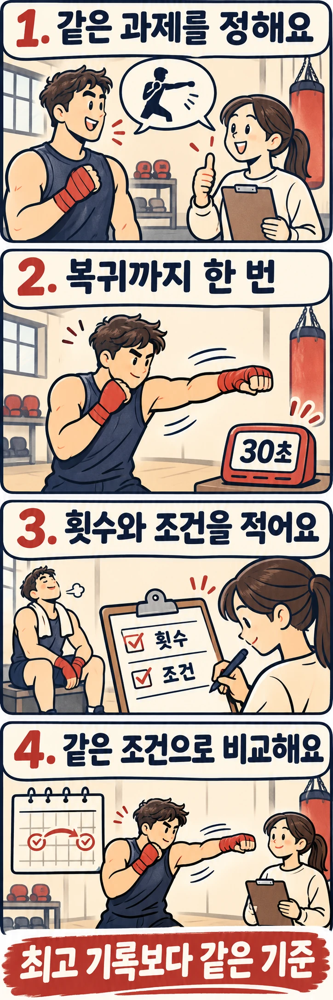

연습을 마치고 “오늘은 원투를 더 많이 했어요”라고 느꼈는데, 다음에는 속도를 낮추라는 말을 들으셨나요? 원투는 잽과 뒷손 스트레이트를 이어 치는 조합입니다. 횟수를 늘린 날과 동작을 꼼꼼히 확인한 날을 그대로 비교하면 무엇이 달라졌는지 설명하기 어렵습니다.

**익숙한 과제 하나를 같은 조건에서 다시 해보고, 횟수와 수행 모습을 따로 살펴보세요.** 아래는 기본 펀치를 배운 성인이 자율연습에 넣어볼 수 있는 비교 설계입니다. 검증된 실력 시험이나 실제 참가자의 실험 결과가 아니라, 다음 연습을 정하기 위한 제안입니다.

## 무엇을 비교할지 한 문장으로 정하세요

“복싱을 잘하게 됐는지”는 이번 점검으로 답하기에 너무 넓습니다. 대신 “익숙한 원투를 서두르지 않고 시작 자세로 돌아오며 이어갈 수 있는지”처럼 범위를 좁혀 보세요. 상대의 움직임을 읽거나 타격을 방어하는 능력은 이 비접촉 과제에 포함되지 않습니다.

코치에게 이미 배운 조합을 골라 수행 기준을 확인하세요. 아직 원투가 낯설다면 잽 한 번과 복귀만으로 줄여도 됩니다. 점검을 위해 새 기술을 급히 추가할 필요는 없습니다. 경험자도 긴 조합으로 바꾸기보다 지금 비교하려는 항목이 그 과제에서 드러나는지 먼저 판단해 주세요.

## 횟수보다 먼저 ‘한 번 완료’의 뜻을 맞추세요

이 예시에서는 원투를 뻗고 두 손과 발이 정해 둔 시작 자세로 돌아오면 한 번으로 셉니다. 힘껏 뻗거나 팔꿈치를 튕기지 않는 편안한 속도로 수행합니다. 점검 중에는 샌드백이나 상대를 치지 않습니다.

관찰자는 완료 횟수와 함께, 복귀 전에 다음 조합을 시작한 경우를 별도로 표시합니다. 이것은 자세 전체의 합격 판정이 아닙니다. 손 위치가 맞는지 같은 기술 판단은 코치에게 확인하고, 관찰자는 합의한 사건만 세어 주세요. 혼자 수행하면서 세기가 어렵다면 횟수를 억지로 추정하지 말고 ‘중간에 멈췄는지’만 기록해도 됩니다.

**기준을 바꿨다면 새 기록의 첫날로 삼으세요.** 이전에는 펀치 두 번만 세고 이번에는 복귀까지 확인했다면, 두 숫자의 차이를 향상이나 퇴보로 해석하지 않습니다.

## 자율연습 앞부분에 짧게 넣어보세요

다음은 코치와 과제를 정한 뒤 사용할 수 있는 예시입니다. 기록 경신을 위한 최대속도 도전으로 진행하지 않습니다.

| 구간 | 제안하는 진행 | 남길 내용 |
| --- | --- | --- |
| 준비 | 평소 배운 준비운동 뒤 과제를 편하게 몇 차례 시도합니다 | 조합과 완료 기준을 확인합니다 |
| 점검 | 30초 동안 익숙한 속도로 과제를 수행합니다 | 완료 횟수와 복귀 전 재출발 횟수를 구분합니다 |
| 정리 | 멈춰서 기록하고 평소 연습으로 넘어갑니다 | 중단 여부와 당시 느낌을 짧게 적습니다 |

30초는 이 제안을 짧게 운영하기 위한 시간이지, 실력을 판정하는 표준 시간이 아닙니다. 부담스럽다면 처음부터 15초로 정하고 이후에도 같은 길이를 사용하세요. 기록이 마음에 들지 않는다고 곧바로 여러 번 재도전해 최고 기록만 골라 남기지 않습니다.

다음 점검은 예를 들어 한 주 뒤의 비슷한 연습 시간에 잡아 보세요. 그 사이에는 평소 연습을 이어갑니다. 이 간격 역시 향상이 나타나는 보장 기간이 아니라 일정 예시입니다. 통증이 있거나 몸 상태가 좋지 않다면 점검을 보류하고, 중간에 불편함이 생기면 기록과 관계없이 멈춥니다.

## 다음번에도 같은 질문을 할 수 있게 조건을 남기세요

기록지에는 날짜 외에 **과제, 시간, 완료 기준, 연습 중 배치 위치**를 적어 주세요. 같은 준비운동 뒤에 점검할지, 같은 사람이 관찰할지도 정해 두면 비교 조건을 맞추기 좋습니다. 처음에는 맨손 비접촉 과제였다가 다음에는 글러브를 끼고 백을 치는 식으로 바꾸면 다른 과제가 됩니다.

전날 운동이 유난히 많았거나 그날 준비 과정이 달랐다면 옆에 표시합니다. 모든 생활 조건을 완벽히 통제할 필요는 없습니다. 다만 조건이 다른 기록을 한 줄의 순위표로 만들지 않는 것이 이 설계의 원칙입니다.

빈 기록지는 다음처럼 간단히 만들 수 있습니다.

- 과제·시간: 원투와 복귀 / 30초
- 완료 기준·배치: 시작 자세 복귀까지 / 준비운동 직후
- 관찰: 완료 __회 / 복귀 전 재출발 __회 / 중단 유무 __
- 달라진 조건과 다음 질문: __

## 숫자가 달라졌을 때 다음 연습을 고르세요

완료 횟수가 늘고 합의한 복귀 기준도 유지됐다면, **그 조건의 과제를 전보다 더 많이 완료했다**고 기록할 수 있습니다. 그것만으로 펀치 위력이나 스파링 능력까지 향상됐다고 결론 내리지는 않습니다.

횟수는 늘었지만 복귀 전 재출발도 늘었다면 속도를 더 올리기보다 기존 속도에서 완료 기준을 다시 확인해 보세요. 횟수가 같아도 중간에 끊기던 부분을 끝까지 이어갔다면 그 변화는 따로 남길 만합니다. 반대로 숫자가 줄었다면 먼저 과제와 당일 조건이 같았는지 살펴보고, 하루 기록만으로 훈련량을 추가하지 마세요.

기준을 유지하기 어려우면 시간을 줄이거나 조합을 단순하게 바꿔 새 기준선을 만듭니다. 익숙해졌더라도 시간·속도·조합을 동시에 바꾸지 마세요. 바꾼 과제는 별도 기록으로 시작해야 무엇을 비교하는지 분명해집니다.

다음 수업에는 “횟수가 늘었어요”에 더해 “복귀까지 같은 기준으로 셌는데, 이 수행을 계속 비교해도 될까요?”라고 물어보세요. 레드복싱에서 배운 동작을 자율연습으로 이어갈 때도, 어떤 모습을 완료로 볼지 확인하는 대화가 출발점이 될 수 있습니다. 오늘 정할 것은 최고 기록이 아니라 **다음번에도 다시 해볼 수 있는 과제 하나**입니다.
