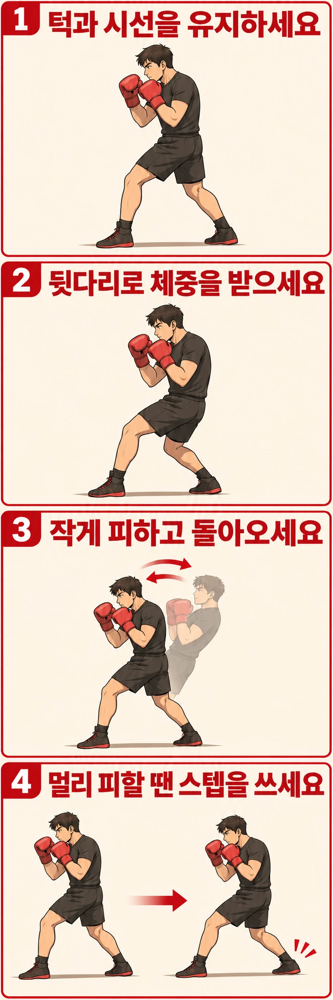

잽을 뒤로 피하려는데 턱이 위로 들리고 천장이 보이나요? 머리를 멀리 보내려다 목부터 젖히는지 살펴보세요. **풀백은 얼굴을 위로 돌리는 동작보다 머리의 위치를 뒤로 옮기는 동작으로 이해하시면 좋습니다.** 이 글에서는 발을 옮기지 않고 작게 물러나는 기본형을 다룹니다.

## 뒤로 피하면 왜 턱이 들릴까요?

턱이 들리는 모습이 같아도 출발은 다를 수 있습니다. 다리는 그대로 둔 채 고개만 뒤로 꺾을 수도 있고, 피하는 거리를 늘리려고 가슴을 과하게 들면서 머리까지 따라갈 수도 있습니다. 이미 뒷다리에 깊이 기대어 서 있다면 더 뒤로 움직일 여유가 적어 상체를 젖히게 될 수도 있습니다.

옆모습에서 **코와 턱이 위로 돌아가는지, 머리 전체가 뒤로 이동하는지**를 구분해 보세요. 턱을 힘껏 가슴에 붙이는 것으로 해결하려 하면 목만 뻣뻣해질 수 있습니다. 처음 가드에서 잡은 편안한 턱 위치와 정면 시선을 유지하는 쪽으로 시작하세요.

## 뒷다리가 받아 주어야 머리도 뒤로 이동합니다

잉글랜드 복싱 코칭 안내서는 레이백이라는 이름으로 이 방어를 설명합니다. 앞다리가 펴지고 뒷다리가 굽혀지며 머리가 타격 거리 밖으로 이동하고, 이후 균형 잡힌 자세로 복귀하는 흐름입니다. 너무 멀리 물러나 지지 기반을 잃고 머리가 들리는 것을 오류로 짚습니다.

여기서 앞다리를 편다는 것은 무릎을 끝까지 잠그라는 뜻이 아닙니다. 앞무릎의 굽힘이 줄어드는 동안 뒷무릎은 조금 더 굽혀져 체중을 받습니다. 상체도 함께 뒤로 이동하지만 허리를 크게 꺾거나 배를 앞으로 내밀지는 않습니다. 발을 옮기지 않는 연습에서는 앞발도 바닥에 남겨 두고 두 발의 지지를 유지하세요.

오른손잡이 기본 자세라면 오른쪽 다리가 뒷다리이고, 반대 자세라면 왼쪽 다리가 뒷다리입니다. 정해진 체중 비율이나 이동 거리를 맞추기보다, **이동한 자리에서 멈추고 다시 출발할 수 있는지**를 기준으로 삼으세요.

## 풀백만으로 계속 거리를 벌릴 수는 없습니다

풀백은 펀치가 닿는 끝 부근에서 머리를 조금 물리는 방어로 접근하는 편이 좋습니다. 상대가 깊이 들어오거나 연속해서 전진하면 제자리에서 몸을 더 젖히는 것만으로는 대응하기 어렵습니다. 작은 움직임으로 충분한지는 상대의 팔 길이뿐 아니라 시작 거리와 공격 타이밍에도 달려 있습니다.

반면 후퇴 스텝은 발을 옮겨 몸 전체의 위치를 바꿉니다. 머리를 더 멀리 보내야 하는 상황이라면 풀백의 폭만 늘리지 말고 코치와 후퇴 스텝 등 다른 방어를 선택하세요. 어느 쪽이든 상대의 다음 공격을 살펴야 합니다. 한 번 뒤로 피했다고 연타까지 끝난 것은 아닙니다.

## 혼자서는 턱의 방향과 복귀부터 확인하세요

이 연습은 실제 공격을 피하는 시험이 아니라 자세를 점검하기 위한 제안입니다. 주변 공간을 비우고 상대나 표적 없이 천천히 해 보세요.

먼저 기본 가드에서 정면의 눈높이에 시선 기준을 정합니다. 앞무릎의 굽힘을 조금 줄이면서 뒷무릎을 굽혀 체중을 받아 보세요. 머리는 상체와 함께 조금 뒤로 이동하고 양손은 얼굴 가까이에 남습니다. 억지로 크게 기울이지 않아도 됩니다.

그 자리에서 짧게 멈춰 시선이 위로 향했는지 확인합니다. 다시 시작 자세로 돌아올 때는 배를 앞으로 튕기거나 머리부터 내밀지 말고, 다리의 굽힘을 되돌리며 상체도 함께 가져오세요. 익숙해지면 멈춤을 없애고 물러남과 복귀를 부드럽게 연결합니다.

옆에서 찍은 짧은 영상이 있다면 출발·뒤로 이동한 순간·복귀를 비교해 보세요. 턱이 들리면 이동 폭을 줄여 목부터 꺾이는지 살펴보고, 뒤로 넘어갈 듯하면 시작부터 뒷다리에 너무 기대지 않았는지 확인하세요. 돌아오며 한 걸음을 급히 디뎌야 한다면 현재 범위를 줄이고 발 간격도 함께 점검하는 편이 좋습니다.

## 다음 동작은 상대의 공격이 지나간 뒤에 고르세요

풀백에서 뒷다리가 체중을 받는 흐름은 뒷손 반격을 준비하는 데 쓰일 수 있습니다. 다만 물러났다가 앞으로 튕기듯 펀치를 내는 습관부터 만들 필요는 없습니다. 먼저 가드 자세로 돌아와 움직일 수 있는지 확인한 뒤, 코치와 정한 신호에 맞춰 미트에 뒷손 스트레이트를 연결해 보세요.

거리와 타이밍을 배우는 단계에서는 코치가 낮은 속도로 공격선과 도달 지점을 보여 주는 비접촉 연습부터 시작하는 편이 좋습니다. 혼자 자세가 안정됐다는 이유로 동료에게 얼굴을 향해 펀치를 요청하지 마세요. 목이나 허리에 통증이 생기면 동작을 멈추고 범위를 점검하세요.

레드복싱에서 동작을 질문하실 때는 “얼마나 뒤로 젖혀야 하나요?”보다 “이 거리에서 제자리 풀백이 충분한가요, 발을 옮겨야 하나요?”라고 물어보세요. 자세 교정과 함께 방어를 선택하는 기준도 배울 수 있습니다.

## 참고 자료

- [잉글랜드 복싱 코칭 안내서 Part 1, 인쇄면 83쪽](https://www.englandboxing.org/wp-content/uploads/2022/03/EB_Boxing-Coaching-Handbook-Part-1_v8-002.pdf): 레이백의 다리 움직임, 가드 유지, 균형 복귀와 거리 판단을 설명합니다. 본문의 턱 방향 관찰과 비접촉 연습은 이를 바탕으로 구성한 연습 제안입니다.
