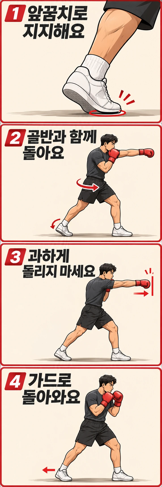

스트레이트를 배우며 “뒷발을 돌리세요”라는 말을 들으면 뒤꿈치를 크게 바깥으로 보내는 데 집중하기 쉽습니다. 그런데 발은 많이 돌아갔는데 몸통은 그대로이거나, 몸 전체가 옆으로 돌아가 버릴 수도 있습니다. **확인할 것은 뒤꿈치의 이동량보다 발의 지지와 몸통 회전이 연결되는지입니다.**

## 뒤꿈치를 드는 것과 발 전체를 떼는 것은 다릅니다

이 글은 왼발이 앞인 오소독스 자세에서, 제자리 오른손 스트레이트를 치는 경우를 기준으로 합니다. 오른발이 앞인 자세라면 좌우를 바꾸어 보세요. 이동하면서 치는 펀치나 스탠스를 바꾸는 동작은 별도로 배워야 합니다.

뒷발의 **앞꿈치**, 즉 발가락 바로 뒤쪽의 넓은 부분으로 바닥을 지지하면서 골반과 어깨가 돌아가도록 해 보세요. 오른쪽 골반과 어깨가 목표 쪽으로 나오는 동안 오른발 뒤꿈치는 가볍게 들려 바깥으로 돌아갈 수 있습니다. 발가락 끝으로만 서거나 발 전체를 공중에 띄우는 동작과는 다릅니다.

뒷발을 바닥에 단단히 붙여 둔 채 상체만 억지로 돌릴 필요도 없습니다. 발이 회전에 맞춰 움직일 여유를 주되, 바닥을 누르는 감각까지 사라지지 않게 해 보세요. 앞다리도 무게를 받으며 지지에 참여합니다. 뒤꿈치를 높이 들려고 몸이 위로 솟는다면 높이보다 접촉과 균형부터 살펴보세요.

## 몇 도를 돌렸는지만으로 판단하지 마세요

[잉글랜드 복싱 코칭 안내서의 뒷손 직선 펀치 설명](https://www.englandboxing.org/wp-content/uploads/2022/03/EB_Boxing-Coaching-Handbook-Part-1_v8-002.pdf)은 뒷발 앞부분을 축으로 하는 회전과 골반의 회전을 함께 제시합니다. 뒤꿈치를 내린 채 발을 고정하는 것뿐 아니라, 뒷발이 바닥에서 떨어지거나 몸을 지나치게 돌려 균형을 잃는 것도 오류로 구분합니다.

안내서에는 뒷발을 4분의 1바퀴 돌리는 지도 표현이 나옵니다. 다만 혼자 점검할 때 시작 발각도와 자세를 무시하고 모든 펀치에서 정확히 90도를 만들려고 하지는 마세요. 이 글에서는 **몸통이 목표를 향해 회전하고, 주먹이 목표로 곧게 나가며, 회수 뒤 다음 동작을 할 수 있는지**를 관찰 기준으로 제안합니다.

뒤꿈치만 먼저 돌리고 골반을 그대로 두면 발 모양만 바뀝니다. 반대로 어깨가 목표를 지나 계속 돌아가면 주먹도 몸 앞을 가로질러 흐를 수 있습니다. 충분히 뻗는 스트레이트를 유지하면서, 타격에 필요하지 않은 추가 회전을 줄이는 것이 목적입니다.

## 손을 뻗는 동안 뒷발과 골반을 연결해 보세요

먼저 주변 공간과 바닥 상태를 확인하고, 아무것도 치지 않는 느린 섀도복싱으로 시작합니다. 신발이 바닥에 지나치게 걸리면 힘으로 비틀지 마세요.

1. 평소 배우는 발 간격으로 서서 양손 가드를 올립니다. 앞에 얼굴 높이의 가상 목표를 정합니다.
2. 오른손을 목표로 뻗으면서 오른쪽 골반과 어깨를 앞으로 보냅니다. 뒷발 앞부분으로 바닥을 지지하고, 그 흐름에 맞춰 뒤꿈치가 돌아가게 합니다.
3. 왼손은 얼굴 가까이에 둡니다. 오른팔을 충분히 뻗되 팔꿈치를 세게 튕겨 잠그지 않고, 시선은 목표에 남깁니다.
4. 오른손을 가드로 회수하면서 몸통과 뒷발도 다음 동작이 가능한 자세로 돌아옵니다. 발을 따로 크게 고쳐 놓아야 하는지 확인합니다.

이 순서는 관찰하기 위해 나눈 설명입니다. 실제로는 발을 먼저 다 돌린 뒤 골반을 돌리고 마지막에 손을 내는 식으로 끊지 않습니다. **발·골반·어깨·손이 한 펀치 안에서 연결되도록** 천천히 이어 보세요. 돌아올 때도 뒤꿈치를 바닥에 세게 찍거나, 체중을 억지로 뒤로 던질 필요는 없습니다.

## 발만 도는지, 몸이 너무 도는지 나눠 보세요

**뒤꿈치는 움직이는데 오른쪽 어깨가 앞으로 나오지 않는다면**, 발을 돌리는 데만 집중했을 수 있습니다. 뒤꿈치를 크게 움직이려는 의도를 내려놓고, 오른쪽 골반과 어깨가 손을 뻗는 동안 함께 나오는지 느린 동작에서 보세요. 어깨만 앞으로 밀어내는 것과도 구분해야 합니다.

**펀치 끝에서 몸이 옆을 보거나 주먹이 목표를 가로질러 간다면**, 회전이 지나쳤을 수 있습니다. 목표 앞에서 주먹의 경로를 확인하고, 손이 도달한 뒤에도 골반과 뒤꿈치가 계속 돌아가는지 살펴보세요. 이 경우에는 팔을 짧게 접는 대신 불필요하게 이어지는 회전을 줄여 봅니다.

**몸이 앞으로 넘어가며 뒷발이 들린다면**, 회전량 외에 거리와 전방 쏠림도 확인해야 합니다. 가상 목표를 너무 멀리 잡았는지 살펴보고 평소 타격 거리에서 다시 해 보세요. 목표에 닿으려고 상체를 던지는 동작을 뒷발 회전만으로 고치기는 어렵습니다.

발 모양만으로 원인을 단정하지 마세요. 무릎이나 발목이 불편하면 더 돌려서 맞추려 하지 말고 동작을 멈춘 뒤 코치에게 자세를 보여 주세요. 통증을 참으며 회전 범위를 늘리는 연습은 피합니다.

## 펀치 다음의 짧은 이동으로 점검을 마무리하세요

느린 스트레이트를 한 번 뻗고 회수한 뒤, 뒷발부터 짧게 한 걸음 물러나 보세요. 목표는 빨리 움직이는 것이 아니라 **발을 다시 배치하지 않아도 후퇴를 시작할 수 있는지** 확인하는 데 있습니다. 뒤꿈치를 먼저 바로잡거나 몸의 쏠림을 수습해야 한다면, 직전 펀치의 끝 자세를 다시 살펴보세요.

이 점검에서 편안해졌다면 스트레이트와 복귀를 멈춤 없이 연결합니다. 이후 코치와 가벼운 미트 타격에서 뒷발의 접촉, 목표까지의 거리, 회수 뒤 균형이 함께 유지되는지 확인해 보세요. 허공에서 편안하다고 실제 타격에서도 같다고 단정할 수는 없습니다.

레드복싱에서 스트레이트를 점검할 때도 “뒤꿈치가 얼마나 돌았나요?”에 더해 “친 뒤 바로 물러날 수 있나요?”를 함께 물어보세요. 발 모양과 다음 움직임을 연결해서 보면 교정할 지점이 더 구체적이 됩니다.

## 참고 자료

- [England Boxing, Boxing Coaching Handbook Part 1, 책자 75쪽](https://www.englandboxing.org/wp-content/uploads/2022/03/EB_Boxing-Coaching-Handbook-Part-1_v8-002.pdf): 뒷손 직선 펀치의 뒷발·골반 회전, 지지 상실과 과회전 오류를 다룹니다. 본문의 느린 섀도복싱과 회수 뒤 후퇴는 이를 참고해 구성한 자체 점검 제안입니다.
