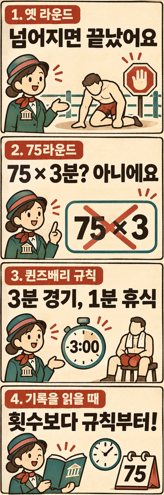

1889년 7월 8일, 미국 미시시피주의 한 야외 링에서 두 복서가 맞붙었습니다. 챔피언 존 L. 설리번과 도전자 제이크 킬레인이었습니다. 경기가 끝났을 때 기록된 라운드 수는 무려 **75라운드**였습니다.

오늘날 복싱에 익숙하다면 고개를 갸웃하게 됩니다. 한 라운드가 3분이니, 75라운드면 경기 시간만 225분이라는 뜻일까요?

실제 승부는 약 **2시간 16분** 동안 이어졌습니다. 이 숫자들 사이의 차이를 이해하려면 시간을 계산하기보다 먼저 질문을 바꿔야 합니다. **당시에는 무엇이 한 라운드를 끝냈을까요?** [샬럿 홀 박물관의 경기 역사](https://archives.sharlothallmuseum.org/articles/days-past-articles/1/prescotts-pugilistic-production-the-sullivan-kilrain-exhibition-of-1909)

## 75라운드의 혈투, 그런데 시계가 달랐습니다

설리번과 킬레인의 경기는 맨주먹으로 치러졌습니다. 두 선수는 뜨거운 날씨 속에서 오랜 시간 싸웠고, 결국 킬레인이 더 이상 경기를 이어 가지 못하면서 설리번이 승리했습니다. 미국 의회도서관이 보존한 1908년 신문에도 이 승부가 75라운드 경기로 기록돼 있습니다. [1908년 신문 지면](https://tile.loc.gov/storage-services/service/ndnp/ct/batch_ct_locust_ver01/data/sn93053726/00271763165/1908050101/0015.pdf)

그런데 75라는 숫자를 현대의 3분 라운드에 그대로 대입하면 경기의 실체가 보이지 않습니다. 이 승부는 오늘날의 시간제 라운드가 아니라 **런던 프라이즈 링 규칙**에 따라 진행됐기 때문입니다. 당시 규칙으로 치러진 경기였다는 점은 박물관의 역사 기록과 스포츠사 자료에서도 확인됩니다. [샬럿 홀 박물관](https://archives.sharlothallmuseum.org/articles/days-past-articles/1/prescotts-pugilistic-production-the-sullivan-kilrain-exhibition-of-1909) · [스포츠사 자료](https://catalogimages.wiley.com/images/db/pdf/9781118537718.excerpt.pdf)

그렇다면 이 규칙에서 한 라운드는 얼마나 길었을까요?

## 당시에는 선수가 넘어지면 라운드가 끝났습니다

런던 프라이즈 링 규칙에서는 선수가 넘어지는 순간 그 라운드가 끝났습니다. 이후 30초가 지나면 다음 라운드를 시작할 준비를 했고, 선수는 이어지는 8초 안에 도움 없이 링 중앙의 기준선인 '스크래치'로 나와야 했습니다. 나오지 못하면 경기를 계속할 수 없었습니다. [영국복싱관리위원회의 역사 설명](https://bbbofc.com/boxing-history)

즉, 라운드의 길이를 결정한 것은 시계가 아니라 **선수가 넘어지는 순간**이었습니다. 어떤 라운드는 짧게 끝날 수 있었고, 어떤 라운드는 길게 이어질 수도 있었습니다.

여기서 말하는 '넘어짐'도 오늘날의 복싱에서 생각하는 다운과 완전히 같지는 않았습니다. 당시에는 레슬링과 비슷한 몸싸움도 경기의 일부였습니다. 설리번 역시 훗날 킬레인전에서 레슬링 공방이 많았다고 회고했습니다. [설리번의 회고가 실린 1908년 신문](https://tile.loc.gov/storage-services/service/ndnp/ct/batch_ct_locust_ver01/data/sn93053726/00271763165/1908050101/0015.pdf)

이제 75라운드라는 기록이 조금 다르게 보입니다. **75번의 3분 경기를 치른 것이 아니라, 넘어짐을 기준으로 구분되는 라운드를 75번 치른 것**입니다. 경기 자체가 길고 힘들었다는 사실은 변하지 않지만, 라운드 수만으로 실제 공방 시간을 계산할 수는 없습니다.

## 복싱은 언제부터 3분을 세기 시작했을까요?

복싱의 모습을 바꾸는 중요한 기준 가운데 하나가 **퀸즈베리 규칙**이었습니다. 이 규칙은 설리번과 킬레인의 경기보다 앞선 19세기에 등장했지만, 모든 경기가 한꺼번에 같은 방식으로 바뀐 것은 아니었습니다.

퀸즈베리 규칙의 제3조는 한 라운드를 3분, 라운드 사이 휴식을 1분으로 정했습니다. 제4조는 선수가 넘어져도 10초 안에 일어나면 남은 라운드를 계속하도록 했습니다. **넘어졌다고 해서 곧바로 새 라운드가 시작되지는 않게 된 것**입니다. [퀸즈베리 규칙 전체 12개 조문](https://en.wikisource.org/wiki/Marquess_of_Queensberry_rules)

| 비교 | 런던 프라이즈 링 규칙 | 퀸즈베리 규칙 |
| --- | --- | --- |
| 라운드가 끝나는 때 | 선수가 넘어질 때 | 정해진 3분이 지났을 때 |
| 넘어진 뒤 | 다음 라운드를 준비 | 10초 안에 일어나면 같은 라운드 계속 |
| 라운드 길이 | 일정하지 않음 | 3분 |
| 경기 방식의 특징 | 맨주먹과 몸싸움이 허용된 형태 | 글러브 사용, 레슬링·껴안기 금지 |

표는 경기를 계속할 수 있는 상황에서의 기본 원칙을 비교한 것입니다. 어느 방식이든 선수가 더 이상 싸울 수 없으면 경기는 끝날 수 있었습니다.

퀸즈베리 규칙에는 글러브 사용과 레슬링·껴안기 금지도 명시돼 있습니다. 바뀐 것은 시계만이 아니었습니다. **어떤 동작을 허용하고, 언제 멈추고, 어떻게 다시 싸우는지까지 달라진 것**입니다. [퀸즈베리 규칙 원문](https://shopqueensberry.com/the-rules/)

## 같은 챔피언의 기록이 보여주는 변화

흥미롭게도 설리번의 경력에는 이 두 시대를 비교할 수 있는 경기가 모두 남아 있습니다.

1889년 킬레인전에서 설리번은 런던 프라이즈 링 규칙에 따라 75라운드 끝에 승리했습니다. 그러나 1892년 제임스 J. 코벳과의 경기에서는 글러브를 끼고 퀸즈베리 규칙으로 싸웠으며, 21라운드 만에 패했습니다. [1908년 신문 기록](https://tile.loc.gov/storage-services/service/ndnp/ct/batch_ct_locust_ver01/data/sn93053726/00271763165/1908050101/0015.pdf)

한 선수의 전적에 적힌 **75라운드 승리**와 **21라운드 패배**. 숫자만 보면 전혀 다른 체력이나 경기력을 떠올리기 쉽지만, 두 기록은 애초에 라운드를 나누는 기준부터 달랐습니다.

여기서 한 가지를 더 구분해야 합니다. 퀸즈베리 규칙은 **한 라운드를 3분으로 정했지만, 경기 전체를 오늘날처럼 12라운드로 제한하지는 않았습니다.** 원래의 12개 조문 전체를 보면 총 라운드 수를 12회로 고정하는 조항은 없습니다. 라운드의 길이가 정해진 것과 경기 전체의 길이가 제한된 것은 서로 다른 변화였습니다. [퀸즈베리 규칙 12개 조문](https://en.wikisource.org/wiki/Marquess_of_Queensberry_rules)

## 75라운드가 우리에게 들려주는 이야기

설리번과 킬레인의 75라운드는 오늘날의 3분 라운드 75개가 아니었습니다. 그렇다고 그들의 승부가 덜 치열했다는 뜻도 아닙니다. 약 2시간 16분 동안 이어진 혈투는 그 자체로 놀라운 기록입니다.

다만 그 기록이 흥미로운 이유는 오래 싸웠기 때문만은 아닙니다. **같은 '복싱'이라는 이름 아래에서도 시대에 따라 전혀 다른 방식으로 싸웠다는 사실**을 보여주기 때문입니다.

오늘날 복싱에서 익숙한 3분 라운드와 1분 휴식, 글러브와 다운 카운트는 처음부터 당연했던 것이 아닙니다. 복싱이 오랜 시간에 걸쳐 규칙을 바꾸며 지금의 스포츠로 발전해 온 결과입니다.

**75라운드라는 숫자가 들려주는 진짜 이야기는 한 복서의 놀라운 체력만이 아닙니다. 우리가 알고 있는 복싱이 어떻게 만들어졌는가에 관한 이야기입니다.**

## 참고 자료

- [샬럿 홀 박물관, 설리번–킬레인전 역사](https://archives.sharlothallmuseum.org/articles/days-past-articles/1/prescotts-pugilistic-production-the-sullivan-kilrain-exhibition-of-1909): 1889년 경기의 장소·날짜·적용 규칙·75라운드와 약 2시간 16분 기록을 확인할 수 있습니다.
- [스포츠사 서적 발췌](https://catalogimages.wiley.com/images/db/pdf/9781118537718.excerpt.pdf): 설리번–킬레인전의 런던 프라이즈 링 규칙 적용과 라운드 종료 방식을 설명합니다.
- [《워터버리 이브닝 데모크랫》 1908년 5월 1일자, 미국 의회도서관 소장](https://tile.loc.gov/storage-services/service/ndnp/ct/batch_ct_locust_ver01/data/sn93053726/00271763165/1908050101/0015.pdf): 킬레인전·코벳전 기록과 설리번의 후대 회고입니다.
- [영국복싱관리위원회, 복싱의 역사](https://bbbofc.com/boxing-history): 런던 프라이즈 링 규칙의 라운드 종료와 재개 절차를 설명합니다.
- [퀸즈베리 규칙 원문 전사본, 위키문헌](https://en.wikisource.org/wiki/Marquess_of_Queensberry_rules): 3분 라운드, 다운 뒤 재개, 글러브·레슬링 규정 및 전체 12개 조문을 확인할 수 있습니다.
- [퀸즈베리 규칙 전문](https://shopqueensberry.com/the-rules/): 전체 12개 조문을 추가 대조할 수 있습니다.
