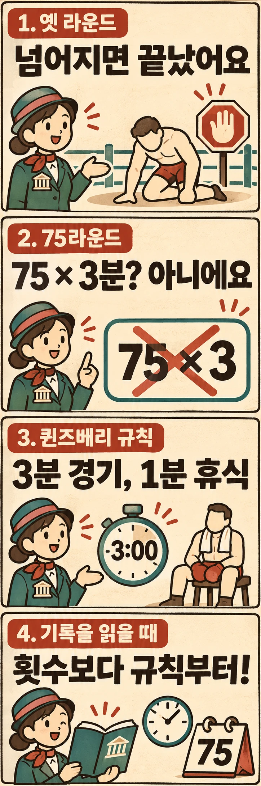

1889년 존 L. 설리번과 제이크 킬레인의 대결에는 ‘75라운드’라는 기록이 남아 있습니다. 한 라운드를 3분으로 생각하면 타격 시간만 225분이 됩니다. 하지만 이 계산으로 당시 경기를 설명할 수는 없습니다. 두 선수가 싸운 규칙에서는 오늘날 익숙한 시간 단위와 라운드의 뜻이 달랐기 때문입니다.

## 75라운드는 어떤 경기의 기록일까요?

1889년 7월 8일, 미국 미시시피주 리치버그에서 설리번은 킬레인에게 승리했습니다. 미국 의회도서관이 보존한 1908년 5월 1일자 《워터버리 이브닝 데모크랫》은 이 경기를 맨주먹으로 치른 75라운드 승부로 정리합니다. 같은 지면에는 설리번 명의의 회고도 실려 있습니다. 경기 당일 기사는 아니지만, 그가 활동하던 시대에 나온 기록이라는 점에서 읽을 가치가 있습니다. [1908년 신문 지면](https://tile.loc.gov/storage-services/service/ndnp/ct/batch_ct_locust_ver01/data/sn93053726/00271763165/1908050101/0015.pdf)

여기서 놀라운 숫자만 떼어 내면 ‘옛 선수들은 지금보다 몇 배나 오래 싸웠다’는 결론으로 흐르기 쉽습니다. 그러나 라운드 수는 같은 규칙 안에서 비교할 때 의미가 분명해집니다. 먼저 이 경기에서 한 라운드가 무엇이었는지 알아야 합니다.

## 시계보다 넘어지는 순간이 기준이었습니다

영국복싱관리위원회(BBBofC)의 역사 자료에 따르면, 런던 프라이즈 링 규칙에서는 선수가 넘어지면 라운드가 끝났습니다. 라운드 뒤 30초가 지나면 다시 시작하는 절차에 들어갔고, 선수는 이어지는 8초 안에 도움 없이 링 중앙의 기준선인 ‘스크래치’로 나와야 했습니다. 나오지 못하면 패배했습니다. [BBBofC의 복싱 역사](https://bbbofc.com/boxing-history)

따라서 한 라운드가 늘 같은 길이일 수는 없었습니다. 어느 라운드는 짧고 다른 라운드는 길 수 있었으므로, 75라는 횟수에 일정한 분량을 곱할 근거가 없습니다. 넘어짐 뒤에 라운드를 새로 시작하는 방식과 정해진 시간이 끝나기를 기다리는 방식은 서로 다른 경기 구조입니다.

당시 승부를 오늘날의 복싱에서 글러브만 벗긴 경기로 생각하는 것도 정확하지 않습니다. 설리번은 1908년 회고에서 킬레인과의 승부에 레슬링 공방이 많았다고 설명합니다. 이는 선수 본인의 후대 회고로 읽어야 하지만, 당시 경기의 넘어짐을 모두 오늘날의 펀치 다운과 동일시해서는 안 된다는 맥락을 전합니다.

## 퀸즈베리 규칙은 넘어짐과 라운드 종료를 나눴습니다

퀸즈베리 규칙 제3조에는 라운드 3분, 라운드 사이 휴식 1분이 명시돼 있습니다. 제4조는 넘어진 선수가 10초 안에 도움 없이 일어나도록 하고, 다시 일어서면 3분이 끝날 때까지 해당 라운드를 이어 가도록 정합니다. 핵심은 **넘어졌다는 사실만으로 새 라운드가 시작되지는 않는다는 점**입니다. [퀸즈베리 규칙 제3·4조](https://en.wikisource.org/wiki/Marquess_of_Queensberry_rules)

| 비교할 항목 | 런던 프라이즈 링 규칙 | 퀸즈베리 규칙 |
| --- | --- | --- |
| 라운드의 종료 기준 | 선수가 넘어지는 때 | 정해진 3분이 끝나는 때 |
| 넘어짐 뒤의 절차 | 라운드 종료 뒤 다음 시작을 준비합니다 | 일어날 수 있는지 확인한 뒤 같은 라운드를 이어 갑니다 |
| 기록을 읽을 때의 주의점 | 라운드 수를 일정한 시간으로 환산할 수 없습니다 | 라운드 길이와 경기 전체의 예정 라운드 수는 별개입니다 |

표의 종료 기준은 경기가 계속될 수 있는 경우를 비교한 것입니다. 선수가 더 싸울 수 없다면 정해진 라운드 시간이 남아 있어도 승부는 끝날 수 있습니다.

이 변화의 의미는 시간표가 생겼다는 데서 끝나지 않습니다. 규칙의 구조를 보면, 넘어진 선수가 계속할 수 있는지를 판단하는 절차와 한 구간의 공방을 마치는 기준이 분리됐다고 해석할 수 있습니다. 제2조의 레슬링·껴안기 금지, 제8조의 글러브 규정도 함께 읽으면 복싱의 형태가 여러 조건을 통해 달라졌다는 점이 보입니다. 다만 이 조문을 현재 모든 대회의 세부 운영 규칙과 같다고 받아들여서는 안 됩니다.

## 한 선수의 두 기록에도 서로 다른 규칙이 담겼습니다

같은 1908년 신문은 설리번이 1892년 9월 7일 뉴올리언스에서 제임스 J. 코벳에게 21라운드 만에 패했다고 기록하며, 퀸즈베리 규칙과 글러브 사용을 명시합니다. BBBofC 자료도 날짜·장소·상대와 타이틀을 잃은 결과를 확인해 줍니다. 설리번 한 사람의 경력 안에서도 맨주먹 승부와 글러브를 낀 승부를 함께 만나게 됩니다.

그렇다고 킬레인전의 75와 코벳전의 21을 나란히 놓고 체력의 증감이나 경기 난도를 계산할 수는 없습니다. 상대도 다르고 라운드를 세는 조건도 다릅니다. 이 두 기록은 누가 더 강했는지 계산하는 재료보다, 같은 선수의 기록에도 서로 다른 경기 형식이 담길 수 있다는 사례로 보는 편이 유용합니다.

또한 **라운드 하나의 길이를 정하는 일과 경기 전체를 몇 라운드로 제한하는 일은 별개**입니다. 퀸즈베리 규칙의 12개 조문에는 오늘날 익숙한 ‘12라운드 경기’라는 총량 규정이 없습니다. 3분 라운드가 등장했다는 사실만으로 현대의 경기 형식이 한꺼번에 완성됐다고 말할 수 없는 이유입니다.

## 옛 기록을 읽을 때는 규칙부터 물어보세요

75라운드는 오늘날의 3분 라운드 75개를 뜻하지 않습니다. 그 숫자는 당시의 라운드 종료 방식 속에서 읽어야 합니다. 그렇다고 오랜 승부의 부담을 가볍게 볼 이유도 없습니다. 단지 라운드 수만으로 경기 시간이나 선수의 능력을 환산하지 않으면 됩니다.

옛 경기 기록을 만나면 ‘몇 라운드였을까?’ 다음에 ‘무엇이 한 라운드를 끝냈을까?’를 물어보세요. 글러브와 시계만큼이나, 넘어짐 뒤 경기를 어떻게 다시 시작했는지가 복싱의 변화를 설명해 줍니다.

## 참고 자료

- [《워터버리 이브닝 데모크랫》 1908년 5월 1일자, 미국 의회도서관 소장](https://tile.loc.gov/storage-services/service/ndnp/ct/batch_ct_locust_ver01/data/sn93053726/00271763165/1908050101/0015.pdf): 킬레인전·코벳전의 기록과 설리번 명의 회고입니다.
- [영국복싱관리위원회, 복싱의 역사](https://bbbofc.com/boxing-history): 런던 프라이즈 링의 라운드 종료·재개 방식과 설리번의 두 경기 맥락을 참고했습니다.
- [퀸즈베리 규칙 원문 전사본, 위키문헌](https://en.wikisource.org/wiki/Marquess_of_Queensberry_rules): 제2·3·4·8조와 전체 12개 조문을 참고했습니다.
