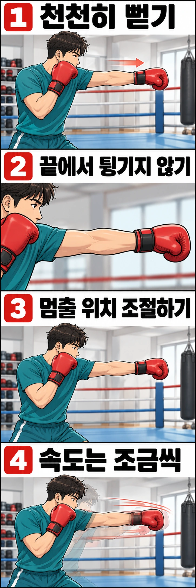

섀도복싱을 하다 보면 주먹을 빠르고 길게 뻗으려다 팔꿈치가 순간적으로 튕기는 경우가 있습니다. 특히 공중에 잽을 반복해서 뻗을 때 이런 느낌이 들 수 있죠.

그렇다고 펀치를 짧게 끊어야 하는 것은 아닙니다. **팔은 충분히 뻗되, 마지막 순간 팔꿈치를 억지로 펴지 않는 것**이 중요합니다. 이번 글에서는 잽을 이용해 펀치의 길이와 속도를 조절하는 방법을 알아보겠습니다.

## 섀도복싱에서 팔꿈치가 튕기는 이유

미트나 샌드백을 칠 때는 주먹이 목표에 닿으면서 충격이 발생합니다. 반면 섀도복싱에서는 주먹을 받아 줄 대상이 없습니다. 따라서 펀치를 뻗는 속도를 스스로 조절하고, 뻗은 팔도 직접 회수해야 합니다.

문제는 팔을 빠르게 뻗다가 **팔꿈치가 더 이상 펴지지 않는 지점에서 갑자기 멈추는 경우**입니다. 이런 동작을 반복하면 팔꿈치에 부담이 생길 수 있습니다.

복싱 코치 폴 캐럴도 섀도복싱을 지도하면서 팔꿈치를 잠그지 말고, 모든 펀치를 최고 속도로 던지지 않도록 권합니다. 그렇다고 팔을 항상 굽힌 채 짧게 치라는 뜻은 아닙니다.

## 펀치는 충분히 뻗고, 자연스럽게 회수하세요

잽을 뻗을 때는 가드에서 출발한 주먹을 목표를 향해 곧게 보냅니다. 팔이 펴지는 동안 어깨도 자연스럽게 움직이지만, 조금 더 멀리 뻗으려고 상체를 앞으로 던지지는 않습니다.

팔이 충분히 뻗었다면 마지막에 팔꿈치를 한 번 더 세게 펴려고 하지 마세요. 주먹을 앞으로 보내던 동작을 부드럽게 전환해 다시 가드로 가져오면 됩니다.

**중요한 것은 펀치를 뻗은 뒤 멈춰 버리는 것이 아니라, 뻗기와 회수를 자연스럽게 연결하는 것**입니다. 잽을 치는 동안 반대 손은 얼굴을 보호하고, 주먹을 회수한 뒤에도 균형 잡힌 자세를 유지해야 합니다.

## 느린 잽으로 펀치 길이를 확인해 보세요

처음에는 연타보다 잽 하나로 연습하는 편이 좋습니다. 벽이나 사람과 충분히 떨어진 공간에서 다음 순서로 진행해 보세요.

1. 평소 복싱 자세에서 양손 가드를 올립니다.
2. 앞손 잽을 천천히 뻗습니다. 팔꿈치가 자연스럽게 펴지는지 확인하세요.
3. 팔이 충분히 뻗었을 때 잠깐 멈춰 봅니다. 팔꿈치를 뒤로 꺾거나 끝에서 억지로 더 펴지 않는지 살펴보세요.
4. 주먹을 얼굴 옆 가드로 되돌립니다. 같은 동작을 몇 차례 반복하며 펀치 길이가 일정한지 확인합니다.

여기서 잠깐 멈추는 것은 자세를 확인하기 위한 연습입니다. 실제 섀도복싱에서는 매번 팔을 뻗은 채 멈출 필요가 없습니다. 동작에 익숙해지면 **잽을 뻗고 바로 회수하는 흐름**으로 연결하세요.

## 이런 모습이 보인다면 확인해 보세요

| 연습 중 나타나는 모습 | 확인할 부분 | 교정 방법 |
| --- | --- | --- |
| 천천히 칠 때는 괜찮지만 빠르게 치면 팔꿈치가 튕김 | 현재 속도에서 펀치를 제어하기 어려운지 | 속도를 낮추고 같은 길이로 반복하기 |
| 펀치 끝에서 어깨와 상체까지 앞으로 밀림 | 주먹을 지나치게 멀리 보내려는지 | 목표 거리를 줄이고 균형을 유지하기 |
| 팔꿈치를 보호하려다 펀치를 너무 짧게 끊음 | 팔을 충분히 뻗기 전에 회수하는지 | 느린 잽으로 적절한 펀치 길이 확인하기 |
| 반복할수록 펀치 길이가 달라짐 | 피로로 자세가 흐트러지는지 | 잠시 쉬었다가 짧게 반복하기 |
| 잽을 뻗은 뒤 손이 아래로 떨어짐 | 회수할 때 가드가 무너지는지 | 뻗은 손을 바로 얼굴 옆으로 되돌리기 |

혼자서 판단하기 어렵다면 옆모습을 짧게 촬영해 보세요. 다만 영상 한 장면만으로 팔꿈치 상태를 판단하기보다는 펀치를 뻗고 회수하는 전체 움직임을 살펴보는 것이 좋습니다.

## 속도는 조금씩 높여 보세요

처음부터 전력으로 펀치를 뻗을 필요는 없습니다. 아래처럼 세 단계로 연습해 보세요.

- **1단계:** 잽을 천천히 세 번 뻗으며 펀치 길이를 확인합니다.
- **2단계:** 같은 길이로 잽을 뻗고, 멈추지 않고 가드로 회수합니다.
- **3단계:** 자세가 안정적이라면 속도를 조금 높입니다. 팔꿈치가 튕기거나 상체가 쏠리면 다시 속도를 낮춥니다.

횟수를 채우는 것보다 **속도가 빨라져도 펀치 길이와 가드 복귀가 일정한지** 확인하는 데 집중하세요. 팔꿈치에 부담을 느끼면서까지 빠르게 반복할 필요는 없습니다.

## 샌드백을 칠 때와는 무엇이 다를까요?

섀도복싱과 샌드백 훈련은 모두 펀치를 연습하지만, 주먹이 목표에 닿는지에 따라 움직임을 조절하는 방식이 달라집니다.

섀도복싱에서는 공중에서 펀치를 스스로 감속해야 합니다. 샌드백이나 미트에서는 실제 접촉이 발생하므로 목표까지의 거리와 타격 순간의 자세를 함께 익혀야 합니다. **섀도복싱에서 익힌 펀치 길이를 모든 타격 상황에 그대로 적용할 수는 없습니다.**

팔꿈치가 아프거나 걸리는 느낌이 든다면 연습을 중단하세요. 불편함이 계속된다면 의료진에게 확인받고, 운동을 다시 시작할 때 코치에게도 알려 주세요.

레드복싱 행신점에서는 섀도복싱을 하면서 **펀치를 충분히 뻗고 있는지, 팔꿈치에 무리가 가지 않는지, 주먹을 빠르게 가드로 회수하는지** 함께 점검할 수 있습니다. 혼자 연습할 때 팔꿈치가 불편했다면 어떤 동작에서 그랬는지 코치에게 알려 주세요.

## 참고 자료

- [폴 캐럴의 섀도복싱을 포함한 홈 운동 안내](https://boxingtrainer.london/quick-home-workouts/): ‘Before You Start’의 팔꿈치 잠금과 펀치 속도에 관한 지도 권장 사항을 참고했습니다. 단계별 잽 연습은 이 글에서 구성한 예시입니다.
