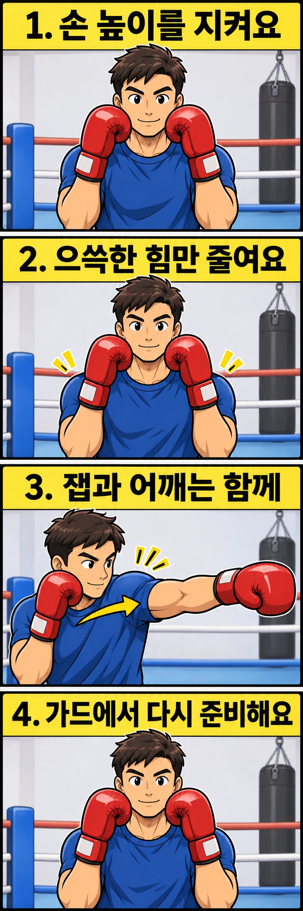

“어깨에 힘을 빼세요”라는 말을 듣고 팔을 축 늘어뜨리면 가드도 함께 내려갑니다. 그렇다고 두 어깨를 귀 가까이 끌어올린 채 굳혀 두는 것이 유일한 방법은 아닙니다. **손의 위치를 지키는 일과 어깨를 계속 으쓱하는 일을 나누어 점검해 보세요.** 여기서는 기본 가드에서 잽을 연습할 때 적용할 방법을 다룹니다.

## 잽을 뻗을 때 어깨가 움직여도 괜찮습니다

잽은 앞손으로 곧게 뻗는 펀치입니다. 팔꿈치만 펴는 것이 아니라 앞어깨와 어깨뼈도 팔의 움직임에 참여합니다. 뻗는 쪽 어깨가 앞으로 나와 턱 옆에 가까워지는 모습은, 준비 자세에서 두 어깨를 계속 위로 끌어올리는 모습과 구분해야 합니다.

England Boxing의 코칭 핸드북도 직선 펀치에서 팔을 편안하게 뻗는 것과 어깨 뒤로 턱을 보호하는 것을 함께 안내하며, 어깨 긴장으로 팔 움직임이 뻣뻣해지는 경우를 교정 항목으로 듭니다. 아래 연습은 이 두 요구를 나누어 확인해 보는 제안입니다.

따라서 어깨 힘을 빼겠다고 펀치를 내는 내내 어깨를 아래로 누르거나 뒤로 고정하지 마세요. 주먹을 충분히 뻗는 움직임까지 막을 수 있습니다. 반대로 어깨가 턱 가까이 왔다고 턱을 들어 맞출 필요도 없습니다. 시선과 턱 위치를 유지하면서 팔과 어깨가 함께 움직이도록 합니다.

이번 연습의 목표는 어깨가 전혀 움직이지 않는 자세가 아닙니다. **펀치를 끝내고 다시 준비할 때도 양쪽 어깨를 불필요하게 끌어올린 채 버티는지** 확인하는 것입니다. 상대의 공격을 막으려고 일시적으로 가드를 높이는 상황까지 같은 기준으로 판단하지는 않습니다.

## 손을 그대로 두고 준비 자세부터 바꿔 보세요

아무것도 치지 않는 섀도복싱 공간에서 코치에게 배운 기본 자세를 잡습니다. 먼저 주먹이 얼굴의 어디쯤에 있는지 확인하세요. 그 위치를 기준으로 다음과 같이 조절해 봅니다.

1. 양손은 얼굴 가까이에 두고 팔꿈치는 자연스럽게 굽힙니다. 글러브를 볼에 세게 밀어 붙이지 않습니다.
2. 어깨를 일부러 더 으쓱하고 있다면 그 힘을 조금 줄입니다. 어깨를 최대한 아래로 당기는 동작으로 바꾸지는 않습니다.
3. 손이 함께 내려왔다면 손 위치부터 다시 맞춥니다. 힘을 덜 쓰면서 같은 가드를 유지할 수 있는 범위를 찾습니다.
4. 그 자세에서 느린 잽을 뻗고 회수합니다. 앞어깨가 나갔다가 돌아오는 움직임을 허용하되, 잽을 뻗기 전부터 반대쪽 어깨까지 불필요하게 으쓱하고 있지는 않은지 살펴봅니다.

팔을 들어 두려면 힘이 필요합니다. 완전히 힘이 빠진 느낌을 정답으로 삼을 필요는 없습니다. 손을 지키면서도 다음 잽을 시작할 수 있는지, 목을 억지로 움츠린 채 기다리고 있지는 않은지가 점검 기준입니다. 가드 높이와 팔꿈치 간격은 체형과 배운 방식에 따라 조절하세요.

## 언제 굳는지에 따라 바꿀 부분이 다릅니다

**펀치를 내기 전부터 두 어깨가 올라간다면**, 세게 치려고 준비하는 과정에서 몸 전체를 미리 굳히는지 살펴보세요. 목표물을 치지 않는 느린 잽으로 바꾸고, 출발 직전에 어깨를 한 번 더 끌어올리는 동작이 있는지 확인합니다. 주먹을 보내기 전에 별도의 ‘으쓱하기’를 덧붙이지 않는 것이 과제입니다.

**한 번은 괜찮지만 연속으로 칠 때 어깨가 점점 올라간다면**, 같은 빠르기를 고집하지 말고 짧은 조합을 끝낸 직후를 확인하세요. 다음 조합을 서두르면서 준비 자세를 놓치는지, 팔을 계속 들고 있기 힘든 상태인지 구분해 봅니다. 잠깐 쉬었을 때 자세가 다시 편해지는지도 비교할 수 있습니다. 피로한 상태에서 어깨를 억지로 눌러 연습을 이어 가지 마세요.

**힘을 줄이면 손이 내려간다면**, 지금은 긴장을 줄이는 동작과 가드를 유지하는 동작을 함께 익힐 필요가 있습니다. 잽까지 추가하기 전에 가드 자세만 짧게 유지하며 조절하세요. 손을 낮춘 덕분에 어깨가 편해진 것을 자세가 좋아진 것으로 판단하지 않습니다.

어깨가 높아 보인다는 이유만으로 원인을 단정할 수는 없습니다. 코치에게는 “힘을 빼면 손도 내려가는데, 손 높이를 유지한 상태에서 어디를 조절하면 될까요?”라고 물어보세요. 자세와 실제 움직임을 함께 보여 주면 설명을 구체적으로 맞출 수 있습니다.

## 멈춰 확인한 뒤에는 동작을 다시 이어 보세요

처음에는 잽을 한 번 내고 준비 자세에서 잠깐 멈춰도 좋습니다. 손 높이와 어깨 상태를 확인하기 위한 구분 연습입니다. 익숙해지면 매번 멈추거나 어깨를 따로 내리는 절차를 없애고, 잽의 회수에서 다음 잽으로 자연스럽게 이어 보세요.

비교할 때는 속도와 동작을 비슷하게 유지합니다. 처음 동작과 나중 동작에서 양손이 같은 높이에 있는지, 잽 전에 어깨를 추가로 으쓱하는지, 펀치 사이에도 목을 계속 움츠리는지 확인하세요. 어깨를 낮추려다 주먹이 짧아지거나 가드가 내려가면 조절 폭을 줄여야 합니다. 목표는 모양 하나를 억지로 고정하는 것이 아니라, **필요한 움직임을 남기면서 계속 버티는 힘을 덜어 내는 것**입니다.

이 비접촉 연습에서 찾은 감각이 강한 타격에서도 그대로 유지된다고 가정하지는 마세요. 미트에서는 코치와 가벼운 강도부터 확인하고, 주먹과 손목을 흐느적거리게 만들어 접촉하지 않습니다. 목이나 어깨에 통증·저림이 생기면 중단하고 상태를 확인하세요. 통증을 단순히 힘이 덜 빠진 탓으로 넘기지 않습니다.

레드복싱에서 기본 자세를 점검하실 때도 “잽을 뻗는 순간과 기다리는 순간의 어깨를 나눠 봐 주세요”라고 요청해 보세요. 손을 지킬 위치와 어깨가 움직일 순간을 함께 살피면 ‘힘을 빼세요’라는 말을 자신의 동작에 더 구체적으로 적용할 수 있습니다.

## 참고 자료

- [England Boxing, Boxing Coaching Handbook Part 1 — The Straight Punches](https://www.englandboxing.org/wp-content/uploads/2026/02/EB_Boxing-Coaching-Handbook-Part-1_09_02_26.pdf): 직선 펀치의 지도 요점과 흔한 오류를 참고했습니다.
