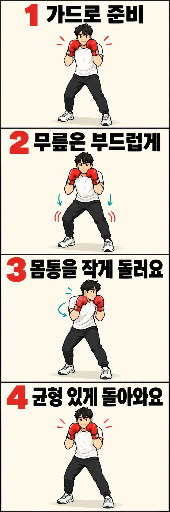

상대의 잽을 피하려고 머리를 옆으로 움직였는데, 몸이 크게 쏠려 다시 중심을 잡느라 바쁜가요? 슬립은 단순히 머리를 피하는 동작이 아니라 **공격선을 벗어난 뒤에도 가드와 균형을 유지하는 방어 기술**입니다.

## 슬립은 고개를 꺾는 동작이 아닙니다

슬립은 상대의 잽이나 스트레이트처럼 곧게 뻗는 펀치를 피하기 위해 머리를 **펀치의 진행 경로 옆으로** 옮기는 방어입니다. 머리만 옆으로 기울이는 것이 아니라 무릎과 몸통의 작은 움직임을 함께 사용합니다.

상대의 팔 바깥쪽으로 머리를 이동하는 동작을 바깥 슬립, 양팔 사이 방향으로 이동하는 동작을 안쪽 슬립이라고 부릅니다. 어느 쪽이 바깥인지는 **상대가 어떤 손으로 공격하는지, 두 선수의 자세가 어떤지**에 따라 달라집니다. 따라서 슬립 방향을 무조건 오른쪽이나 왼쪽으로 외우기보다, 실제 펀치가 지나가는 선을 기준으로 이해해야 합니다.

처음에는 코치가 잽의 방향과 피할 쪽을 정해 주는 상황에서 한 방향의 슬립부터 익히면 좋습니다. 상대의 다른 손이 이어질 수 있으므로, 머리를 옮길 때도 반대쪽 가드를 놓지 않아야 합니다.

## 몸이 옆으로 쏠리는 이유 세 가지

**첫째, 목만 꺾어 머리를 멀리 보내는 경우입니다.** 귀를 어깨 쪽으로 붙이듯 기울이면 펀치를 피하는 폭은 커 보일 수 있지만, 몸통과 머리가 따로 움직여 다음 동작을 연결하기 어렵습니다.

**둘째, 상체를 지나치게 돌리거나 허리를 깊게 접는 경우입니다.** 머리가 공격선에서 벗어나더라도 몸이 크게 흔들리면 복귀에 시간이 걸립니다.

**셋째, 발의 지지와 체중 이동이 무너지는 경우입니다.** 피한 뒤 발을 급하게 다시 디뎌야 한다면 움직임이 너무 크거나 시작 자세가 불안정할 수 있습니다.

복싱 스코틀랜드의 지도 자료에서도 슬립을 설명할 때 약간의 무릎 굽힘, 몸통 회전, 가드 유지와 과도한 회전에 따른 균형 상실을 함께 다룹니다. 핵심은 **머리를 많이 움직이는 것보다 필요한 만큼 정확하게 움직이는 것**입니다.

## 좋은 슬립은 피한 뒤의 자세에서 드러납니다

슬립의 끝에서 잠깐 멈춰 보세요. 발을 새로 디디지 않고 버틸 수 있는지, 양손이 얼굴을 보호하는지, 상대를 계속 볼 수 있는지 확인합니다.

균형을 유지하려면 무릎을 부드럽게 굽히고 몸통을 작게 움직이되, 발바닥으로 바닥을 지지하는 느낌을 잃지 않아야 합니다. 무게가 한쪽 발로 조금 옮겨갈 수는 있지만 **한쪽 다리에 몸 전체를 기대는 동작**이 되어서는 안 됩니다.

여기서 한 가지 구분해야 합니다. **균형이 좋다고 해서 실제 펀치를 피한 것은 아닙니다.** 펀치가 지나가는 공격선에서 머리가 충분히 벗어났는지는 코치와 함께 거리와 타이밍을 확인해야 합니다.

## 혼자 연습하는 슬립 4단계

1. **가드 준비:** 양발을 안정적으로 벌리고 양손을 얼굴 가까이에 둡니다. 시선은 정면을 향합니다.
2. **작게 이동:** 무릎을 살짝 굽히면서 몸통을 작게 움직여 머리를 한쪽으로 옮깁니다. 목만 꺾거나 바닥을 보지 않습니다.
3. **잠깐 멈춤:** 발을 다시 디디지 않고 중심을 유지할 수 있는지, 가드가 내려가지 않았는지 확인합니다.
4. **가드로 복귀:** 반동으로 몸을 크게 흔들지 않고 시작 자세로 돌아옵니다.

처음에는 한쪽 방향으로 세 번 정도 천천히 반복해도 충분합니다. 횟수보다 **이동·멈춤·복귀가 한 번에 통제되는지**를 확인하는 것이 중요합니다.

## 이런 모습이 보이면 이렇게 고쳐 보세요

| 연습 중 나타나는 모습 | 먼저 확인할 점 | 교정 방향 |
| --- | --- | --- |
| 고개만 옆으로 기울어집니다 | 목만 움직이고 있지 않은가요? | 이동 폭을 줄이고 몸통과 함께 움직입니다 |
| 피한 뒤 발을 급히 디딥니다 | 너무 멀리 움직이지 않았나요? | 보폭과 시작 자세를 확인하고 작은 슬립부터 반복합니다 |
| 몸이 크게 돌아갑니다 | 어깨를 과하게 돌리지 않았나요? | 상대를 볼 수 있는 범위에서 움직입니다 |
| 돌아오며 반대쪽으로 흔들립니다 | 반동에 의존하지 않았나요? | 끝에서 잠깐 멈춘 뒤 천천히 복귀합니다 |
| 피하면서 가드가 내려갑니다 | 팔을 움직임에 맡기고 있지 않나요? | 양손 위치를 유지한 채 몸통만 작게 움직입니다 |

슬립은 모양만 따라 한다고 완성되지 않습니다. 실제 공격에 맞춰 머리가 얼마나 움직여야 하는지는 상대의 거리와 펀치 궤적에 따라 달라집니다.

## 슬립 다음에는 무엇을 해야 할까요?

슬립을 배우는 이유는 펀치를 피하는 데서 끝나지 않습니다. **피한 뒤 곧바로 다시 공격하거나 다음 펀치를 방어할 수 있는 자세**를 만드는 데 있습니다.

기본 동작이 익숙해지면 코치가 미트로 잽의 경로를 보여 주고, 그 공격선을 벗어난 뒤 짧은 스트레이트를 연결하는 연습을 할 수 있습니다. 이때 피하는 동작과 반격을 서두르기보다, **슬립 직후에도 발이 안정적으로 지지되는지**를 먼저 확인합니다.

상대의 잽을 피했다고 해서 다른 손의 공격까지 사라지는 것은 아닙니다. 반격할 때도 가드와 시선을 유지하고, 실제 접촉 연습은 코치의 지도 아래 단계적으로 진행하는 것이 좋습니다.

## 복싱 슬립은 직접 교정받을 때 더 명확해집니다

혼자 연습하면 균형이 흔들리는지는 느낄 수 있어도, 실제 펀치의 공격선에서 머리가 벗어났는지 판단하기는 어렵습니다.

레드복싱 행신점과 을지로점에서는 기본 자세와 가드, 슬립의 이동 범위를 코치와 함께 점검하며 **방어에서 반격으로 이어지는 움직임**을 배워볼 수 있습니다. 머리를 크게 피하는 것보다 **다음 동작이 가능한 자세를 남기는 것**부터 익혀 보세요.

## 참고 자료

- [잉글랜드 복싱 기초 코칭 안내서, 바깥 슬립, 인쇄면 85쪽](https://www.englandboxing.org/wp-content/uploads/2022/03/EB_Boxing-Coaching-Handbook-Part-1_v8-002.pdf)
- [복싱 스코틀랜드 지도 자료, 몸통 방어와 슬립](https://www.boxingscotlandtoolkit.org/session-delivery/defence-use-trunk-defence-if-no-use-of-lower-body-etc/)
