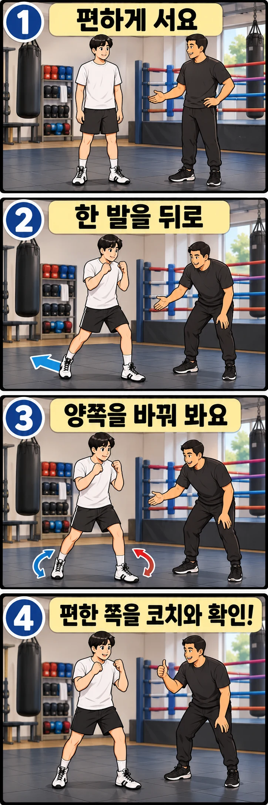

복싱을 처음 배우면 어느 발을 앞에 놓아야 할지부터 헷갈릴 수 있습니다. 평소 오른손을 주로 쓰는데 오른발을 앞에 두어도 되는지, 두 발은 얼마나 벌려야 하는지 궁금하기도 하죠.

복싱 스탠스는 단순히 편하게 서 있는 자세가 아닙니다. **펀치를 뻗고, 상대의 공격을 피하고, 어느 방향으로든 움직일 준비를 하는 기본 자세**입니다. 먼저 앞발을 정하는 기준부터 알아보겠습니다.

## 오른손잡이는 왜 왼발을 앞에 둘까요?

복싱에서는 보통 오른손잡이가 왼발을 앞에 두는 **오소독스(Orthodox)** 자세를 배웁니다. 반대로 왼손잡이는 오른발을 앞에 두는 **사우스포(Southpaw)** 자세를 많이 사용합니다.

오소독스를 기준으로 왼손은 앞손, 오른손은 뒷손이 됩니다. 앞손은 잽으로 거리를 확인하고 공격의 시작을 만드는 데 자주 사용하며, 뒷손은 몸통과 하체의 회전을 연결해 스트레이트를 뻗을 때 중요한 역할을 합니다.

일반적으로 주로 사용하는 손을 뒤에 두는 이유도 여기에 있습니다. **익숙하고 힘을 쓰기 좋은 손을 뒷손 펀치에 활용하기 위해서**입니다.

다만 오른손잡이라고 반드시 오소독스만 써야 하는 것은 아닙니다. 손잡이와 스탠스가 다른 선수도 있고, 기존 운동 경험이나 움직임의 특성에 따라 반대 자세가 더 적합할 수 있습니다. 처음에는 일반적인 기준으로 시작하되, 최종 선택은 코치와 함께 판단하는 것이 좋습니다.

## 두 발은 어떻게 놓아야 할까요?

오소독스 자세를 기준으로 설명하겠습니다. 사우스포라면 좌우를 반대로 적용하면 됩니다.

1. 정면을 보고 편안하게 섭니다.
2. 오른발을 뒤로 보내 왼발이 앞에 오도록 합니다.
3. 두 발을 앞뒤로만 놓지 말고 좌우로도 적당히 벌립니다.
4. 무릎을 가볍게 굽히고 양손을 얼굴 가까이 올립니다.
5. 턱을 살짝 당긴 상태에서 앞을 바라봅니다.

발을 앞뒤로 벌리는 거리와 좌우 폭에는 모두에게 맞는 하나의 정답이 없습니다. 다만 **두 발이 일직선으로 겹치면 좌우 균형을 잡기 어렵고, 지나치게 넓게 벌리면 이동이 둔해질 수 있습니다.**

처음에는 발을 움직이지 않고도 편안하게 균형을 잡을 수 있는 위치를 찾아보세요. 발뒤꿈치를 억지로 높이 들거나 무릎을 뻣뻣하게 펼 필요는 없습니다.

## 좋은 스탠스는 움직여 보면 알 수 있습니다

가만히 서 있을 때 안정적인 자세라도 실제로 움직이면 불편할 수 있습니다. 복싱에서는 공격과 방어를 위해 계속 발을 움직이기 때문입니다.

기본 자세를 잡았다면 다음 동작을 천천히 해 보세요.

- **앞으로 이동:** 앞발을 먼저 움직이고 뒷발이 따라옵니다.
- **뒤로 이동:** 뒷발을 먼저 움직이고 앞발이 따라옵니다.
- **왼쪽으로 이동:** 왼발을 먼저 움직이고 오른발이 따라옵니다.
- **오른쪽으로 이동:** 오른발을 먼저 움직이고 왼발이 따라옵니다.

어느 방향으로 움직이든 두 발이 지나치게 붙거나 교차하지 않도록 주의하세요. 이동한 뒤에도 처음과 비슷한 발 간격을 유지하면 다음 펀치나 방어 동작으로 연결하기 쉽습니다.

처음부터 빠르게 움직일 필요는 없습니다. 한 걸음 이동한 뒤 잠깐 멈춰 균형을 확인하고, 익숙해지면 자연스럽게 이어 보세요.

## 양쪽 스탠스를 비교할 때 확인할 점

어느 발을 앞에 두는 것이 좋은지 고민된다면 양쪽 자세를 잠깐 비교해 볼 수 있습니다. 다만 **몇 초 서 봤을 때 편하다는 이유만으로 스탠스를 결정하지는 마세요.**

왼발을 앞에 둔 자세와 오른발을 앞에 둔 자세에서 다음 항목을 살펴보세요.

| 확인할 동작 | 살펴볼 점 |
| --- | --- |
| 양손 가드 올리기 | 어깨와 팔에 지나치게 힘이 들어가지 않는지 |
| 앞뒤로 한 걸음 움직이기 | 발이 꼬이지 않고 균형을 유지하는지 |
| 앞손 잽 뻗기 | 주먹을 뻗은 뒤 자세가 크게 무너지지 않는지 |
| 뒷손 스트레이트 연결하기 | 하체와 몸통 회전을 자연스럽게 연결할 수 있는지 |
| 가드로 돌아오기 | 펀치를 친 뒤에도 다음 동작을 준비할 수 있는지 |

한쪽 자세가 낯설다고 반드시 잘못된 선택은 아닙니다. 처음 배우는 동작은 어느 쪽이든 어색할 수 있습니다. 손잡이, 움직임, 펀치 연결을 함께 보고 코치와 기본 스탠스를 정하는 편이 좋습니다.

## 초보자가 자주 하는 실수

**두 발을 일직선으로 놓는 경우**

줄 위에 서 있는 것처럼 앞발과 뒷발이 겹치면 옆으로 흔들리기 쉽습니다. 두 발 사이에 좌우 간격을 확보해 보세요.

**발을 너무 넓게 벌리는 경우**

안정적으로 느껴질 수 있지만 발을 옮기거나 방향을 바꾸기 어려워집니다. 한 걸음 이동한 뒤에도 자세를 유지할 수 있는 폭으로 조절하세요.

**상체를 지나치게 앞으로 숙이는 경우**

앞발에 체중이 과하게 쏠리면 뒤로 물러나거나 뒷손을 뻗을 때 균형을 잃기 쉽습니다. 무릎을 가볍게 굽히되 상체를 억지로 앞으로 던지지 마세요.

**발끝 모양만 신경 쓰는 경우**

발끝의 방향도 중요하지만, 그보다 먼저 균형과 이동이 자연스러운지 확인해야 합니다. 발 모양만 맞추느라 무릎이나 골반을 억지로 비틀지 마세요.

## 스탠스를 정했다면 기본 동작부터 익혀 보세요

처음에는 한쪽 스탠스를 정해 잽과 스트레이트, 앞뒤 이동을 반복해 보세요. 동작을 연습할 때마다 앞발을 바꾸면 몸에 익히기 어려울 수 있습니다.

중요한 것은 **어느 발이 앞에 있는지만 기억하는 것이 아니라, 그 자세에서 공격하고 방어하며 균형을 유지할 수 있는지**입니다.

레드복싱 행신점에서는 초보자의 손잡이와 움직임을 살펴 기본 스탠스를 잡고, 잽과 스트레이트, 스텝까지 차근차근 지도합니다. 복싱을 처음 시작한다면 혼자 자세를 고민하기보다 코치와 함께 자신에게 맞는 기본 자세부터 익혀 보세요.
