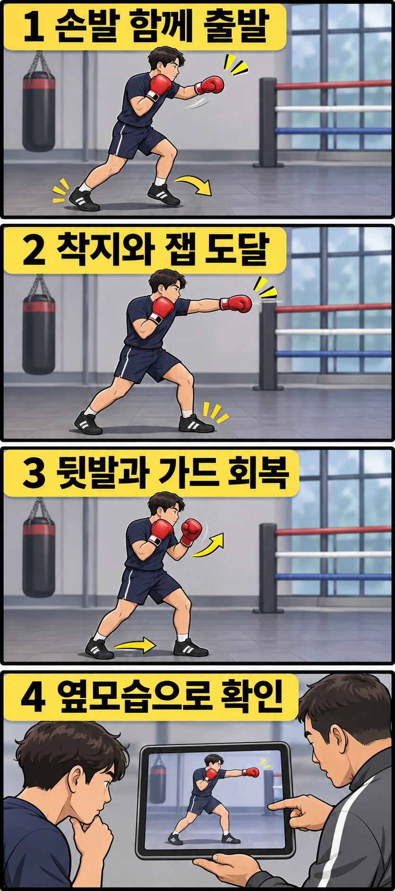

앞으로 한 걸음 들어가 잽을 치는데, 발이 먼저 멈춘 뒤에야 손이 나가나요? 이동 후 자세를 확인하고 치는 연습은 기본기를 나눠 익힐 때 유용합니다. 다만 **전진하는 동안 잽을 도달시키려는 상황**이라면 걸음과 펀치를 한 흐름으로 연결해야 합니다. 여기서는 앞발 착지와 잽이 목표에 닿는 시점을 가깝게 맞추는 기본 전진 잽을 연습합니다.

## 발과 손을 왜 한 박자로 연결할까요?

잽은 앞에 둔 손으로 뻗는 직선 펀치입니다. 전진 잽에서는 한 걸음으로 거리를 좁히는 동안 앞손도 목표를 향해 나갑니다. 몸이 먼저 가까워지고 손이 뒤늦게 출발하면, 상대에게 접근하는 구간과 공격하는 구간이 분리됩니다. 상대의 반응에 따라 그 사이에 거리가 다시 벌어지거나 반격이 들어올 수 있습니다.

이번 연습의 기준은 **앞발이 바닥을 다시 짚을 무렵 잽도 목표에 도달하는 것**입니다. 발로 바닥을 세게 찍어 소리를 내라는 뜻은 아닙니다. 앞발을 옮기는 동안 팔이 뻗어지고, 도달 뒤에는 손을 회수하며 다음 움직임을 준비합니다.

모든 전진 잽이 정확히 같은 시점에 맞아야 하는 것은 아닙니다. 먼저 잽을 보여 주며 들어가거나 상대의 움직임에 맞춰 박자를 바꾸기도 합니다. 여기서는 의도한 변화를 배우기 전에, 걸음이 끝날 때까지 손이 기다리는 습관을 구분하는 데 집중합니다.

## 앞발을 옮기는 동안 손도 출발하게 해 보세요

왼발·왼손이 앞인 자세를 기준으로 설명합니다. 오른발이 앞이라면 좌우를 바꿔 적용하세요. 평소 가드에서 앞쪽을 보고, 무릎을 가볍게 굽힌 채 시작합니다. 앞손을 미리 길게 내밀어 놓고 발만 따라가는 연습과는 구분합니다.

1. 뒷발로 바닥을 밀어 몸이 앞으로 이동하도록 하며 앞발을 짧게 옮깁니다. 이때 앞손도 목표를 향해 출발시킵니다.
2. 앞발이 다시 바닥에 닿을 무렵 잽이 충분히 뻗어지도록 연결합니다. 뒷손은 얼굴 옆을 지키고, 상체만 앞쪽으로 내던지지 않습니다.
3. 잽을 회수하는 흐름에 뒷발을 따라오게 해 평소 발 간격을 되찾습니다. 손과 발을 모두 정리한 뒤에도 앞을 보며 다음 동작을 준비합니다.

처음에는 허공의 목표를 향해 천천히 움직이세요. 팔은 자연스럽게 길게 뻗되 끝에서 팔꿈치를 세게 튕기지 않습니다. 뒷발을 바닥에 붙여 둔 채 앞발과 손만 멀리 보내면 자세가 길어지므로, 잽 끝 모양뿐 아니라 따라오는 뒷발까지 한 동작으로 보세요.

## 늦은 손과 긴 걸음을 나눠 확인하세요

손이 늦는 것처럼 보여도 원인은 다를 수 있습니다. 먼저 제자리에서 가볍게 잽을 뻗어 보고, 같은 손 동작에 짧은 전진을 더해 비교해 보세요.

**앞발을 딛고 나서 손이 출발한다면**, 발을 옮기는 일을 먼저 끝내려는 순서가 붙었을 수 있습니다. 이동 폭을 줄이고, 앞발이 움직이는 동안 앞손도 가드에서 나오는지 확인합니다. 발을 재빨리 옮겨 손을 기다리게 하는 대신 두 동작의 시작을 연결해 보세요.

**손은 함께 출발하지만 팔이 다 뻗은 뒤에도 앞발이 이동 중이라면**, 보폭이 길거나 손을 지나치게 빨리 끝내고 있을 수 있습니다. 우선 걸음을 줄여 비교합니다. 몸을 더 멀리 던지거나 주먹을 뻗은 채 기다리는 것으로 맞추지 마세요.

**착지와 잽은 맞는데 다음 움직임이 어렵다면**, 뒷발이 남아 있는지 살펴봅니다. 이 경우에는 손을 더 빠르게 하는 것보다 따라오는 발까지 연결하는 것이 우선입니다. 잽 뒤 곧바로 짧게 물러날 수 있는지도 확인해 보세요. 발을 다시 모으거나 몸을 크게 젖혀야 한다면 이동 폭과 마무리 자세를 조정합니다.

## 옆에서 보고 한 가지 시점만 비교해 보세요

주변을 비우고 전신이 보이도록 옆모습을 짧게 촬영합니다. 촬영 기기를 보려고 고개를 돌리지 말고 정면의 목표를 보세요. 영상을 멈춰 **앞발이 처음 바닥에 닿는 순간 손이 어디에 있는지** 확인합니다.

그때 손이 아직 가드에 있는지, 뻗어지는 중인지, 이미 회수 중인지를 비교하면 박자를 구분하기 쉽습니다. 한 프레임의 완벽한 일치에 집착할 필요는 없습니다. 걸음과 잽 사이에 뚜렷한 멈춤이 있는지 살피는 용도입니다. 발소리만으로는 조용히 딛는 순간을 놓칠 수 있으니 손과 발을 함께 보세요.

동작을 고친 뒤에는 멈춰 보지 않고 정상 속도로도 확인합니다. 출발·도달·회수가 끊기지 않고, 잽 뒤에도 균형을 유지하는지가 최종 기준입니다.

## 미트에서는 도달하는 순간을 함께 맞춰 보세요

비접촉 연습이 이어지면 코치와 고정된 미트에 가볍게 전진 잽을 맞춰 볼 수 있습니다. 이동 뒤 팔이 자연스럽게 뻗어 닿을 거리를 먼저 정하고, 미트를 갑자기 움직이지 않는 조건에서 시작합니다. 혼자 타이밍을 시험하려고 다른 사람에게 잽을 뻗지 마세요.

미트까지 닿지 않는다고 걸음부터 크게 늘리지는 않습니다. 시작 거리가 먼지, 몸이 이동하는 동안 손이 먼저 끝나는지, 미트가 뒤로 움직였는지를 코치와 구분하세요. 반대로 너무 가까워 팔이 접힌다면 출발 위치나 보폭을 조절합니다. 소리가 크게 나는지보다 **목표에 닿을 때 발의 지지가 이어지고, 타격 뒤 자세를 회복하는지**를 확인합니다.

통증이 생기거나 균형을 잃으면 멈추고 자세와 강도를 조정하세요. 느린 속도에서 손발이 연결된 뒤 속도를 올리며, 강도와 보폭까지 한꺼번에 늘리지는 않습니다.

레드복싱에서 전진 잽을 점검할 때는 “앞발을 딛는 순간 제 손이 너무 늦게 나오나요?”라고 질문해 보세요. 발 순서만 확인하는 것에서 한 걸음 더 나아가, 거리를 좁히는 움직임과 잽이 실제로 이어지는지 살펴볼 수 있습니다.