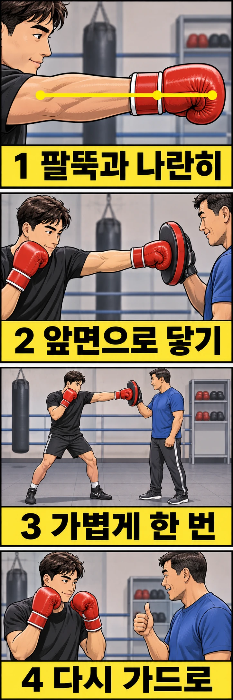

잽이나 뒷손 스트레이트를 뻗을 때 글러브만 목표를 향하게 만들다 보면, 손목을 위아래나 옆으로 꺾어 방향을 맞추기도 합니다. 이때는 손목에 힘을 더 주기 전에 **주먹이 팔뚝과 어떤 선으로 이어지는지, 목표의 어느 면에 닿는지**부터 나눠 살펴보세요.

이 글은 얼굴 높이의 고정된 목표를 향한 기본 직선 펀치 연습을 기준으로 설명합니다. 훅이나 어퍼컷의 접촉 각도까지 같은 모양으로 맞추려 하지는 마세요.

## 손바닥을 돌리는 것과 손목을 꺾는 것은 다릅니다

손바닥이 아래를 향하도록 주먹을 돌리는 동작과, 손등을 팔뚝 쪽으로 젖히는 동작은 다릅니다. 팔뚝과 주먹이 함께 돌아가면 손바닥 방향은 바뀌어도 손목을 곧게 유지할 수 있습니다. 반면 손등만 뒤로 젖히거나 주먹을 새끼손가락 쪽으로 기울이면 손과 팔뚝 사이에 꺾임이 생깁니다.

잉글랜드 복싱의 코칭 안내서는 펀치의 기본 원칙으로 손목을 곧게 유지하도록 권합니다. 여기서 연습할 기준도 **주먹과 팔뚝이 꺾이지 않고 이어지는가**입니다. 팔 전체를 뻣뻣하게 굳히라는 뜻은 아닙니다. 어깨와 팔꿈치는 펀치에 맞춰 움직이면서, 접촉 순간 주먹만 다른 방향으로 접히지 않게 하는 데 집중하세요.

글러브의 두툼한 외형만으로 내부 손목 각도를 정확히 알기는 어렵습니다. 먼저 맨손으로 모양을 살핀 뒤, 타격할 때는 핸드랩과 글러브를 착용하고 다시 확인하는 편이 좋습니다.

## 아무것도 치지 않고 두 방향에서 살펴보세요

편안한 가드에서 앞손을 천천히 뻗어 봅니다. 손가락을 말아 주먹을 쥐되 엄지는 주먹 바깥에 놓습니다. 먼저 옆에서 손등과 팔뚝이 만나는 부분을 확인하고, 다음에는 위에서 주먹이 좌우로 기울지 않는지 살펴보세요. 손목을 억지로 눌러 직선으로 만들지는 마세요.

혼자 보기 어렵다면 팔을 낮춰 편한 위치에서 모양을 확인한 뒤 다시 펀치 높이로 올리세요. 코치에게 옆과 위에서 봐 달라고 요청해도 좋습니다. 주먹을 보기 위해 펀치를 뻗는 내내 고개를 숙일 필요는 없습니다.

천천히 뻗고 가드로 돌아오는 동안 모양이 유지되는지 확인합니다. 잽이 편해지면 뒷손 스트레이트에서도 살펴보세요. 몸통이 돌아갈 때 주먹만 뒤늦게 비틀어 방향을 맞추고 있지는 않은지 관찰합니다. 이 점검은 손목의 움직임을 알아보는 연습이며, 실제 충격을 잘 받을 수 있다는 확인까지 대신하지는 못합니다.

## 목표를 향한 팔의 방향도 함께 맞추세요

손목이 곧아도 주먹이 목표를 스치듯 비스듬히 닿을 수 있습니다. 예를 들어 몸은 백의 한쪽을 향하는데 손만 옆으로 꺾어 백의 가운데를 노리면, 마지막 순간 손목으로 방향을 보정하게 됩니다. 이때는 손목 모양만 고치기보다 **서 있는 위치와 펀치가 향하는 곳**을 함께 확인하세요.

처음에는 움직이지 않는 미트를 얼굴 높이에 두고, 코치와 거리를 맞춰 직선으로 뻗어 봅니다. 글러브의 손가락 관절 앞쪽 패딩이 표적을 향하도록 하되, 손목을 꺾어 앞면을 억지로 붙이지 않습니다. 미트의 높이와 기울기, 수련자의 위치를 함께 조정해야 할 수도 있습니다.

샌드백에서는 옆으로 둥글게 말려 들어간 면을 따라 손목을 구부리지 마세요. 치려는 지점 앞쪽으로 자리를 바꾸거나 백이 잦아든 뒤 시작해 보세요. 정상적으로 팔을 뻗을 수 있는 거리에서 연습하며, 손목을 지키려고 펀치를 늘 짧게 끊을 필요는 없습니다.

## 어느 순간에 꺾이는지에 따라 점검을 달리하세요

**닿기 전부터 모양이 달라진다면** 손바닥을 돌리는 과정에서 손등을 함께 젖히는지 살펴보세요. 속도를 낮추고 비접촉 동작으로 돌아가, 팔뚝과 주먹이 함께 돌아가는 감각부터 확인합니다.

**접촉할 때만 꺾인다면** 타격을 멈추고 거리와 표적 방향을 다시 맞춥니다. 너무 먼 곳을 손목으로 뻗어 맞추거나 비스듬한 면에 닿는지 확인하세요. 글러브 안에서 손이 움직이거나 손목 부분이 헐거운지도 함께 살펴봅니다. 이런 관찰만으로 원인을 하나로 확정할 수는 없습니다.

**연속으로 칠 때만 흐트러진다면** 펀치를 한 번씩 칠 때와 비교해 보세요. 횟수가 늘며 접촉 위치가 달라지는지, 회수하는 손을 급히 돌리다가 다음 펀치를 시작하는지 구분합니다. 한 번씩 칠 때는 유지되는데 연타에서 달라진다면, 당장은 단발로 돌아가 접촉과 회수를 연결하는 편이 좋습니다.

핸드랩이나 손목 끈을 더 세게 조이는 것만으로 동작 문제를 해결하려 하지는 마세요. 손이 저리거나 불편할 정도로 조이지 말고, 착용 상태는 코치와 함께 확인하세요.

## 가벼운 한 발을 가드 복귀까지 이어 보세요

비접촉 동작이 편해지면 코치가 든 고정된 미트에 힘을 낮춰 한 발씩 쳐 봅니다. 코치는 접촉 전후의 손목을 관찰하고, 수련자는 앞을 보며 주먹을 가드로 되돌립니다. 표적에 글러브를 댄 채 체중을 싣거나, 상대가 손목을 눌러 버티는 힘을 시험하는 방식은 쓰지 마세요.

한 발을 친 다음에는 잠깐 멈춰 피드백을 듣습니다. 손목 정렬이 유지되는지와 함께 반대손 가드, 몸의 균형도 확인하세요. 접촉만 맞추느라 몸이 앞으로 쏠렸다면 거리부터 다시 조정합니다. 안정되면 매번 길게 멈추지 않고 펀치와 회수를 부드럽게 이어 갑니다. 속도와 힘은 코치가 관찰할 수 있는 범위에서 점차 높이세요.

손목에 통증이 생기면 강도를 높여 시험하지 말고 타격을 중단하세요. 이 연습은 통증의 원인을 진단하거나 치료하기 위한 방법이 아닙니다.

다음 연습에서는 “손목이 곧나요?”에 더해 **“닿기 전과 닿은 직후 중 언제 모양이 달라지나요?”**라고 물어보세요. 어느 순간을 고쳐야 할지 더 구체적으로 확인할 수 있습니다.

## 참고 자료

- [잉글랜드 복싱 Level 2 코칭 안내서](https://www.englandboxing.org/wp-content/uploads/2022/03/Level-2-Coaching-Handbook-compressed.pdf): 펀치의 기본 원칙 중 손목을 곧게 유지하라는 지도 기준을 참고했습니다. 위의 단계별 관찰과 연습 순서는 이 글에서 제안한 방법입니다.
