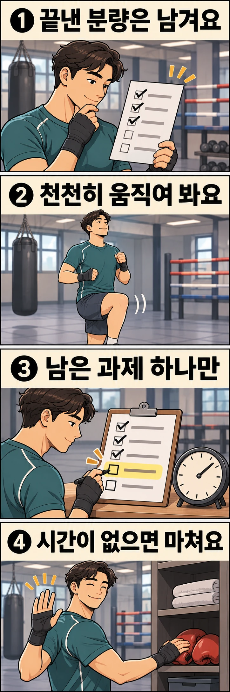

## 끊긴 라운드를 처음부터 다시 해야 할까요?

혼자 복싱 연습을 하다가 급한 연락을 받고 자리를 비웠다고 가정해 보겠습니다. 돌아와 보니 계획했던 라운드를 모두 하기에는 시간이 모자랍니다. 끝낸 운동까지 지우고 처음부터 다시 하거나, 휴식을 줄여 남은 양을 밀어 넣어야 할까요?

**끝낸 분량은 남겨 두고, 다시 움직일 준비와 남은 시간을 확인한 뒤 오늘의 계획을 줄여 보세요.** 아래는 기본 동작을 배운 성인이 비접촉 개인 연습을 재구성하는 제안입니다. 실제 참가자에게 적용해 성과를 측정한 프로그램은 아닙니다. 수업 중이라면 코치에게 다시 시작할 과제를 확인하세요.

## 끝냄·도중에 멈춤·아직 안 함을 나누세요

준비운동 뒤 섀도복싱 2라운드와 샌드백 2라운드를 계획했다고 해 보겠습니다. 섀도복싱은 허공에 펀치와 움직임을 연결하는 연습입니다. 섀도복싱 첫 라운드를 끝내고 두 번째 라운드의 절반에서 연락을 받았다면 다음처럼 구분합니다.

- 섀도복싱 첫 라운드: 완료했습니다.
- 섀도복싱 두 번째 라운드: 절반 정도 진행하다 멈췄습니다.
- 샌드백: 아직 시작하지 않았습니다.

멈춘 라운드를 완료로 세지도, 앞서 끝낸 라운드까지 없던 일로 처리하지도 않습니다. 타이머가 계속 돌아갔다면 화면의 시간과 실제 움직인 시간도 구분하세요. 초 단위로 복원하려 애쓸 필요는 없습니다. ‘중간에 멈춤’ 표시만으로도 다음 선택에 필요한 정보가 됩니다.

## 돌아오면 타격 전에 움직임을 확인하세요

이 계획에서는 ‘10분 이상 끊기면 무조건 처음부터’ 같은 경계값을 두지 않습니다. 자리를 비운 동안 앉아 있었는지, 계속 걸었는지, 돌아왔을 때 움직임이 어떤지도 함께 확인해 보세요.

먼저 주변 공간과 장비를 다시 살피세요. 그사이 다른 사람이 샌드백을 쓰고 있다면 연습 중인 사람 옆으로 바로 들어가지 않습니다. 자리가 확보되면 편한 걷기나 작은 스텝, 배운 동작의 느린 섀도복싱을 차례로 해 보세요. 속도를 올리기보다 움직임을 살피는 데 집중합니다.

몸이 뻣뻣하거나 동작이 계속 흐트러진다면 확인 시간을 늘리거나 오늘 연습을 마치세요. 통증이나 어지럼증 때문에 멈췄던 경우에는 이 재개 예시를 적용하지 마세요. 증상이 남아 있다면 운동을 이어 가지 않고 필요한 도움을 받으세요.

## 남은 12분을 다시 배정하는 예시입니다

일정 때문에 잠시 자리를 비웠고, 돌아온 뒤 연습 장소를 떠나기까지 12분이 남았다고 가정하겠습니다. 다음 배분은 보편적인 준비운동 기준이 아니라 **재개 확인과 마무리까지 시간을 남겨 두는 예시**입니다.

| 시간 배정 | 할 일 | 선택 기준 |
| --- | --- | --- |
| 처음 3분 | 편한 걷기·작은 스텝에서 느린 섀도복싱으로 이어 갑니다. | 배운 움직임을 편하게 할 수 있는지 살핍니다. 부족하면 이 구간을 늘립니다. |
| 다음 6분 | 익숙한 섀도복싱 2분과 휴식 1분을 두 번 반복합니다. | 몰아치기보다 오늘 정한 연습 과제 하나를 수행합니다. |
| 마지막 3분 | 편한 움직임으로 마치고 장비를 정리합니다. | 종료 시각에 쫓겨 타격을 추가하지 않습니다. |

원래 계획에 샌드백이 있었어도 이 예시에서는 빼 둡니다. 남은 짧은 시간에는 이미 하던 비접촉 과제 하나로 마치는 선택입니다. 오늘의 목적이 코치와 정한 샌드백 과제였다면, 재개 확인 뒤 코치와 상의해 섀도복싱 대신 그 과제만 짧게 남길 수도 있습니다. 두 과제를 모두 더하지는 마세요.

재개 확인에 5분이 필요했다면 연습 구간을 줄이세요. 시간을 맞추려고 펀치를 더 빨리 치거나 휴식을 없애지 않습니다. 입문자는 익숙한 단일 동작으로, 경험자는 배운 짧은 연결 동작으로 과제를 고르되, 끊겼던 날이라는 이유로 난도를 올릴 필요는 없습니다.

## 시간이 거의 없으면 끝내는 것도 계획입니다

돌아온 뒤 4분밖에 남지 않았다면 위의 예시를 세 배 빠르게 실행하지 마세요. 주변을 정리하고 편하게 움직이며 마무리하는 쪽으로 바꿀 수 있습니다. ‘연습을 다시 확인하고 짧은 과제까지 할 여유가 있는가?’에 답하기 어렵다면 추가 라운드를 생략하세요.

남긴 분량을 다음 운동에 빚처럼 붙이지도 마세요. 다음번에는 원래 예정한 계획에서 시작하고, 그날의 시간과 상태에 맞춰 조정합니다. 같은 일정 때문에 자주 끊긴다면 연락을 처리한 뒤 개인 연습을 시작하거나, 중단될 가능성이 큰 시간대에는 과제 수를 처음부터 줄여 보세요.

기록은 ‘섀도복싱 1라운드 완료, 다음 라운드 중단, 복귀 후 짧게 재개’ 정도면 충분합니다. 중단된 날과 중단 없이 끝낸 날의 라운드 수를 그대로 비교해 실력이 떨어졌다고 판단하지 마세요. 수행 조건이 달랐다는 표시를 남기는 데 의미가 있습니다.

## 오늘 끝낸 운동을 인정하고 다음 선택을 하세요

연습이 끊겼다면 끝낸 분량을 표시하고, 재개할 움직임을 확인한 뒤 남은 시간 안에서 과제 하나를 고르거나 마무리하세요. 지금 실행할 수 있는 계획을 만드는 것이 목표입니다.

레드복싱에서 연습할 때도 ‘오늘 여기까지 했고, 지금은 이만큼 시간이 남았습니다’라고 알려 보세요. 어디서 다시 시작할지 상의하는 데 구체적인 출발점이 됩니다.
