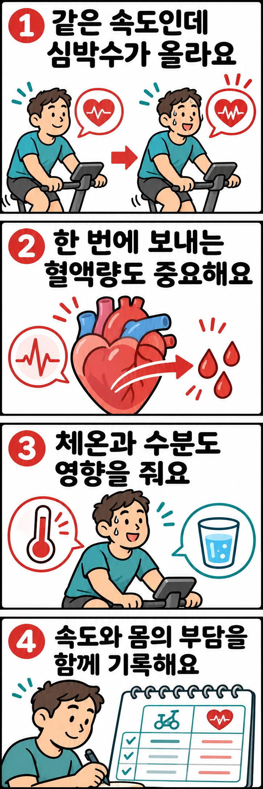

실내 자전거의 저항과 회전수를 그대로 유지했는데 후반에는 심박수가 더 높아질 수 있습니다. 운동량을 늘린 것도 아닌데 숫자가 오른다면 체력이 갑자기 떨어진 걸까요? **한 번의 운동 안에서 심박수가 서서히 오르는 현상은, 몇 주간 훈련한 뒤 체력이 달라지는 것과 구분해서 해석해야 합니다.**

## 박동 횟수가 늘면 혈류도 반드시 늘어날까요?

심박수는 1분 동안 심장이 뛰는 횟수입니다. 일회박출량은 심장이 한 번 수축할 때 내보내는 혈액량이고, 심박출량은 1분 동안 내보내는 혈액량입니다. 관계는 **심박출량 = 심박수 × 일회박출량**입니다.

따라서 한 번에 내보내는 양이 줄면 더 자주 뛰면서 분당 혈류를 유지할 수 있습니다. 심박수가 높아졌다는 사실만으로 혈류나 근육의 에너지 소비가 같은 비율로 증가했다고 계산할 수는 없습니다.

일정한 강도의 운동을 오래 이어 갈 때 일회박출량이 낮아지고 심박수가 점차 오르는 양상을 **심혈관 드리프트**라고 부릅니다. 단순히 운동 시작과 동시에 심박수가 빨라지는 반응과는 다릅니다. 다만 손목 기기의 숫자만으로 일회박출량 감소까지 확인할 수는 없습니다.

## 심장으로 돌아오는 양과 채울 시간이 함께 작용합니다

심장은 수축하기 전에 이완하면서 혈액을 받습니다. 돌아오는 혈액과 채울 시간이 충분해야 다음 박동에서 내보낼 양을 확보하기 쉽습니다. 심박수가 빨라지면 박동 사이의 간격, 특히 이완에 쓸 수 있는 시간이 짧아집니다. 이것이 심장에 혈액이 차는 과정에 영향을 줄 수 있습니다.

오래 운동하며 체온이 오르고 수분을 잃는 상황도 순환 조건을 바꿉니다. 혈액량 감소는 심장으로 돌아올 혈액을 제한할 수 있고, 체온 상승은 심박수를 높이는 데 관여할 수 있습니다. 그래서 ‘한 번에 적게 보내니 더 빨리 뛴다’는 보상만으로 전체 현상을 설명하기 어렵습니다. 빨라진 박동 자체가 충만을 제한하는 방향으로 작용할 수도 있기 때문입니다.

그렇다고 ‘피부로 혈액이 계속 몰려서 생긴다’거나 ‘전부 탈수 때문이다’라고 단정할 수도 없습니다. 어떤 조건에서 측정했는지를 봐야 합니다. [심장 충만과 심박수에 관한 연구](https://journals.physiology.org/doi/10.1152/jappl.1999.86.3.799)

## 심박수 상승을 억제한 실험은 무엇을 보여 줬을까요?

Fritzsche와 동료들의 1999년 실험에서는 활동적인 남성 7명이 27°C, 상대습도 40% 미만에서 최고산소섭취량의 약 57% 강도로 60분간 자전거를 탔습니다. 위약 조건에서는 운동 15분에서 55분 사이 심박수가 11% 증가하고 일회박출량은 13% 감소했습니다. 심박출량은 유지됐습니다.

연구진이 약물로 후반 심박수 상승을 억제한 조건에서는 일회박출량 감소도 나타나지 않았습니다. 피부 혈류 반응은 두 조건이 비슷했습니다. 이 결과는 **이 실험 조건에서 후반 일회박출량 감소에 심박수 상승이 관여했다**는 근거입니다. 피부 혈류가 계속 증가해야만 드리프트가 생긴다는 설명과도 맞지 않습니다. 약물은 기전을 분리하기 위한 연구 수단이며 운동 중 심박수를 낮추는 실천법이 아닙니다. [연구 원문](https://journals.physiology.org/doi/10.1152/jappl.1999.86.3.799)

한편 González-Alonso와 동료들의 1997년 지구력 운동선수 대상 실험은 높은 체온과 탈수 조건을 분리해 비교했습니다. 대조 조건보다 심부체온이 약 1°C 높은 경우와 체중의 약 4%를 잃은 탈수 조건은 각각 일회박출량을 낮추고 심박수를 높였습니다. 두 조건이 겹쳤을 때는 심박수 증가만으로 심박출량을 유지하지 못했습니다. 이는 체온·수분 상태에 따라 순환 부담이 달라진다는 결과이지, 그 수준의 탈수를 견디며 운동하라는 기준이 아닙니다. [연구 초록](https://pubmed.ncbi.nlm.nih.gov/9104860/)

두 실험은 한 번의 운동 중 나타난 급성 반응을 다룹니다. 장기 훈련 효과를 비교한 연구가 아니며, 소규모 성인 실험과 지속적인 자전거 운동의 결과를 모든 연령이나 복싱 라운드에 그대로 적용할 수는 없습니다. 첫 실험의 변화율도 개인에게 적용할 정상 범위가 아닙니다.

## 기록에는 속도와 몸의 부담을 따로 남겨 보세요

이 원리를 활용하려면 심박수 하나로 운동 강도를 판정하기보다 **외부에서 한 일과 몸의 반응을 나누어 기록**하는 편이 유용합니다. 다음은 연구의 검증된 처방이 아니라 기록을 해석하기 위한 예시입니다.

평소 하던 실내 자전거 운동에서 저항과 회전수를 유지한 구간을 고릅니다. 준비운동 직후의 상승 구간을 피하고, 중간과 후반의 심박수에 ‘숨이 얼마나 찬지’와 ‘얼마나 힘든지’를 함께 적습니다. 실내 온도나 선풍기 사용처럼 달라진 조건도 한 줄 남깁니다. 후반 숫자가 오른다고 일부러 운동을 연장할 필요는 없습니다.

- 저항·회전수가 같아도 심박수와 체감 부담이 함께 올랐다면, 같은 외부 작업을 유지하는 데 몸의 부담이 커진 것으로 해석할 수 있습니다. 원인이 탈수인지 체온인지까지 기록만으로 확정하지는 않습니다.
- 일정한 심박수 범위에서 편하게 운동하려는 날이라면 후반에 저항이나 속도를 낮출 수 있습니다. 이때 작업량 감소를 곧바로 체력 저하로 읽지 않습니다.
- 다른 날과 체력을 비교할 때는 운동 후 몇 분째인지도 맞춥니다. 오늘 초반과 지난번 후반을 비교하면 시간 경과의 영향을 훈련 효과로 오해하기 쉽습니다.

복싱은 타격 횟수·힘·스텝·휴식이 계속 바뀌므로 ‘같은 라운드 길이’가 ‘같은 작업량’을 뜻하지 않습니다. 후반 심박수 상승을 모두 드리프트로 설명하기보다 실제 동작과 휴식의 변화부터 함께 보는 편이 좋습니다.

같은 속도에서 후반 심박수가 오르는 것은 심장이 보내는 혈액량과 충만 조건이 달라지는 과정의 일부일 수 있습니다. 다음 기록에서는 숫자 옆에 **운동 경과 시간과 유지한 저항·속도**를 함께 적어 보세요. 그러면 ‘더 많이 운동했다’와 ‘같은 운동이 더 힘들어졌다’를 구분하기 쉬워집니다.

## 참고 자료

- Fritzsche RG, Switzer TW, Hodgkinson BJ, Coyle EF. (1999). *Stroke volume decline during prolonged exercise is influenced by the increase in heart rate.* Journal of Applied Physiology, 86(3), 799–805. [DOI: 10.1152/jappl.1999.86.3.799](https://journals.physiology.org/doi/10.1152/jappl.1999.86.3.799)
- González-Alonso J, Mora-Rodríguez R, Below PR, Coyle EF. (1997). *Dehydration markedly impairs cardiovascular function in hyperthermic endurance athletes during exercise.* Journal of Applied Physiology, 82(4), 1229–1236. [PMID: 9104860](https://pubmed.ncbi.nlm.nih.gov/9104860/), DOI: 10.1152/jappl.1997.82.4.1229.
