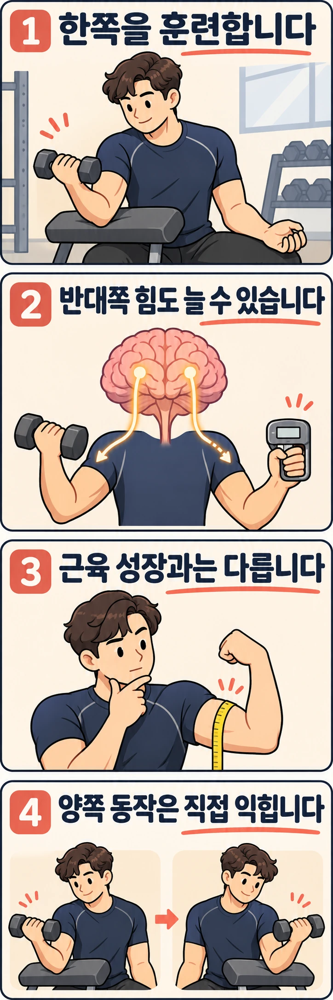

오른팔만 저항 운동을 했다면 왼팔의 힘은 그대로일까요? 연구에서는 직접 훈련하지 않은 반대쪽 팔다리에서도 힘이 증가하는 현상이 관찰됩니다. 이를 **교차교육**이라고 합니다. 여기서 교육은 한쪽에서 얻은 수행 능력이 다른 쪽으로 전이된다는 뜻입니다.

다만 ‘한쪽만 운동해도 양쪽 운동이 끝난다’는 의미는 아닙니다. **반대쪽에서 무엇을 측정했는지**가 핵심입니다.

## 반대쪽으로 옮겨 가는 것은 무엇일까요?

교차교육 연구는 보통 한쪽에만 반복 훈련을 시킨 뒤, 반대쪽의 같은 역할을 하는 근육에서 수행 변화를 측정합니다. 오른쪽 손목을 굽히는 훈련이라면 왼쪽 손목을 굽히는 힘을 보는 식입니다. 몸 어디서나 같은 효과가 생긴다는 뜻은 아닙니다.

근력은 정해진 과제에서 낼 수 있는 힘이고, 근육 크기는 조직의 구조를 나타냅니다. 반대쪽 힘의 증가만 측정했다면 그쪽 근육도 커졌다고 결론 낼 수 없습니다. 힘을 일정하게 유지하는 능력과 최대 힘 역시 서로 다른 결과입니다. [교차교육에 관한 합의 연구](https://pmc.ncbi.nlm.nih.gov/articles/PMC7806569/)도 근력 전이와 기술 전이를 구별하도록 권합니다.

## 한쪽 운동인데 왜 신경계 양쪽을 살펴볼까요?

손목을 굽히려는 명령은 뇌에서 시작해 척수와 운동신경을 거쳐 근육에 전달됩니다. 근육은 힘을 만드는 조직이지만, 그 힘을 얼마나 끌어내는지는 신경계의 조절에도 달려 있습니다. 그래서 훈련 효과가 운동한 근육에만 머무르지 않을 가능성이 생깁니다.

설명에 쓰이는 가설은 크게 두 가지입니다. **교차 활성화 가설**은 한쪽을 움직일 때 반대쪽 움직임에 관여하는 신경 회로에도 활동이 생기고, 반복하면서 그 회로가 적응한다고 봅니다. **양측 접근 가설**은 한쪽에서 익힌 운동 과제의 정보에 반대쪽도 접근할 수 있다고 설명합니다. 앞의 설명은 양쪽 회로의 활동과 적응에, 뒤의 설명은 배운 정보를 사용하는 경로에 무게를 둡니다.

이들은 가능한 설명 모형입니다. 어느 하나가 모든 근력 전이를 완전히 설명한다고 확정되지는 않았습니다. 뇌의 좌우 사이에서 신호를 억제하는 작용이 달라지는 것도 연구 대상입니다. 억제는 신경 신호를 줄이는 조절을 뜻하며, 단순히 없어야 좋은 장벽은 아닙니다.

[신경생리학 연구를 모은 2018년 문헌고찰·메타분석](https://pubmed.ncbi.nlm.nih.gov/29446711/)은 중추신경계의 적응이라는 설명을 지지하면서도, 합쳐 분석할 수 있는 자료가 제한적이라고 밝힙니다. 뇌를 자극했을 때 근육에 나타나는 반응과 훈련 후 힘의 변화가 함께 관찰돼도, 특정 신경 지표가 증가분 전부의 원인이라는 증명과는 다릅니다.

## 사람 대상 실험에서는 어떻게 확인했을까요?

그린과 가브리엘의 2018년 연구에는 젊은 성인 40명, 남녀 각 20명이 참여했습니다. 참가자는 손목 굽힘 또는 발등 들어 올리기 훈련군에 배정돼 주로 사용하는 쪽을 6주 동안 훈련했습니다. 연구진은 훈련 전후와 훈련 중단 후에 힘과 힘 조절 능력을 평가했습니다. [연구 논문](https://journals.physiology.org/doi/abs/10.1152/jn.00116.2018)

훈련 직후 직접 운동하지 않은 팔과 다리에서 근력 전이가 나타났습니다. 일부 신경계 측정값의 변화도 근력 변화와 관련됐습니다. 이는 근육을 직접 반복해서 훈련하지 않은 쪽에서도 힘을 내는 조절이 달라질 수 있다는 근거입니다. 다만 특정 관절의 제한된 과제를 다룬 실험이며, 전신을 연결하는 펀치나 경기 수행을 측정하지는 않았습니다.

[2017년 근력 전이 메타분석](https://pubmed.ncbi.nlm.nih.gov/28936703/)도 여러 편측 저항 훈련 연구를 종합해 반대쪽 근력 증가를 다뤘습니다. 서로 다른 팔다리, 수축 방식과 검사 조건을 합친 결과를 개인의 예상 증가율로 사용해서는 안 됩니다. 관절을 고정하고 버티는 힘과 움직이면서 드는 힘은 같은 검사가 아니기 때문입니다.

## 그렇다면 한쪽 연습을 생략해도 될까요?

양쪽을 사용할 수 있는 사람이 이 현상만을 근거로 한쪽 훈련을 없앨 이유는 없습니다. 전이가 관찰됐다는 것과 양쪽을 직접 훈련한 결과에 도달했다는 것은 다른 질문입니다. 특히 복싱의 잽과 뒷손 스트레이트는 출발 자세와 몸통 회전의 역할이 달라, 한쪽 힘의 전이를 다른 손의 기술 완성으로 바꿔 말할 수 없습니다.

원리를 적용할 때는 **한쪽에서 나아진 능력을 반대쪽이 그대로 갖췄다고 가정하지 않는 것**부터 시작해 보세요. 평소 한 손씩 하는 저항 운동을 기록한다면 다음처럼 나눌 수 있습니다.

- 오른쪽과 왼쪽의 무게·반복 횟수·수행 범위를 각각 적습니다.
- 오른쪽 기록이 늘었어도 왼쪽 무게를 자동으로 올리지 않습니다. 왼쪽에서 익숙한 무게를 실제로 다루는 모습을 먼저 봅니다.
- 두 쪽 모두 운동했다면 그 기록으로 교차교육의 크기를 계산하지 않습니다. 직접 훈련 효과와 전이 효과를 분리할 수 없기 때문입니다.

이는 교차교육을 입증하는 개인 실험이 아니라, 한쪽 기록으로 다른 쪽의 준비 상태를 추정하지 않기 위한 방법입니다. 부상으로 한쪽을 쓰지 못하는 상황에서 반대쪽 훈련을 활용할지는 재활의 별도 판단이며, 이 일반 운동 기록법을 치료 계획으로 삼지는 않습니다.

한쪽 훈련의 영향은 신경계를 통해 반대쪽 수행에도 이어질 수 있습니다. 다음 운동에서 확인할 것은 ‘효과가 옮겨 갔을 것’이라는 기대보다 **각 쪽이 실제로 어떤 과제를 어느 정도 수행하는지**입니다. 좌우의 연결을 이해하면서도, 필요한 동작은 양쪽에서 직접 익혀 보세요.

## 참고 자료

- [Manca 외, 2017, Cross-education of muscular strength following unilateral resistance training: a meta-analysis](https://pubmed.ncbi.nlm.nih.gov/28936703/). DOI: 10.1007/s00421-017-3720-z. 편측 저항 훈련 후 반대쪽 근력의 종합 근거입니다.
- [Manca 외, 2018, Neurophysiological adaptations in the untrained side in conjunction with cross-education of muscle strength: a systematic review and meta-analysis](https://pubmed.ncbi.nlm.nih.gov/29446711/). DOI: 10.1152/japplphysiol.01016.2017. 신경생리학적 변화와 근거의 한계를 다룹니다.
- [Green·Gabriel, 2018, The cross education of strength and skill following unilateral strength training in the upper and lower limbs](https://journals.physiology.org/doi/abs/10.1152/jn.00116.2018). DOI: 10.1152/jn.00116.2018, PMID: 29668382. 6주 편측 훈련 연구입니다.
- [Manca 외, 2021, Contralateral Effects of Unilateral Strength and Skill Training: Modified Delphi Consensus to Establish Key Aspects of Cross-Education](https://pmc.ncbi.nlm.nih.gov/articles/PMC7806569/). DOI: 10.1007/s40279-020-01377-7. 효과량을 새로 측정한 실험이 아니라 전문가 합의를 조사한 연구입니다.
