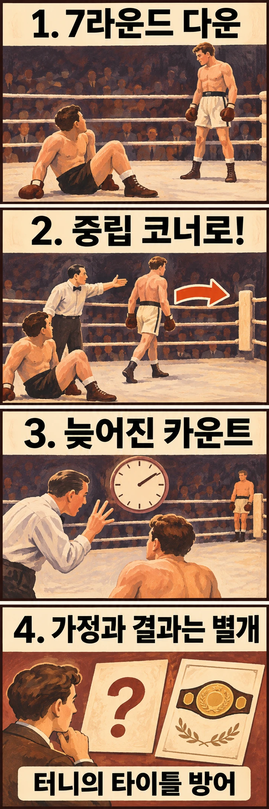

## 쓰러진 시간과 심판의 카운트는 왜 달랐을까요?

복싱에서 상대를 쓰러뜨린 뒤에도 공격한 선수에게 할 일이 남아 있습니다. 1927년 잭 뎀프시와 진 터니의 재대결에서는 바로 그 절차가 승부만큼 오래 기억됐습니다. 터니가 다운된 뒤 뎀프시가 중립 코너로 물러나지 않아 심판의 카운트가 늦어진 사건, 이른바 **‘롱 카운트’**입니다.

중립 코너는 두 선수가 각자 쉬는 자기 코너가 아닌 나머지 코너를 뜻합니다. 이 사건을 이해하려면 ‘얼마나 오래 누워 있었나’와 ‘경기에서 어떤 절차로 카운트를 진행했나’를 함께 살펴봐야 합니다.

## 재대결의 7라운드에 무슨 일이 있었을까요?

두 선수의 재대결은 **1927년 9월 22일 미국 시카고 솔저 필드**에서 열렸습니다. 터니는 전년도 첫 대결에서 뎀프시를 꺾고 헤비급 챔피언이 된 선수였고, 뎀프시는 타이틀을 되찾으려는 도전자였습니다. [WBA에 실린 역사 기사](https://www.wbaboxing.com/boxing-news/today-in-boxing-history-the-long-count)는 재대결이 예정된 10라운드까지 진행됐고 터니가 타이틀을 지켰다고 정리합니다.

논란은 7라운드에 생겼습니다. 뎀프시가 터니를 쓰러뜨렸지만 곧바로 중립 코너로 이동하지 않았고, 카운트 시작이 늦어졌습니다. 뉴질랜드 국립도서관이 공개한 [1927년 9월 24일자 오타고 데일리 타임스의 당시 보도](https://paperspast.natlib.govt.nz/newspapers/ODT19270924.2.50)는 중립 코너로 물러나야 카운트를 시작하는 규칙을 설명하면서, 지연으로 터니에게 회복할 시간이 더 생겼다고 전했습니다.

여기서 확인할 수 있는 것은 다운, 이동 지연, 늦어진 카운트라는 사건의 골격입니다. 뎀프시가 정확히 무엇을 생각했는지까지 이 기록으로 알 수 있는 것은 아닙니다. 흥분해서 잊었는지, 규칙에 익숙하지 않았는지 하나로 단정하면 사건 설명에 추측이 섞입니다.

## 왜 중립 코너로 보내는 절차가 중요했을까요?

중립 코너 이동은 다운을 만든 선수를 쓰러진 상대에게서 떨어뜨리는 절차입니다. 이 경기에서는 공격한 선수가 어디에 서 있는지가 카운트 시작과 연결돼 있었습니다. 따라서 관중이 잰 경과 시간과 심판이 진행한 숫자가 어긋날 수 있었습니다.

당시 보도는 같은 날 앞서 열린 경기들에서도 상대를 쓰러뜨린 선수가 중립 코너로 물러날 때까지 심판들이 기다렸다고 전했습니다. 이 대목은 터니에게만 갑자기 특별한 조건을 만들어 줬다는 설명을 경계하게 합니다. 다만 앞 경기에서도 적용했다는 사실만으로 본 경기의 집행에 관한 모든 논쟁이 해소되는 것은 아닙니다.

이 장면을 읽는 핵심은 공격의 성공과 경기 절차의 준수를 따로 보는 데 있습니다. 강한 펀치로 다운을 만들어도, 그다음 행동까지 규칙 안에서 이어져야 합니다. 이는 뎀프시의 기술을 평가하는 말이라기보다 롱 카운트가 왜 단순한 초시계 문제가 아니었는지 설명하는 관점입니다.

## ‘제때 셌다면 KO’라고 결론 내릴 수 있을까요?

뎀프시 측의 불만은 당시에도 분명했습니다. 오타고 데일리 타임스는 그의 매니저가 터니에게 15초의 카운트가 주어졌다며 항의할 뜻을 밝혔다고 보도했습니다. **15초는 여기서 뎀프시 측이 제기한 수치**이며, 모두가 합의한 정밀 측정값처럼 받아들여서는 안 됩니다.

후대의 WBA 게재 기사도 터니가 쓰러진 뒤 지난 시간을 단일한 숫자로 확정하지 않습니다. 중요한 차이는 ‘회복할 시간이 더 주어졌다’와 ‘그 시간이 없었다면 반드시 패했다’ 사이에 있습니다. 앞의 설명은 카운트 지연에 관한 것이지만, 뒤의 말은 실제로 진행되지 않은 상황의 결과를 가정하는 것입니다.

당시 신문에는 뎀프시가 우승을 되찾을 기회를 놓쳤다는 평가와 함께, 터니의 경기 운영과 지구력이 타이틀 방어를 가능하게 했다는 평가도 실렸습니다. 논쟁의 존재는 당시 반응으로 읽을 수 있지만, 어느 한쪽의 평가를 공식 결과로 바꿔 적을 수는 없습니다. 터니가 승리해 타이틀을 지켰다는 기록과 ‘다르게 진행됐다면’이라는 논쟁은 구분해야 합니다.

## 롱 카운트가 남긴 것은 무엇일까요?

이 사건을 중립 코너 규칙이 처음 생긴 순간이라고 설명할 수는 없습니다. 당시 보도 자체가 이미 적용되던 규칙으로 이를 다루고 있기 때문입니다. 한 번의 논란이 이후 복싱 규칙 전체를 바꿨다고 확대할 근거도 여기에는 없습니다.

대신 롱 카운트는 복싱의 역사를 볼 때 펀치와 승패 사이에 심판의 절차가 있다는 점을 선명하게 보여 줍니다. 쓰러진 선수의 상태, 공격한 선수의 위치, 카운트의 진행을 함께 봐야 논쟁의 구조가 드러납니다.

‘왜 바로 세지 않았을까?’라는 처음 질문의 답은 뎀프시의 중립 코너 이동이 늦어졌기 때문입니다. 하지만 그 답이 곧 ‘진짜 승자는 따로 있었다’는 결론은 아닙니다. 롱 카운트가 오래 남은 까닭은 확인할 수 있는 절차의 지연과 확인할 수 없는 다른 결말이 계속 맞물리기 때문이라고 읽을 수 있습니다.

## 참고 자료

- [오타고 데일리 타임스, 1927년 9월 24일: Dempsey’s Mistake](https://paperspast.natlib.govt.nz/newspapers/ODT19270924.2.50) — 중립 코너 규칙, 카운트 지연, 뎀프시 측 항의와 당시의 상반된 평가를 담은 보도입니다.
- [WBA 게재 역사 기사: Boxing History: The Long Count](https://www.wbaboxing.com/boxing-news/today-in-boxing-history-the-long-count) — 경기 날짜·장소·재대결 배경·타이틀 방어 결과를 정리한 후대의 글입니다.
