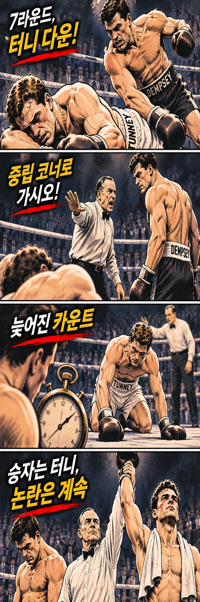

헤비급 세계 챔피언이 링 바닥에 쓰러졌습니다.

도전자는 챔피언 벨트를 되찾을 기회를 잡은 듯했습니다. 그런데 심판은 곧바로 다운 카운트를 시작하지 않았습니다.

**문제는 쓰러진 챔피언이 아니라, 그를 쓰러뜨린 도전자가 서 있던 위치였습니다.**

1927년 잭 뎀프시와 진 터니의 재대결에서 벌어진 이 사건은 지금까지도 **‘롱 카운트(Long Count)’**라는 이름으로 기억됩니다.

## 빼앗긴 챔피언 벨트를 되찾으려던 밤

1926년 진 터니는 잭 뎀프시를 꺾고 세계 헤비급 챔피언에 올랐습니다. 1년 뒤인 **1927년 9월 22일**, 두 사람은 미국 시카고의 솔저 필드에서 다시 만났습니다.

터니에게는 타이틀 방어전이었지만, 뎀프시에게는 잃어버린 왕좌를 되찾을 기회였습니다.

승부가 요동친 것은 7라운드였습니다. 뎀프시의 공격에 터니가 다운됐습니다. 챔피언이 쓰러졌고, 관중의 시선은 심판과 터니에게 쏠렸습니다.

하지만 심판이 먼저 신경 쓴 것은 **다운을 만든 뎀프시의 위치**였습니다.

## 쓰러뜨린 선수가 왜 코너로 가야 했을까요?

복싱에는 선수가 다운됐을 때 공격한 상대가 **중립 코너**로 이동해야 한다는 절차가 있습니다. 중립 코너란 두 선수에게 배정된 자기 코너가 아닌 나머지 코너를 말합니다.

이 절차는 공격한 선수를 다운된 상대에게서 떨어뜨리고, 심판이 다운된 선수의 상태와 카운트에 집중할 수 있도록 하는 장치입니다.

그날 뎀프시는 터니를 쓰러뜨린 직후 곧바로 중립 코너로 물러나지 않았습니다. 심판은 뎀프시를 코너로 보내는 데 시간을 썼고, **그동안 공식 카운트의 시작이 늦어졌습니다.**

1927년 9월 24일자 뉴질랜드 신문 *오타고 데일리 타임스*는 당시 규칙상 공격한 선수가 중립 코너로 물러나야 심판이 카운트를 시작할 수 있었다고 보도했습니다. 같은 날 열린 앞선 경기들에서도 심판들이 이 절차를 적용했다고 전했습니다.

따라서 이 사건을 ‘터니에게만 갑자기 만들어 준 특별 규칙’으로 설명하는 것은 정확하지 않습니다. 다만 규칙이 존재했다는 사실과 그날의 집행을 둘러싼 논란은 별개의 문제입니다.

뎀프시가 왜 바로 움직이지 않았는지는 확인된 기록만으로 단정하기 어렵습니다. **분명한 것은 그가 중립 코너로 이동하지 않는 사이, 다운된 터니에게 추가 시간이 흘렀다는 점**입니다.

## 터니는 다시 일어났고, 논란은 시작됐습니다

터니는 결국 일어나 경기를 계속했습니다. 뎀프시가 챔피언을 쓰러뜨렸다는 사실은 바뀌지 않았지만, 그 다운이 경기의 끝이 되지는 않았습니다.

뎀프시 측은 강하게 반발했습니다. 당시 *오타고 데일리 타임스*는 뎀프시의 매니저가 터니에게 **15초의 카운트가 주어졌다**고 주장하며 항의할 뜻을 밝혔다고 보도했습니다.

여기서 **15초는 뎀프시 측의 주장**이지, 누구나 동의한 정확한 공식 측정값은 아닙니다. 다운 이후 실제로 흐른 시간과 심판이 규칙에 따라 세기 시작한 카운트는 구별해야 합니다.

결국 경기는 예정된 10라운드까지 이어졌고, **터니가 판정승으로 세계 헤비급 타이틀을 지켰습니다.**

그러나 사람들의 기억에는 공식 결과만 남지 않았습니다. '그때 심판이 바로 세었다면?'이라는 질문도 함께 남았습니다.

## 제때 카운트했다면 뎀프시가 이겼을까요?

이 사건을 이야기할 때 가장 쉽게 나오는 말은 ‘카운트만 빨랐다면 뎀프시의 KO승이었다’는 주장입니다.

하지만 **카운트가 늦어진 사실**과 **지연이 없었다면 반드시 KO가 나왔을 것이라는 가정**은 다릅니다.

터니가 실제로 어느 시점에 일어날 수 있었을지, 다른 상황에서 어떤 반응을 보였을지는 확인할 방법이 없습니다. 실제로 치르지 않은 경기의 결과를 확정할 수는 없는 것입니다.

당시 신문 보도에서도 뎀프시가 결정적인 기회를 놓쳤다는 평가와, 터니의 경기 운영 및 지구력이 승리를 뒷받침했다는 평가가 함께 등장합니다.

그래서 롱 카운트의 핵심은 '누가 진짜 승자였는가'를 다시 판정하는 데 있지 않습니다. **한 번의 다운 이후, 경기 규칙을 집행하는 절차가 어떻게 승부의 흐름에 영향을 줄 수 있었는가**를 살펴보는 데 있습니다.

## 링 위에서는 주먹만으로 승부가 끝나지 않습니다

뎀프시는 챔피언을 쓰러뜨렸습니다. 하지만 챔피언 벨트를 되찾지는 못했습니다.

터니는 다시 일어났고, 남은 라운드를 마친 뒤 공식 승자가 됐습니다. 이 결과는 롱 카운트 논란과 별개로 기록에 남아 있습니다.

이 사건이 중립 코너 규칙을 처음 만들어 낸 것도 아닙니다. 당시 보도는 이미 적용되던 규칙으로 설명하고 있습니다. 한 경기 때문에 복싱의 모든 다운 규칙이 바뀌었다고 말할 근거도 없습니다.

그 대신 롱 카운트는 복싱의 중요한 특징을 선명하게 보여 줍니다. **강한 펀치로 승리의 기회를 만드는 것과, 그 기회를 규칙 안에서 끝까지 살리는 것은 서로 다른 일**이라는 사실입니다.

만약 카운트가 즉시 시작됐다면 결과가 달라졌을까요? 누구도 확실히 답할 수 없습니다.

**뎀프시는 주먹으로 챔피언을 쓰러뜨렸지만, 그 순간에도 지켜야 할 규칙이 있다는 사실을 복싱 역사에 남겼습니다.**

## 참고 자료

- [Otago Daily Times, 1927년 9월 24일, 「Dempsey’s Mistake」](https://paperspast.natlib.govt.nz/newspapers/ODT19270924.2.50) — 당시 중립 코너 규칙, 카운트 지연, 뎀프시 측의 15초 주장, 앞선 경기의 규칙 적용과 경기 평가를 전한 동시대 보도.
- [WBA, 「Today in Boxing History: The Long Count」](https://www.wbaboxing.com/boxing-news/today-in-boxing-history-the-long-count) — 재대결의 날짜·장소, 7라운드 다운과 10라운드 판정 결과를 정리한 역사 기사.
