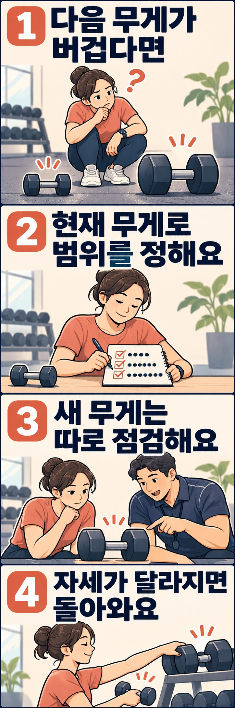

지금 덤벨로는 정한 횟수를 마치지만 다음 덤벨을 잡으면 몇 번 들기도 버겁습니다. 그렇다고 횟수를 끝없이 늘리고 싶지는 않습니다. 이럴 때는 **현재 무게로 할 연습과 새 무게를 확인하는 절차를 나눠 보세요.** 증량을 시도한 날에도 원래 무게로 돌아올 수 있도록 계획하는 것입니다.

## 덤벨 사이의 차이부터 계산해 보세요

한 손에 드는 덤벨이 4kg에서 6kg으로 바뀌면 2kg 증가지만, 현재 무게를 기준으로는 50% 증가입니다. 10kg에서 12kg은 같은 2kg 차이여도 20%입니다. 이 계산만으로 적정 증량 폭을 정할 수는 없지만, ‘겨우 한 단계’라는 말에 가려진 차이는 확인할 수 있습니다.

양손 운동이라면 기록에도 한 손 기준인지 양손 합계인지 표시해 주세요. 합계 8kg으로 적다가 다음에는 한 손 무게를 적으면 비교부터 어긋납니다.

아래는 이미 배운 덤벨 운동을 안정적으로 수행하는 성인을 위한 계획 제안입니다. 실제 참가자의 효과를 확인한 실험 결과는 아닙니다. 동작이 낯설다면 증량 일정부터 잡기보다 코치와 시작 무게를 확인해 주세요.

## 현재 무게에 횟수의 상한을 둡니다

한 손 4kg으로 두 세트, 세트당 8회를 무리 없이 하고 있다고 가정하겠습니다. 다음 6kg이 버거워 기존 무게를 유지한다면 **두 세트 각각 8~12회**처럼 반복 범위를 정해 볼 수 있습니다. 이 숫자는 모두에게 맞는 처방이 아니라 계획을 설명하기 위한 예시입니다.

모든 세트의 횟수를 함께 올릴 필요는 없습니다. 첫 세트만 한 회 더 하고 두 번째는 그대로 두는 식으로 변경할 수 있습니다. 아래는 다음 목표를 정하는 예시이며, 실제 변화 기록이나 정해진 주차별 과제가 아닙니다.

| 지금 확인한 수행 | 다음에 시도할 선택 |
| --- | --- |
| 8회·8회를 여유 있게 마쳤습니다 | 첫 세트만 9회를 시도합니다 |
| 9회·8회에서 두 번째 세트가 버겁습니다 | 같은 횟수를 유지하거나 줄입니다 |
| 두 세트 모두 상한 12회를 안정적으로 마쳤습니다 | 다른 날 같은 조건에서 한 번 더 확인합니다 |

무게와 동작 범위, 세트 사이 휴식은 비교할 수 있게 유지합니다. 평소 사용하던 휴식 2분을 그대로 두는 식입니다. 준비가 덜 됐다면 더 쉬되 기록에 표시해 주세요. 횟수·휴식·세트 수를 동시에 바꾸면 다음 계획을 무엇에 맞춰 고칠지 불분명해집니다.

마지막 한 번을 억지로 완수하는 규칙은 두지 마세요. 정한 범위로 움직이지 못하거나 몸을 크게 흔들어야 하면 세트를 마칩니다. 상한에 도달한 날은 증량을 반드시 해야 하는 날이 아니라, **새 무게를 점검할지 결정할 시점**입니다.

## 새 무게는 기존 세트와 별도로 점검합니다

새 덤벨을 잡자마자 이전 횟수를 똑같이 채우겠다고 정하지 마세요. 기존 무게에서의 반복 기록과 새 무게에서의 수행은 구분해서 적습니다.

처음 전환할 때는 코치와 함께 다음을 확인해 보세요. 평소 준비운동과 가벼운 준비 세트를 마친 뒤, 아직 지치지 않은 상태에서 진행합니다.

1. 새 덤벨을 시작 위치로 가져오고 다시 내려놓는 과정까지 스스로 조절할 수 있는지 확인합니다.
2. 배운 동작을 짧게 수행하며 이전과 같은 움직임 범위와 몸통 위치를 유지하는지 봅니다. 횟수를 채우려고 버티는 시험으로 만들지 않습니다.
3. 수행이 달라지면 시도를 끝내고 원래 무게를 사용합니다. 끝낸 점검 분량도 그날 운동량에 포함하고, 예정 세트를 전부 추가로 채우지는 않습니다.

누운 자세에서 덤벨을 드는 운동처럼 시작과 종료에 도움이 필요할 수 있는 종목은 혼자 새 무게를 시험하는 예시로 삼지 마세요. 한 손에만 더 무거운 덤벨을 들거나 덤벨에 임의로 물건을 묶어 간격을 메우는 방식도 이 계획에서는 사용하지 않습니다. 통증이나 저림이 생기면 운동을 중단해 주세요.

## 보류한 뒤에는 무엇을 할까요?

원래 무게로 돌아왔는데도 매번 횟수를 더해야 할까요? **상한을 유지하는 선택도 넣어 두세요.** 다음 무게를 다루기 전까지 횟수·세트·느린 속도를 계속 추가해 빈틈을 메울 필요는 없습니다.

- **더 촘촘한 무게를 쓸 수 있다면:** 사용이 허용된 조절식 덤벨이나 중간 무게가 있는지 확인해 보세요. 같은 종목을 이어 가려는 경우의 선택입니다.
- **현재 장비만 쓸 수 있다면:** 정한 범위에서 운동을 유지하고, 다음 상담 때 새 무게에서 달라졌던 점을 보여 주세요. 정해진 날짜까지 증량해야 한다는 마감은 두지 않습니다.
- **다른 운동을 선택한다면:** 이미 배운 종목 중에서 지도자와 고르고 새 기록으로 시작합니다. 덤벨 운동의 숫자를 다른 기구의 숫자와 그대로 이어 붙이지 않습니다.

복싱 연습도 함께 하는 날이라면 증량 점검을 이유로 웨이트 분량을 덧붙이기보다 처음 정한 전체 일정 안에 점검 자리를 잡아 주세요. 운동을 마친 뒤 마지막에 충동적으로 새 무게를 시험하는 방식은 피합니다.

## 다음 운동 전에 한 줄로 결정해 보세요

‘한 손 4kg, 두 세트 9회·8회, 휴식 2분, 다음에도 유지’처럼 적으면 다음 행동이 분명해집니다. 새 무게를 확인했다면 ‘6kg에서는 몸통이 흔들려 보류’처럼 이유를 붙여 주세요. 며칠 뒤 반드시 성공하겠다는 약속보다 **유지·재점검·장비 변경 중 무엇을 할지** 남기는 기록입니다.

다음 덤벨이 버겁다면 지금 무게의 연습 범위를 먼저 정하세요. 그 범위에서 수행을 확인하고, 새 무게는 별도로 점검한 뒤 맞지 않으면 돌아오시면 됩니다. 무게 사이의 빈칸을 억지로 채우기보다 다음 선택을 정해 두는 것이 이번 계획의 목표입니다.
