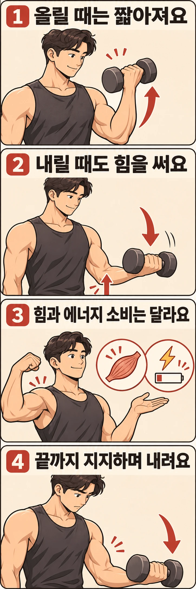

덤벨을 들어 올리기는 버거운데 내려놓기는 상대적으로 수월할 때가 있습니다. 그렇다고 내려가는 동안 팔이 아무 일도 하지 않는 것은 아닙니다. **근육이 내는 힘과 그 힘을 내는 데 쓰는 에너지는 같은 양이 아닙니다.** 이 차이를 이해하면 덜 숨차다는 이유로 내려가는 동작의 부담을 작게 보지 않게 됩니다.

## 내려갈 때 근육은 무엇을 하나요?

덤벨 컬에서 팔꿈치를 굽혀 무게를 올리면 위팔 앞쪽 근육이 힘을 내며 짧아집니다. 이를 **단축성 수축**이라고 합니다. 반대로 팔꿈치를 펴며 덤벨을 제어해 내릴 때는 같은 근육이 힘을 내면서 길어집니다. 이것이 **신장성 수축**, 또는 편심성 수축입니다. 여기서 수축은 반드시 짧아진다는 뜻이 아니라 근육이 활성화되어 힘을 내는 상태를 가리킵니다.

중력이 덤벨을 아래로 끌어당길 때 팔은 그 움직임에 제동을 겁니다. 손이 아래로 이동해도 덤벨에 가하는 지지력은 위쪽을 향합니다. 힘과 이동 방향이 반대여서 근육이 외부 부하로부터 에너지를 받아들이는 일을 **음의 일**이라고 부릅니다. ‘음’은 운동 효과가 나쁘다는 뜻이 아닙니다. [신장성 수축의 생리학 문헌고찰](https://www.frontiersin.org/journals/physiology/articles/10.3389/fphys.2019.00536/full)

덤벨을 올렸다 같은 높이로 내리면 덤벨의 높이는 원래대로 돌아옵니다. 그렇다고 몸이 쓴 에너지까지 0이 되지는 않습니다. 외부 물체에 한 기계적 일과 몸속에서 소비한 대사 에너지는 따로 계산해야 하기 때문입니다.

## 제동을 거는 데도 ATP가 필요한가요?

**ATP**는 세포가 에너지를 전달할 때 사용하는 분자입니다. 근육 안에서 액틴과 미오신이라는 단백질이 일시적으로 연결되어 힘을 전달하는데, 이 연결을 가교라고 합니다. 가교의 결합과 분리 과정, 수축을 조절하는 칼슘을 다시 저장하는 과정 등에 에너지가 필요합니다. 따라서 무게가 근육을 늘려 준다고 ATP 사용이 사라지는 것은 아닙니다.

다만 길어지며 힘을 받는 상태는 가교가 반복해서 근육을 짧게 만드는 상태와 역학적 조건이 다릅니다. 신장성 수축에서는 같은 힘을 내는 데 필요한 근육 활성과 에너지 소비가 단축성 수축보다 낮게 관찰됩니다. **큰 힘을 전달하는 능력과 빠르게 ATP를 소비하는 정도가 반드시 함께 커지지는 않는 것**입니다.

그 차이를 ‘미오신이 몇 번 덜 움직이기 때문’ 하나로 확정할 수는 없습니다. 근육 내부의 탄성 구조가 힘을 분담하는 방식도 설명에 포함되며, 각 요소의 기여는 연구 과제입니다. [Hody 등의 문헌고찰](https://www.frontiersin.org/journals/physiology/articles/10.3389/fphys.2019.00536/full)도 신장성 수축의 독특한 특성을 만드는 기전이 충분히 해명되지 않았다고 정리합니다. 관찰된 에너지 차이와 그 차이를 설명하는 분자 수준의 가설은 구분해야 합니다.

## 사람의 근육에서 실제로 확인했나요?

Ryschon과 동료들의 1997년 연구는 건강한 성인 12명이 참여한 실험입니다. 발등을 들어 올리는 근육을 대상으로 장비로 힘과 움직임을 측정하고, 인 자기공명분광법으로 ATP·인산크레아틴 등 에너지 대사 상태를 살폈습니다. 인산크레아틴은 ATP를 빠르게 다시 만드는 데 쓰이는 저장 물질입니다.

참가자들은 최대 등척성 힘의 30%를 기준으로 5초 운동과 5초 이완을 반복했습니다. 등척성은 관절을 움직이지 않고 힘을 내는 상태입니다. 단축성·신장성 조건의 관절 회전 속도는 초당 6도로 통제했습니다. 연구진은 운동 직후 인산크레아틴이 회복되는 초기 속도에서 ATP 합성률을 추정했습니다. 비교 가능한 기계적 조건에서 단축성 활동의 대사 부담이 더 컸고, 신장성 활동은 기계적 일의 크기에 비해 에너지 요구가 낮았습니다. [연구 원문](https://journals.physiology.org/doi/full/10.1152/jappl.1997.83.3.867)

이것은 특정 발목 근육의 **한 차례 운동 중 반응**입니다. 모든 참가자가 모든 산출값에 포함된 것도 아니어서 원문의 주요 비교 표는 조건별 8회 실험으로 제시됩니다. 이 결과를 덤벨 운동 전체의 칼로리 차이로 환산하거나, 몇 주 뒤 어느 방식이 더 많은 근육을 만드는지에 대한 답으로 사용할 수는 없습니다.

## 에너지가 덜 들면 더 무겁게 내려도 될까요?

그 결론은 나오지 않습니다. 에너지 소비가 낮다는 것은 조직에 전달되는 힘까지 작다는 뜻이 아니기 때문입니다. 낯선 신장성 운동에서 큰 기계적 부담과 이후 기능 저하가 나타날 수 있다는 점도 [문헌고찰](https://www.frontiersin.org/journals/physiology/articles/10.3389/fphys.2019.00536/full)에서 다룹니다. 숨이 덜 차거나 올리기보다 수월하게 느껴진다는 사실만으로 무게를 크게 늘릴 근거는 부족합니다.

원리를 확인하려면 새로운 고중량 훈련을 추가할 필요는 없습니다. 평소 익숙하게 하는 가벼운 덤벨 컬에서 반복 한 번의 두 구간을 구분해 보세요.

- **올릴 때:** 덤벨의 높이를 높이기 위해 힘을 냅니다.
- **내릴 때:** 손의 이동 방향은 바뀌지만 무게에 대한 지지를 유지합니다.
- **관찰할 점:** 내려가는 도중 갑자기 속도가 빨라지거나 마지막에 덤벨이 툭 떨어지는지 봅니다.

이것은 에너지 소비를 측정하는 실험이 아니라 힘과 이동 방향을 구별하는 관찰 예시입니다. 내리는 구간의 제어가 끊기면 더 긴 시간 버티기를 목표로 삼기보다 무게나 반복 수를 줄여 처음부터 끝까지 지지할 수 있는지 살펴보세요. 혼자 들 수 없는 무게를 올려 달라고 한 뒤 내리기만 시험하는 방법은 이 관찰에 필요하지 않습니다.

## 덜 힘들게 느껴져도 제동은 일하고 있습니다

도입의 덤벨로 돌아오면, 내려놓기가 수월한 이유를 ‘근육이 쉬어서’라고 설명할 수는 없습니다. 길어지며 제동을 거는 근육은 힘을 전달하면서도 단축성 활동과 다른 에너지 요구를 보입니다. 다음 반복에서는 숨찬 정도와 별개로 **내려가는 무게를 끝까지 지지하는지**를 살펴보세요. 그 구분이 이 연구를 운동에 가져오는 가장 직접적인 방법입니다.

## 참고 자료

- Ryschon TW, Fowler MD, Wysong RE, Anthony A-R, Balaban RS. 1997. [Efficiency of human skeletal muscle in vivo: comparison of isometric, concentric, and eccentric muscle action](https://journals.physiology.org/doi/full/10.1152/jappl.1997.83.3.867). 인체 급성 실험. DOI: 10.1152/jappl.1997.83.3.867. PMID: 9292475.
- Hody S, Croisier J-L, Bury T, Rogister B, Leprince P. 2019. [Eccentric Muscle Contractions: Risks and Benefits](https://www.frontiersin.org/journals/physiology/articles/10.3389/fphys.2019.00536/full). 생리학적 특성과 기전의 불확실성을 다룬 문헌고찰. DOI: 10.3389/fphys.2019.00536. PMID: 31130877.
