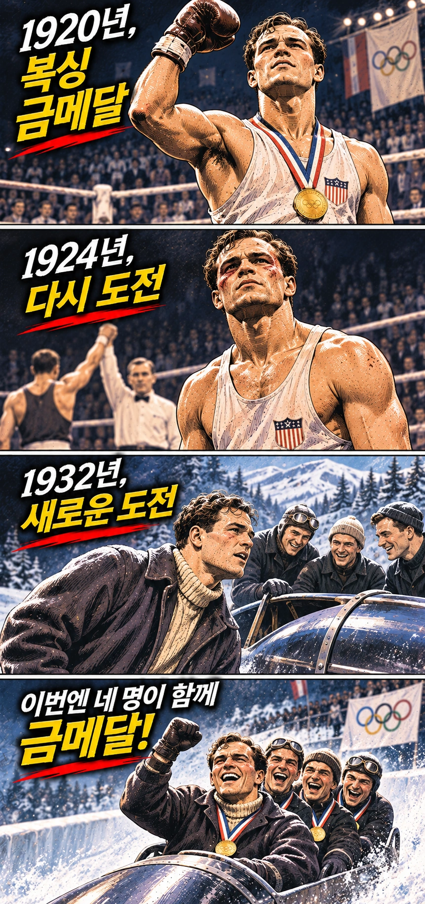

올림픽 복싱 챔피언이 다시 금메달을 얻었다고 하면, 다음 복싱 대회를 떠올리기 쉽습니다. 하지만 미국의 에디 이건(Eddie Eagan)이 두 번째 정상에 오른 무대는 눈과 얼음의 대회였습니다. 링에서의 우승은 어떻게 봅슬레이 기록과 한 사람의 경력으로 묶이게 됐을까요?

## 첫 금메달 뒤에도 복싱 출전은 이어졌습니다

이건은 1920년 안트베르펜 올림픽에서 복싱 라이트헤비급 금메달을 획득했습니다. 라이트헤비급은 몸무게에 따라 나눈 복싱 경기 구분 중 하나입니다. 당시의 우승은 개인 종목인 복싱에서 얻은 성과였습니다. [미국 올림픽·패럴림픽 박물관의 선수 소개](https://usopm.org/eddie-eagan/)

그렇다고 복싱 금메달 직후 곧바로 겨울 종목으로 옮긴 것은 아닙니다. 미국 올림픽위원회의 선수 기록에는 1924년 파리 올림픽 복싱 헤비급 출전과 9위가 함께 남아 있습니다. 같은 체급에서 올림픽 타이틀을 연달아 지킨 경력과는 다릅니다. [Team USA 선수 기록](https://www.teamusa.com/hall-of-fame/hall-of-fame-members/eddie-eagan)

이 대목을 빼면 이야기는 너무 매끈해집니다. 실제 기록에는 첫 우승 이후 메달 없이 마친 복싱 대회도 있고, 두 번째 금메달까지 긴 간격도 있습니다. 이건의 경력을 이해하는 출발점은 모든 도전에서 우승한 선수로 그를 그리지 않는 데 있습니다.

## 12년 뒤 금메달은 네 사람이 함께 얻었습니다

1932년 레이크플래시드 동계올림픽에서 이건은 미국 봅슬레이 **4인승 팀의 일원**으로 금메달을 얻었습니다. 1920년 복싱 우승으로부터 12년 뒤였습니다. IOC의 동계올림픽 메달 기록에도 그의 이름 옆에 복싱과 봅슬레이가 나란히 적혀 있습니다. [IOC 메달 기록](https://stillmed.olympics.com/media/Documents/Olympic-Games/Factsheets/Records-of-medals-at-the-Olympic-Winter-Games.pdf)

Team USA는 이건이 대회를 불과 3주 앞두고 봅슬레이를 시작했다고 소개합니다. 짧은 입문 기간은 놀랍지만, 이것만으로 혼자 힘으로 우승했다거나 복싱 훈련이 우승의 직접적인 원인이었다고 설명할 수는 없습니다. 선수 소개가 알려주는 것은 입문 시점과 결과이지, 특정 체력 요소의 기여도를 측정한 분석은 아니기 때문입니다.

여기서 두 금메달의 차이가 드러납니다. 첫 번째는 개인 복싱 경기의 우승이고, 두 번째는 4인승 팀의 우승입니다. 같은 선수의 성공이지만, 성과를 만든 경기 단위까지 같았던 것은 아닙니다. 이 차이를 함께 읽어야 이색 기록이 단순한 ‘만능 선수’ 이야기에 머물지 않습니다.

## ‘동·하계 금메달’에는 왜 종목 구분이 필요할까요?

이건을 소개할 때는 **서로 다른 종목에서** 동·하계 금메달을 얻었다는 조건이 중요합니다. 동계와 하계라는 대회 이름만으로 경기의 성격까지 단정하면 다른 선수의 기록을 놓칠 수 있습니다.

스웨덴의 일리스 그라프스트룀은 1920년 안트베르펜과 1924년 샤모니에서 모두 피겨스케이팅 금메달을 얻었습니다. 피겨스케이팅이 1920년에는 하계올림픽 프로그램에 들어 있었기 때문입니다. IOC는 이후 1928년 우승까지 이어진 그의 피겨스케이팅 기록을 설명하고 있습니다. [IOC의 피겨스케이팅 올림픽 역사](https://www.olympics.com/ioc/news/figure-skating-and-ice-hockey-make-their-olympic-debut-at-the-summer-games)

따라서 ‘여름과 겨울에 모두 우승했다’는 말과 ‘여름 종목과 겨울 종목에서 각각 우승했다’는 말은 구분해서 써야 합니다. 그라프스트룀의 경우 같은 종목이 서로 다른 대회 프로그램에 속했고, 이건의 경우 선수 자신이 복싱에서 봅슬레이로 경기 종목을 바꿨습니다. 대회 분류의 역사와 선수의 종목 전환이 서로 다른 이야기인 셈입니다.

## 이건이 남긴 것은 다른 경기에서도 이어진 선수의 경력입니다

이건의 사례가 복싱을 배우면 겨울 종목도 잘하게 된다는 공식을 증명하지는 않습니다. 기록으로 확인되는 것은 한 복싱 챔피언이 훗날 다른 종목의 팀에 합류했고, 그 팀에서도 올림픽 우승을 경험했다는 사실입니다.

그의 두 금메달을 함께 보는 의미는 복싱 선수의 역사를 링 안의 승패로만 닫지 않는 데 있습니다. 개인 경기의 챔피언이 새로운 팀 경기의 구성원이 됐다는 점에 주목하면, 두 번째 우승은 첫 번째 우승의 반복이 아니라 다른 방식의 성취로 읽힙니다. 12년을 사이에 둔 두 기록은 한 선수의 경력이 종목의 경계 밖으로도 이어질 수 있음을 보여줍니다.

## 참고 자료

- [미국 올림픽·패럴림픽 박물관: Eddie Eagan](https://usopm.org/eddie-eagan/) — 두 금메달의 대회와 종목.
- [Team USA: Eddie Eagan](https://www.teamusa.com/hall-of-fame/hall-of-fame-members/eddie-eagan) — 세 차례 올림픽 출전 기록과 봅슬레이 입문 시점.
- [IOC: Records of medals at the Olympic Winter Games](https://stillmed.olympics.com/media/Documents/Olympic-Games/Factsheets/Records-of-medals-at-the-Olympic-Winter-Games.pdf) — 복싱·봅슬레이 메달의 교차 기록.
- [IOC: Figure skating and ice hockey make their Olympic debut… at the Summer Games!](https://www.olympics.com/ioc/news/figure-skating-and-ice-hockey-make-their-olympic-debut-at-the-summer-games) — 1920년 하계올림픽의 겨울 종목과 그라프스트룀의 우승 기록.
