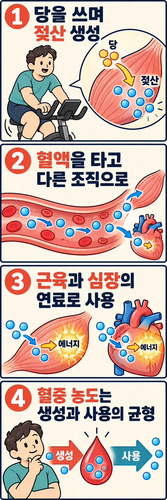

샌드백을 연속해서 치거나 실내 자전거의 속도를 높이면 젖산 이야기를 듣곤 합니다. 그런데 운동 중 생긴 젖산은 어디로 갈까요? 근육 밖으로 나가 다른 조직에 전달되고, 에너지를 만드는 데 다시 쓰일 수 있습니다.

## 당을 빠르게 쓰는 과정에서 젖산이 만들어집니다

근육 수축에는 ATP라는 분자가 필요합니다. ATP는 일을 할 때 바로 사용하는 에너지 전달 물질이며, 운동하는 동안 계속 다시 만들어야 합니다. 그 공급 경로 중 하나가 **해당과정**, 즉 포도당을 여러 단계로 분해하는 과정입니다.

해당과정에서는 소량의 ATP와 함께 피루브산이라는 물질이 생깁니다. 이 과정이 계속되려면 전자를 받아 주는 보조 물질인 NAD+도 재생되어야 합니다. 피루브산을 젖산으로 바꾸는 반응은 NADH를 NAD+로 되돌려 해당과정이 이어지도록 돕습니다.

여기서 일상적으로 부르는 '젖산'은 몸속에서 주로 젖산 이온 형태로 존재하는 물질을 가리킵니다. 젖산으로 바꾸는 반응 자체가 ATP를 추가로 만드는 것은 아닙니다. **당을 분해하는 흐름을 이어 갈 수 있게 한다**는 점이 핵심입니다.

산소가 있는 상태에서도 젖산은 만들어집니다. 따라서 젖산이 늘었다는 사실만으로 근육에 산소가 전혀 없었다고 해석할 수는 없습니다. 해당과정의 속도와 다른 대사 경로의 처리 속도를 함께 봐야 합니다. 이 원리는 [Gladden의 젖산 대사 종설](https://pmc.ncbi.nlm.nih.gov/articles/PMC1664920/)에서 다룹니다.

## 만든 곳과 쓰는 곳을 연결하는 '젖산 셔틀'

젖산은 세포막의 운반 단백질을 통해 드나들 수 있습니다. 혈액으로 나온 젖산은 다른 근육이나 심장에 전달될 수 있고, 같은 근육 안에서도 만드는 쪽과 사용하는 쪽 사이에 이동할 수 있습니다. 이런 연료 전달을 **젖산 셔틀**이라고 부릅니다.

젖산을 받아들인 조직에서는 이를 피루브산으로 전환해 산화적 에너지 대사에 이용할 수 있습니다. 산화적 대사는 산소를 이용하는 ATP 공급 과정이며, 미토콘드리아가 중심 역할을 합니다. 젖산의 탄소가 이 경로에 들어가 에너지 공급에 기여하는 것입니다.

또 다른 길은 간 등에서 포도당을 새로 만드는 데 쓰이는 것입니다. 이를 **포도당 신생합성**이라고 합니다. 그렇게 만들어진 포도당도 다시 연료가 될 수 있습니다. 다만 포도당으로 되돌리는 데에는 에너지가 들므로, 몸 전체에서 공짜로 에너지를 얻는 순환은 아닙니다.

[Brooks의 2018년 종설](https://doi.org/10.1016/j.cmet.2018.03.008)은 이런 조직 사이의 교환과 연료 이용을 정리합니다. 여기서는 젖산의 이동과 재사용이라는 큰 경로에 초점을 둡니다. 세포 안의 세부 이동 경로를 모두 하나의 방식으로 단정할 필요는 없습니다.

## 혈중 농도가 같아도 젖산의 이동량은 다를 수 있습니다

혈중 젖산 농도는 혈액 일정 부피에 젖산이 얼마나 들어 있는지를 보여 줍니다. 욕조의 수위처럼 생각하면 쉽습니다. 물이 빠르게 들어와도 같은 속도로 빠져나가면 수위는 그대로입니다. 젖산도 혈액에 들어오는 속도와 빠져나가는 속도가 비슷하면, 양쪽 흐름이 빨라도 농도는 크게 변하지 않을 수 있습니다.

반대로 혈액으로 들어오는 속도가 빠져나가는 속도를 웃돌면 농도가 높아집니다. 이때의 '제거'에는 다른 조직이 연료로 쓰거나 포도당으로 전환하는 일도 포함됩니다. 몸 밖으로 배출하는 것만을 뜻하지 않습니다.

Messonnier 등의 2013년 연구는 비훈련 남성 6명과 지구력 훈련 남성 6명이 각자의 젖산역치에 해당하는 강도로 60분간 운동할 때 젖산의 출현과 처리 속도를 살폈습니다. 젖산역치는 운동 강도가 높아질 때 혈중 농도의 상승이 두드러지는 지점을 뜻합니다. 측정 방법에 따라서도 추정값은 달라질 수 있습니다.

훈련 집단에서는 젖산의 생성과 처리 흐름이 모두 더 컸습니다. 다만 이들이 수행한 절대 운동 강도도 더 높았습니다. 따라서 집단 차이를 곧바로 훈련 하나의 효과로 돌리거나, 혈중 수치가 낮은 사람이 언제나 체력이 좋다고 판단해서는 안 됩니다. [연구 원문](https://pmc.ncbi.nlm.nih.gov/articles/PMC9094885/)이 보여 주는 것은 농도와 대사 흐름을 구분해야 한다는 점입니다.

## 사람의 몸에서 연료로 쓰인다는 근거는 무엇일까요?

Emhoff 등의 2013년 연구는 비훈련 남성 6명과 지구력 훈련 남성 6명을 대상으로 60분간 일정한 부하의 자전거 운동을 시행했습니다. 동위원소로 표지한 젖산과 호흡 가스 등을 이용해 젖산의 탄소가 에너지 대사에 쓰이는 경로를 추적했습니다.

연구진은 젖산이 포도당으로 바뀌는 단계를 거치지 않고 산화되는 경로와, 포도당으로 전환된 뒤 산화되는 경로를 나누어 추정했습니다. 운동 중 두 경로가 모두 관찰됐고, 전자의 기여가 더 컸습니다. 여기서 '직접 산화'라는 분류는 **포도당으로 먼저 바뀌지 않았다**는 뜻입니다. 젖산 분자가 아무런 변환 없이 곧바로 ATP가 된다는 뜻은 아닙니다.

이 [원저 연구](https://pmc.ncbi.nlm.nih.gov/articles/PMC8846964/)는 젖산의 재사용을 사람에게서 추적했다는 점에서 유용합니다. 다만 표본이 작고 남성의 지속적인 자전거 운동을 다뤘습니다. 짧은 타격과 멈춤이 섞이는 복싱에서 같은 연료 비율이 나온다거나, 특정 훈련법이 장기적으로 가장 좋다는 결론까지 입증한 연구는 아닙니다.

## 체력이 좋아졌는지는 같은 운동을 반복해 비교하세요

예를 들어 실내 자전거를 같은 저항과 속도로 15분 탔을 때, 전에는 마지막 5분이 버거웠는데 이제는 끝까지 페이스를 유지할 여유가 생겼다면 기록해 보세요. 같은 변화가 여러 번 이어지면 지금 강도에 익숙해졌다는 단서가 됩니다.

혈중 젖산을 측정한다면 운동 종류, 부하를 올린 방법, 채혈 시점도 함께 기록하세요. 검사 조건을 맞추면 수치 변화를 해석하기 쉽습니다.

운동을 시작하고 싶은데 어느 정도 강도로 해야 할지 막막하다면, 레드복싱 행신점에서 운동 상담부터 받아 보세요. 지금 편하게 할 수 있는 운동과 꾸준히 다닐 수 있는 일정을 바탕으로 첫 운동의 강도를 함께 정해 볼 수 있습니다.

## 참고 자료

- Gladden LB. 2004. 젖산 대사와 조직 간 교환을 정리한 종설. *Lactate metabolism: a new paradigm for the third millennium*. DOI: 10.1113/jphysiol.2003.058701. [원문](https://pmc.ncbi.nlm.nih.gov/articles/PMC1664920/)
- Brooks GA. 2018. 젖산 셔틀과 연료 재사용을 정리한 종설. *The Science and Translation of Lactate Shuttle Theory*. DOI: 10.1016/j.cmet.2018.03.008. [학술지 원문](https://doi.org/10.1016/j.cmet.2018.03.008)
- Messonnier LA 외. 2013. 훈련 집단과 비훈련 집단의 젖산 이동을 비교한 사람 대상 연구. *Lactate kinetics at the lactate threshold in trained and untrained men*. DOI: 10.1152/japplphysiol.00043.2013. [원문](https://pmc.ncbi.nlm.nih.gov/articles/PMC9094885/)
- Emhoff CW 외. 2013. 젖산의 직접·간접 산화를 추적한 사람 대상 연구. *Direct and indirect lactate oxidation in trained and untrained men*. DOI: 10.1152/japplphysiol.00538.2013. [원문](https://pmc.ncbi.nlm.nih.gov/articles/PMC8846964/)
