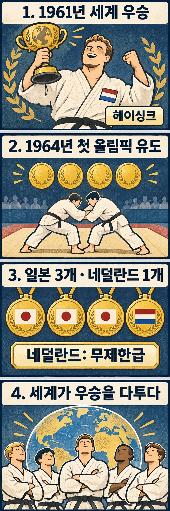

1964년 도쿄 올림픽 유도에는 네 개의 금메달이 걸려 있었습니다. 일본 선수가 세 종목에서 우승했지만 무제한급 금메달은 네덜란드의 안톤 헤이싱크에게 돌아갔습니다. 왜 이 우승은 유도 역사에서 특별하게 기억될까요?

## 첫 올림픽은 어떤 무대였을까요?

유도가 처음 올림픽 정식 경기를 치른 곳은 1964년 도쿄였습니다. 남자 경기만 열렸고, 체중으로 나눈 세 종목에 무제한급을 더한 구성이었습니다. 무제한급은 체중 구분 없이 겨루는 종목을 뜻합니다. 경기장은 대회를 위해 건설한 일본무도관이었습니다. [국제유도연맹의 도쿄 대회 회고](https://ijf.org/news/tokyo-1964-the-first-chapter)는 이 첫 무대의 배경과 결과를 정리합니다.

여기서 생각해 볼 질문은 종목이 시작된 나라와 우승할 수 있는 나라가 같은 범위인가 하는 것입니다. 개최국에서 열린 첫 올림픽은 일본 유도의 기량을 보여 주는 자리인 동시에, 다른 나라 선수도 같은 타이틀을 두고 경쟁하는 자리였습니다.

헤이싱크의 승리를 일본 유도 전체의 몰락으로 설명하면 당시 결과를 놓칩니다. 나머지 세 종목의 우승자는 모두 일본 선수였습니다. 일본의 강세가 분명한 대회에서 네덜란드 선수가 무제한급을 차지했다는 두 사실을 함께 보아야 합니다.

## 이름 없는 도전자가 갑자기 등장했을까요?

올림픽 결승에서 이야기를 시작하면 헤이싱크가 어느 날 일본의 강자들을 놀라게 한 선수처럼 보일 수 있습니다. 하지만 그는 이미 1961년 세계선수권 우승자였습니다. 국제유도연맹은 그를 일본 국적이 아닌 선수 가운데 처음으로 세계선수권에서 우승한 인물로 소개합니다. [명예의 전당 기록](https://www.ijf.org/history/hall-of-fame/95)에서도 이 이력을 확인할 수 있습니다.

따라서 1964년의 의미는 외국 선수가 갑자기 강해졌다는 데만 있지 않습니다. 세계선수권에서 확인된 경쟁력이 올림픽이라는 다른 무대에서도 결과로 이어졌다는 데 있습니다. 처음 듣는 이름이었다는 관객의 경험과, 이미 국제대회 우승 경력이 있었다는 사실은 구분해야 합니다.

국제유도연맹도 [무제한급의 역사를 다룬 글](https://www.ijf.org/news/show/why-the-openweight-world-championships-matters-in-2017)에서 그가 1961년 무제한급 세계 챔피언이었다는 점이 종종 간과된다고 짚습니다. ‘뜻밖의 우승’이라는 짧은 표현 뒤에 이미 쌓인 성취가 있었던 셈입니다.

## 무제한급 금메달은 무엇을 보여 주었을까요?

도쿄 무제한급 최종 순위에서 헤이싱크는 1위, 일본의 가미나가 아키오는 2위였습니다. 국제유도연맹의 대회 회고에 남은 결과입니다. 첫 올림픽 유도에서 일본 밖의 선수도 정상에 설 수 있다는 사실이 기록으로 드러났습니다.

국제유도연맹은 헤이싱크의 승리를 유도의 국제적 발전을 보여 준 상징으로 평가합니다. 이 평가를 따라 읽으면 일본에서 발전한 경기 방식이 일본 밖에서도 높은 수준으로 익혀지고, 우승을 다투는 대상이 될 수 있었다는 의미가 보입니다.

다만 한 경기 때문에 유도가 세계로 퍼졌다고 결론 내릴 수는 없습니다. 헤이싱크가 올림픽에 나서기 전부터 세계선수권이 있었고, 그 자신도 그 무대의 우승자였습니다. 도쿄의 금메달은 국제화의 출발점 하나로 모든 것을 설명하기보다, 이미 진행되던 변화를 선명하게 드러낸 사건으로 보는 편이 적절합니다.

## 종주국의 패배보다 넓게 남은 유산입니다

헤이싱크의 우승을 기억하는 방법은 ‘일본 선수가 졌다’에서 멈추지 않습니다. 일본 선수들의 세 종목 우승은 당시의 강세를 보여 주고, 네덜란드 선수의 무제한급 우승은 그 강세가 다른 나라의 우승 가능성을 닫지는 못했음을 보여 줍니다.

이 글에서 두 결과를 함께 읽는 이유도 여기에 있습니다. 한 나라의 전통이 국제 스포츠가 된다는 것은 다른 나라가 관객으로 참여하는 데 그치지 않고, 같은 무대에서 우승을 다툴 수 있다는 뜻이기도 합니다. 1961년과 1964년을 이어 보면 헤이싱크의 금메달은 갑작스러운 반전보다 더 긴 변화의 상징으로 남습니다.

## 참고 자료

- [국제유도연맹: Tokyo 1964: The First Chapter](https://ijf.org/news/tokyo-1964-the-first-chapter) — 첫 올림픽 유도의 구성·경기장·종목별 결과와 역사적 평가입니다.
- [국제유도연맹 명예의 전당: Anton Geesink](https://www.ijf.org/history/hall-of-fame/95) — 1961년 세계선수권과 1964년 올림픽 우승 이력입니다.
- [국제유도연맹: Why the Openweight World Championships matters in 2017](https://www.ijf.org/news/show/why-the-openweight-world-championships-matters-in-2017) — 올림픽 이전의 세계 타이틀과 무제한급의 역사적 맥락입니다.
