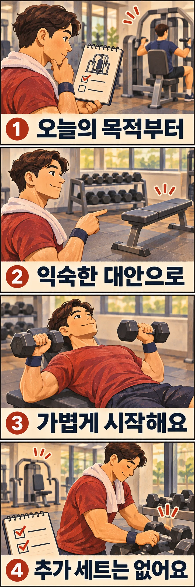

체스트프레스를 하려고 왔는데 다른 분이 사용 중입니다. 옆의 빈 기구부터 할까요, 덤벨로 바꿀까요? 이때는 **빈 기구를 찾기 전에 오늘 지키려던 과제를 확인하는 것**이 출발점입니다. 같은 기구를 쓰는 것이 목표인 날과, 가슴을 미는 운동을 하려던 날의 선택은 다를 수 있습니다.

## 특정 종목 연습인가요, 근력운동 한 항목인가요?

벤치프레스의 자세와 기록을 연습하는 날이라면 벤치프레스 자체가 과제입니다. 다른 프레스를 했다고 그 종목을 연습한 것으로 기록하지는 마세요. 기다릴 수 있는 시간을 정하거나, 그날의 종목 연습을 다음 훈련으로 옮기는 선택이 더 명확합니다.

반대로 일반적인 근력운동 계획에서 ‘가슴 앞으로 밀기’ 한 항목을 채우려던 날이라면, 이미 배운 다른 프레스를 대안으로 준비할 수 있습니다. 미국스포츠의학회(ACSM)의 2026년 공식 안내는 평균적인 건강한 성인의 훈련 결과에서 머신과 프리웨이트 같은 **장비 유형이 일관되게 결과를 좌우하지는 않았다**고 설명합니다. 그렇다고 모든 기구와 동작을 같은 운동으로 취급한다는 뜻은 아닙니다. 특정 종목 숙련과 일반적인 체력 목표를 구분해야 합니다. [ACSM 공식 안내](https://acsm.org/resistance-training-guidelines-update-2026/)

다음 기준은 혼잡한 날의 선택을 돕기 위한 제안입니다. 이 순서로 운동한 사람들의 효과를 측정한 실험 결과는 아닙니다.

## 세 가지 선택을 미리 정해 두세요

| 오늘의 조건 | 선택할 방법 | 지킬 기준 |
| --- | --- | --- |
| 특정 종목을 연습해야 하고 시간이 남습니다 | 잠시 기다립니다 | 남은 이용량을 정중히 묻고, 기다림의 한도를 정합니다 |
| 같은 계획 안에서 먼저 해도 되는 다른 항목이 있습니다 | 순서를 바꿉니다 | 원래 우선 종목을 나중에 할 때 평소 기록을 강요하지 않습니다 |
| 목적에 맞는 익숙한 대안이 있고 시간이 빠듯합니다 | 대체합니다 | 대체한 세트를 계획에 반영하고 원래 항목을 덧붙이지 않습니다 |

예를 들어 운동 시간이 30분 남았다면 기다리는 시간을 5분까지만 쓰기로 정할 수 있습니다. 5분은 운동 효과를 가르는 기준이 아니라 일정 관리를 위한 개인적인 한도입니다. 남은 세트 수를 알 수 없거나 대기자가 많다면, 한도 안에서도 다음 선택으로 넘어가세요.

순서를 바꿀 때는 ‘어느 운동이든 먼저 하면 된다’고 생각하지 마세요. 오늘 중요하게 연습할 종목을 뒤로 미뤄야 한다면, 다른 운동을 세게 채우기보다 그 종목의 연습을 다른 날로 옮길지 결정하는 편이 낫습니다. 특히 최대중량을 시험하는 일정은 이 글의 임시 대체안에 넣지 않습니다.

## 대체 운동은 같은 부위라는 이유만으로 고르지 마세요

가슴 운동이라는 이름은 같아도 앞으로 미는 프레스와 팔을 모으는 플라이는 다른 동작입니다. 오늘의 과제가 프레스였다면 ‘가슴 기구가 비었으니 아무거나’보다 **움직임과 익숙함**을 함께 살펴보세요.

- **하려던 움직임이 비슷한가요?** 가슴 앞으로 미는 과제라면 이미 배운 체스트프레스나 덤벨 프레스 중 가능한 것을 후보로 둡니다. 완전히 같은 자극이라고 가정하지는 않습니다.
- **혼자 준비하고 마칠 수 있나요?** 기구 조절과 무게 회수 방법을 모르는 동작은 즉석 대안으로 삼지 않습니다. 직원이나 지도자에게 먼저 확인하세요.
- **지금의 공간에서 가능한가요?** 덤벨과 벤치가 모두 필요하다면 둘 다 사용 가능한지 확인합니다. 통로나 다른 사람의 운동 범위는 대체 장소가 아닙니다.

배운 대안이 하나도 없다면 그 항목을 오늘 생략하는 선택도 남겨 두세요. 사용법을 모르는 기구를 급하게 시도해서 계획표를 채울 필요는 없습니다. 재활이나 별도 처방에 따른 운동은 임의로 바꾸지 말고 담당자에게 대안을 확인하세요.

## 2세트를 바꿨다면 2세트를 더하지 않습니다

다음은 기본 동작을 배운 성인이 일반적인 근력운동을 하는 날의 예시입니다. 개인별 처방을 대신하는 완성 루틴은 아닙니다.

원래 계획이 체스트프레스 2세트, 각 8~12회였다고 해 보겠습니다. 기구가 사용 중이라서 이미 배운 덤벨 프레스로 바꾸기로 했습니다. 이때는 머신에 적힌 무게를 덤벨에 그대로 옮겨 맞추려 하지 말고, **새 동작에서 조절할 수 있는 가벼운 무게로 준비 세트**를 해 보세요.

문제없이 준비했다면 본 세트는 계획했던 2세트 안에서 진행합니다. 예시의 강도는 정한 반복을 마친 뒤에도 같은 자세로 2~3회 정도는 더 할 여유가 있다고 느끼는 정도로 잡습니다. 이 여유를 정확히 판단하기 어렵다면 더 가볍게 시작하고 자세를 확인받으세요. 세트 사이는 예시로 2분을 쉬되, 다음 세트를 안정적으로 시작하기 어렵다면 더 쉬거나 남은 양을 줄입니다. 날카로운 통증이나 동작을 통제하기 어려운 느낌이 있으면 중단하세요.

덤벨 프레스를 끝냈을 때 체스트프레스가 비었다고 원래 2세트를 추가하지 않습니다. **대체는 교환이지 추가가 아닙니다.** 준비 세트와 본 세트를 구분해 두면 기다리는 동안 이것저것 하다가 계획한 양을 넘기는 일을 줄일 수 있습니다.

## 다음 혼잡한 날을 위해 대안 하나만 남겨 두세요

기록에는 원래 계획과 실제 수행을 구분해 적어 보세요. 예를 들면 ‘체스트프레스 2세트 예정 → 사용 중이어서 덤벨 프레스 2세트, 각 10회’처럼 남깁니다. 덤벨 무게는 한 손 기준인지도 적고, 대기 시간과 준비에 어려움이 있었는지 한 줄 덧붙이면 충분합니다. 다른 종목의 무게를 이전 기구의 기록과 직접 비교해 향상 여부를 판정하지는 마세요.

혼잡할 때마다 같은 항목이 빠진다면, 다음 운동 전에 지도자와 익숙한 대안 하나를 정하거나 이용 시간을 조정해 보세요. 대안이 너무 많을 필요는 없습니다. **목표를 확인하고, 기다림의 한도를 정한 뒤, 익숙한 대안으로 교환하고 끝내는 것**이 이번 선택의 핵심입니다. 오늘 계획표에서 자주 기다리는 항목 하나에만 대안을 붙여 보세요.

## 참고 자료

- [ACSM, 2026년 근력운동 가이드라인 공식 안내](https://acsm.org/resistance-training-guidelines-update-2026/): 건강한 성인을 대상으로 한 권고의 기관 요약이며, 장비 유형과 개인 목표에 따른 계획 조정을 설명합니다. 본문의 혼잡 상황별 선택과 세트 예시는 이 자료에서 시험한 프로그램이 아닌 실용적인 제안입니다.