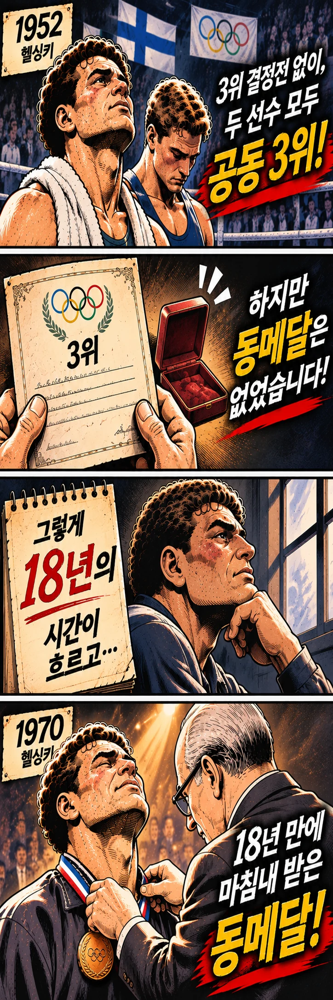

집 벽에는 올림픽에서 3위를 했다는 상장이 걸려 있었습니다. 그런데 누군가 동메달을 보여 달라고 하면, 선수는 이렇게 설명해야 했습니다. **동메달은 받은 적이 없다고요.**

1970년 핀란드 복싱협회장이 보낸 편지에는 1952년 헬싱키 올림픽에 출전했던 한 복서의 이런 사연이 등장합니다. 성적은 분명히 3위였지만, 손에 쥔 것은 메달이 아닌 상장이었습니다.

이상한 일은 그 선수 한 명에게만 벌어진 것이 아니었습니다. **헬싱키 올림픽 복싱의 공동 3위 선수 20명 모두가 같은 상황**이었습니다.

## 3위 결정전을 없앴는데, 동메달도 사라졌습니다

1948년 런던 올림픽까지 복싱에서는 준결승에서 패한 두 선수가 다시 맞붙었습니다. 이른바 **3위 결정전**이었습니다. 승자는 동메달을 받았고, 패자는 메달 없이 대회를 마쳤습니다.

1952년 헬싱키에서는 이 경기가 사라졌습니다. 지친 복서들에게 한 경기를 더 치르게 하지 않겠다는 취지였습니다. 당시 국제아마추어복싱연맹(AIBA)의 권고에 따라 준결승 패자 두 명을 공동 3위로 인정했습니다.

그런데 예상 밖의 조건이 붙었습니다. **공동 3위 두 명 모두에게 동메달을 주지 않는 것**이었습니다.

1952년 올림픽 공식 보고서에 따르면 이 선수들은 시상식에 초대됐고 국기도 게양됐지만, 메달 대신 상장을 받았습니다. 빌 맬런이 정리한 국제올림픽위원회(IOC)의 1951년 회의 기록에도 공동 3위 인정과 동메달 미수여를 구분한 결정이 남아 있습니다.

선수들을 보호하기 위해 추가 경기를 없앤 결정이, 정작 그 선수들에게는 메달을 주지 않는 결과로 이어진 것입니다.

## 1956년에는 두 선수 모두 동메달을 받았습니다

4년 뒤인 1956년 멜버른 올림픽에서는 같은 상황에 놓인 선수들이 다른 대우를 받았습니다. 준결승에서 패한 두 선수에게 각각 동메달을 수여하기 시작한 것입니다.

3위 결정전은 여전히 열리지 않았습니다. 달라진 것은 **공동 3위의 성적을 메달로 인정하는 방식**이었습니다.

그렇다면 헬싱키 선수들은 어떻게 됐을까요?

그들의 경기 결과는 달라지지 않았습니다. 이미 3위로 기록돼 있었습니다. 하지만 동메달은 여전히 없었습니다. 시간이 흘러 다른 올림픽의 공동 3위 선수들이 메달을 받는 동안, 1952년의 스무 선수만 예외로 남아 있었습니다.

## 18년 뒤, 한 장의 편지가 문제를 다시 꺼냈습니다

1970년 3월 17일, 핀란드 복싱협회장 아틀레 살로캉가스는 AIBA 회장 루디야드 러셀에게 편지를 보냈습니다.

편지에는 앞서 소개한 선수의 사연이 담겨 있었습니다. 집에 3위 상장은 있지만 동메달은 없다는 이야기였습니다. 핀란드 복싱협회는 1952년의 스무 선수가 다른 대회의 같은 성적을 거둔 선수들과 달리 메달을 받지 못한 상황을 부당하다고 판단했습니다.

이 문제를 해결하려면 여러 기관이 얽혀 있었습니다. 국제복싱연맹과 핀란드 측 관계자들이 의견을 나눴고, 핀란드 올림픽위원회는 IOC에도 문의했습니다.

여기서 절차를 단순화해서는 안 됩니다. **IOC가 새로운 공식 결의를 통해 1952년의 메달을 일괄 승인했다고 확인되는 것은 아닙니다.** 맬런은 관련 서신을 검토한 뒤 당시 IOC 사무총장의 대응을 사실상의 묵시적 동의로 해석했습니다. 이는 연구자의 해석이지, 별도의 공식 의결이 확인됐다는 뜻은 아닙니다.

## 1970년 4월 2일, 다시 헬싱키에 선 복서들

마침내 1970년 4월 2일, 헬싱키의 메수할리 경기장에서 뒤늦은 동메달 수여식이 열렸습니다. **18년 전 올림픽 복싱 경기가 열렸던 바로 그 장소**였습니다.

스무 명 모두가 참석할 수는 없었습니다. 갑작스러운 일정 때문에 다섯 명이 현장에 왔고, 불가리아의 보리스 니콜로프는 하루 늦게 도착해 4월 3일 별도의 자리에서 메달을 받았습니다. 참석하지 못한 선수들에게는 메달을 우편으로 보냈습니다.

이 과정은 빌 맬런이 당시 관계자들의 편지와 자료를 대조해 정리한 역사입니다. 메달이 뒤늦게 전달된 사실과 IOC의 정식 승인 절차가 완전히 정리됐는지는 구분할 필요가 있습니다.

그래도 한 가지는 분명했습니다. **1952년에 거둔 성적을 기념하는 동메달이 1970년에야 선수들에게 전달됐다는 사실**입니다.

## 메달이 늦게 왔다고, 3위가 늦게 된 것은 아닙니다

1952년 헬싱키의 복서들은 18년 동안 더 좋은 선수가 된 것도, 경기 결과를 새로 바꾼 것도 아니었습니다. 그들이 치른 준결승은 이미 끝났고, 공동 3위라는 성적도 정해져 있었습니다.

뒤늦게 달라진 것은 그 성적을 인정하는 방식이었습니다.

복싱의 역사는 누가 누구를 이겼는지만으로 완성되지 않습니다. 경기를 어떻게 치르게 할지, 패한 선수의 성취를 어떻게 기록하고 보상할지 역시 그 역사의 일부입니다.

**선수들의 실력은 이미 1952년에 증명됐지만, 그들에게 돌아갈 동메달은 18년이나 늦게 도착했습니다.**

## 참고 자료

- [Bill Mallon, 「The 1952 Boxing Bronzes」, *Journal of Olympic History* 2/2013, 20~24쪽](https://isoh.org/wp-content/uploads/2015/03/238.pdf) — 1952년 공식 보고서, 1951년 IOC 회의 기록, 1970년 핀란드 복싱협회와 IOC 사이의 서신, 4월 2~3일 메달 수여 경위를 인용·분석한 연구.
- [Olympedia — 1952년 헬싱키 올림픽 복싱](https://www.olympedia.org/editions/13/sports/BOX?id=CMA) — 대회 결과 및 메달 기록 참고.
