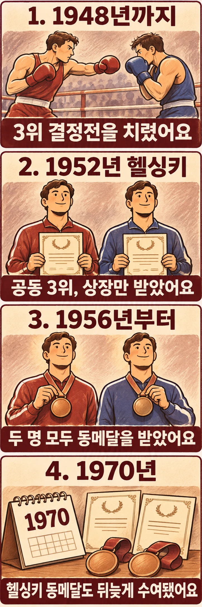

## 공동 3위인데 메달은 없었다고요?

1952년 헬싱키 올림픽 복싱 결과표에는 체급마다 동메달리스트가 두 명씩 올라 있습니다. 그러나 이 선수들이 대회 당시 동메달을 받은 것은 아닙니다. 공동 3위라는 순위를 정하는 일과 그 성적에 메달을 주는 일이 갈라졌기 때문입니다. [Olympedia의 대회 기록](https://www.olympedia.org/editions/13/sports/BOX?id=CMA)은 이 차이를 설명합니다.

## 추가 경기를 없애면 무엇을 줘야 할까요?

1920년부터 1948년까지 올림픽 복싱에서는 준결승에서 진 두 선수가 다시 맞붙어 동메달의 주인을 정했습니다. 헬싱키에서는 이 3위 결정전을 열지 않았습니다. 당시 국제아마추어복싱연맹인 AIBA의 권고에 따라 공동 3위 선수들에게 상장을 주었지만, 동메달은 수여하지 않았습니다.

역사가 빌 맬런이 소개한 헬싱키 공식 보고서는 지친 선수들에게 추가 경기의 부담을 주지 않으려는 취지였다고 설명합니다. 여기서 없앤 것은 패자에게 한 번 더 싸우게 하는 절차였습니다. 그다음 질문은 남았습니다. 승부를 더 가리지 않은 두 선수의 성취를 어떻게 인정할 것인가 하는 문제입니다. [공식 보고서와 서신을 인용한 맬런의 연구](https://isoh.org/wp-content/uploads/2015/03/238.pdf)에서 당시의 판단을 살펴볼 수 있습니다.

## 1956년에는 두 명 모두 동메달을 받았습니다

1956년 멜버른 올림픽부터는 준결승 패자 두 명에게 각각 동메달을 주었습니다. 추가 대결 없이 두 선수의 성적을 인정하는 방식이 자리 잡은 것입니다. 따라서 헬싱키의 변화는 두 단계로 나눠 읽어야 합니다. 1952년에는 3위 결정전이 사라졌고, 1956년에는 두 명에게 메달을 주는 방식으로 이어졌습니다. [Olympedia](https://www.olympedia.org/editions/13/sports/BOX?id=CMA)

이 구분을 놓치면 지금의 결과표를 보면서 과거 시상식도 같았다고 생각하기 쉽습니다. 결과표는 정리된 성적을 보여 주지만, 선수들이 당시 무엇을 받았는지까지 한눈에 알려 주지는 않습니다.

## 헬싱키 선수들의 메달은 1970년에 돌아왔습니다

맬런의 연구에 따르면 핀란드 복싱협회는 1970년 미수여 동메달 문제를 다시 제기했습니다. 같은 공동 3위인데 헬싱키 선수들에게만 메달이 없다는 불균형이 쟁점이었습니다. 그해 헬싱키에서 뒤늦은 수여가 이루어졌고, 나머지 메달은 우편으로 보내졌습니다.

다만 이를 단순히 국제올림픽위원회가 새 결의를 내려 일괄 정정했다고 표현하기는 어렵습니다. 맬런은 관련 서신을 검토하며 IOC의 태도를 묵시적 동의로 해석합니다. 메달 수여가 이루어졌다는 사실과 승인 절차에 관한 연구자의 해석은 구분해서 읽어야 합니다. [맬런의 연구, 22~24쪽](https://isoh.org/wp-content/uploads/2015/03/238.pdf)

## 메달 개수보다 먼저 바뀐 것은 경기 방식이었습니다

헬싱키의 공동 3위 선수들은 순위가 없어서 메달을 받지 못한 것이 아니었습니다. 추가 경기를 없애는 결정과 그 성적에 어떤 상을 줄지 정하는 결정 사이에 놓여 있었습니다.

이 역사는 복싱의 제도가 승자를 가리는 방법뿐 아니라, 더 싸우지 않고도 성취를 인정하는 방법을 정해 온 과정임을 보여 줍니다. 올림픽 기록을 읽을 때 공동 3위라는 숫자 옆에 시상 방식의 변화까지 떠올리면, 같은 동메달도 조금 다르게 보입니다.

## 참고 자료

- [Olympedia: 1952년 올림픽 복싱](https://www.olympedia.org/editions/13/sports/BOX?id=CMA) — 당시 미수여와 이후 메달 수여, 1956년 제도 설명.
- [Bill Mallon, 「The 1952 Boxing Bronzes」, Journal of Olympic History 2/2013, 20~24쪽](https://isoh.org/wp-content/uploads/2015/03/238.pdf) — 공식 보고서와 관계자 서신을 인용한 역사 연구.
