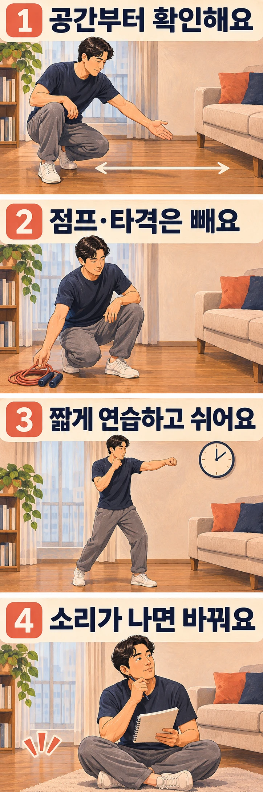

집에서도 복싱을 하고 싶은데 줄넘기나 발 구르는 소리가 신경 쓰이시나요? 그렇다면 샌드백과 점프를 집 안으로 가져오기보다 **배운 동작을 공중에서 짧게 연결하는 과제**부터 골라 보세요. 섀도복싱은 상대나 기구를 치지 않고 가상의 상대를 떠올리며 움직이는 연습입니다.

아래는 기본 자세와 직선 펀치를 수업에서 배운 성인을 위한 소규모 연습 제안입니다. 소음 감소량을 측정한 실험이나 체력 향상을 보장하는 프로그램은 아닙니다. 목표는 집에서 할 수 있는 범위를 정하고, 타격과 큰 이동은 다른 장소에 남겨 두는 것입니다.

## 먼저 이 집에서 가능한 과제를 정하세요

점프를 하지 않는다고 이웃에게 소리가 전혀 전달되지 않는 것은 아닙니다. 건물과 바닥 조건을 모르는 상태에서 특정 매트나 동작을 무소음이라고 판단하지 마세요. 소음이 허용되는 시간과 주거 공간의 이용 규칙부터 확인하고, 늦은 시간이라면 몸을 움직이는 연습을 다른 시간으로 옮기는 선택도 가능합니다.

연습 전에는 팔을 천천히 뻗고 작은 걸음으로 주변을 확인해 보세요. 손이 벽·등·가구에 닿거나 발이 물건에 걸린다면 그 자리는 사용하지 않습니다. 아이나 반려동물이 드나드는 동선과도 분리하세요. England Boxing의 [가정용 섀도복싱 안내](https://www.englandboxing.org/news_articles/shadow-boxing-drills-with-mick-driscoll-week-two/) 역시 충분하고 미끄럽지 않은 바닥 공간을 전제로 합니다.

매트 위에 섰다는 이유만으로 공간 확인을 생략하지 마세요. 가장자리가 말리거나 발이 걸리고, 움직일 때 밀리는 물건은 연습 구역에서 치워 주세요. 소리를 줄이려고 발을 바닥에 억지로 붙인 채 몸만 비트는 방식도 피하세요. 자연스럽게 움직일 여유가 없다면 그 동작은 집에서 제외하는 편이 낫습니다.

## 점프·타격·큰 이동을 과제에서 빼 보세요

집에서의 목표를 운동량을 최대한 채우기로 잡으면 제외했던 점프나 빠른 발놀림을 다시 넣기 쉽습니다. 이번에는 **수업에서 배운 짧은 연결을 떠올리는 시간**으로 범위를 좁혀 보세요.

| 하려던 훈련 | 이번 집 연습에서의 선택 | 따로 남겨 둘 과제 |
| --- | --- | --- |
| 줄넘기와 제자리 뛰기 | 생략하고 편안한 서기와 작은 움직임으로 시작합니다 | 점프와 착지 반복 |
| 샌드백 강타 | 물건을 치지 않는 가벼운 섀도복싱으로 바꿉니다 | 접촉 거리와 타격 강도 조절 |
| 넓게 오가는 풋워크 | 공간이 충분할 때만 작은 이동을 넣습니다 | 긴 전후 이동과 빠른 방향 전환 |
| 빠른 연타로 끝까지 몰아치기 | 익숙한 짧은 조합 뒤에 재정비 시간을 둡니다 | 높은 강도의 라운드 훈련 |

쿠션이나 벽을 임시 샌드백으로 사용하지 마세요. 표의 오른쪽 과제는 집에서 반드시 보충해야 할 숙제가 아닙니다. 적합한 장소에서 코치와 연습할 항목으로 남겨 두시면 됩니다.

## 처음에는 준비부터 정리까지 10분만 배치해 보세요

다음 시간표는 이 글에서 구성한 예시입니다. 장비는 필요하지 않으며, 시간을 확인할 시계만 있으면 됩니다. 휴대전화 알림을 쓴다면 소리 크기도 주변 상황에 맞춰 주세요.

- **처음 2분:** 공간과 바닥을 확인하고, 편안하게 몸을 움직이며 준비합니다. 움직임이 불편하면 본 연습에 들어가지 않습니다.
- **다음 6분:** ‘가벼운 섀도복싱 1분 + 휴식과 공간 점검 1분’을 세 차례 반복합니다. 쉬는 시간에는 점프나 다른 운동을 추가하지 않습니다.
- **마지막 2분:** 움직임을 멈추고 정리한 뒤, 집에서 제외한 과제와 다음 수업에 가져갈 질문을 한 가지씩 남깁니다.

첫 번째 연습 구간에는 이미 배운 잽과 스트레이트를 편안하게 연결해 보세요. 두 번째에는 같은 조합을 유지하되 시작 전 가상의 상대 위치를 떠올립니다. 세 번째에는 그 조합 뒤에 다음 행동을 생각할 여유를 남깁니다. 새로운 기술을 늘리거나 점점 빠르게 하는 과제는 넣지 않습니다.

펀치는 힘껏 내지 말고 스스로 제어할 수 있는 속도로 합니다. 자세를 유지하려고 발을 자연스럽게 움직여야 한다면 그렇게 하되, 그 움직임이 공간이나 소음 조건과 맞지 않으면 과제를 줄이세요. **집의 조건에 몸을 억지로 맞추기보다 연습할 항목을 바꾸는 것**이 이번 계획의 핵심입니다.

## 소리가 나거나 자리가 좁다면 시간을 늘리지 마세요

발을 내려놓을 때 쿵 하는 소리가 반복되면 속도와 이동 폭부터 낮춰 보세요. 그래도 계속되면 해당 구간을 끝내고, 배운 순서를 떠올리거나 다음 수업의 질문을 정리하는 시간으로 바꿉니다. 내 귀에 작게 들리는 것만으로 다른 공간에서도 조용하다고 결론 내리지는 마세요.

공간이 좁아 펀치를 충분히 뻗을 수 없다면 가구 사이에서 억지로 짧게 치지 마세요. 팔을 뻗는 연습 자체를 보류합니다. 바닥이 미끄럽거나 주변 사람이 들어오면 즉시 멈추고, 통증이 생겨도 동작을 이어 가지 않습니다.

반대로 여유가 있다고 해서 첫날부터 연습 구간을 추가할 필요는 없습니다. 우선 같은 구성을 다시 해 보며 어떤 과제가 공간에 맞았는지 확인하세요. 이미 익숙한 분도 집에서 강도를 높이는 대신, 가상의 상대 위치를 더 구체적으로 설정하는 식으로 과제를 바꿀 수 있습니다. 상대의 실제 반응과 타격 감각까지 혼자 확인할 수 있는 것은 아닙니다.

## 다음 수업에서는 집에서 뺀 과제를 이어 가세요

연습 후에는 운동량 점수보다 **가능했던 동작·제외한 동작·제외한 이유**를 남겨 보세요. 예를 들어 ‘직선 펀치 연결은 가능, 좌우 이동은 가구 때문에 보류’라면 다음 장소에서 무엇을 연습할지 분명해집니다. 집에서 하지 못한 시간을 벌충하려고 다음 수업에 무조건 라운드를 더할 필요는 없습니다.

레드복싱에서 배운 내용을 집에서도 이어 가고 싶다면, 집의 공간과 소음 조건을 설명하고 혼자 반복할 과제의 범위를 물어보세요. 집에서는 짧은 비접촉 연결을, 적합한 훈련 공간에서는 이동과 접촉 과제를 나누는 방식으로 계획을 세울 수 있습니다.

집에서 복싱을 하고 싶지만 소음이 걱정될 때의 첫 선택은 장비를 추가하는 일이 아닙니다. **점프와 타격을 빼고도 가능한 과제가 있는지 확인한 뒤, 가능한 범위만 짧게 연습해 보세요.** 그 범위가 나오지 않는 날에는 장소나 시간을 바꾸셔도 됩니다.

## 참고 자료

- [England Boxing: Shadow Boxing drills with Mick Driscoll – week two](https://www.englandboxing.org/news_articles/shadow-boxing-drills-with-mick-driscoll-week-two/): 가정 연습 시 충분하고 미끄럽지 않은 바닥 공간이 필요하다는 안내를 참고했습니다. 위 10분 구성과 과제 분류는 이 글의 제안입니다.
