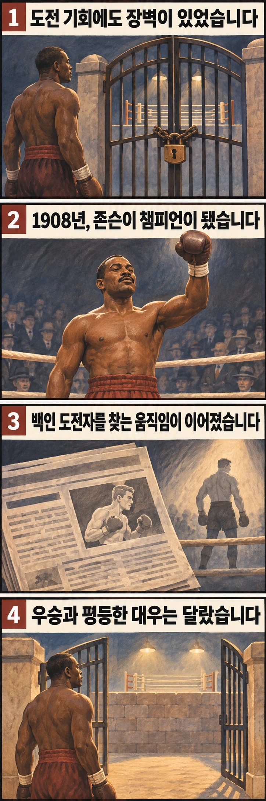

## 챔피언이 되면 장벽도 사라질까요?

1908년 12월 26일, 잭 존슨은 호주 시드니에서 토미 번스를 꺾고 최초의 흑인 세계 헤비급 챔피언이 됐습니다. 그러나 타이틀을 얻었다고 해서 그를 둘러싼 인종 차별까지 끝난 것은 아니었습니다. 오히려 그의 왕좌를 되찾을 백인 선수를 찾는 움직임이 뒤따랐습니다.

이 역사를 이해하려면 누가 더 강했는지만 물어서는 부족합니다. **누가 타이틀에 도전할 수 있었고, 누가 챔피언으로 받아들여졌는지**를 함께 살펴봐야 합니다.

## 실력만으로 도전 기회를 얻기 어려웠습니다

당시 복싱의 ‘컬러 라인’은 피부색을 기준으로 대결과 기회를 가르던 인종 장벽을 뜻합니다. 흑인 선수가 실력을 갖췄더라도 백인 챔피언이 대결을 거부하면 타이틀을 겨룰 길이 막힐 수 있었습니다. 모든 체급의 상황이 같았다는 뜻은 아닙니다. 여기서는 존슨이 세계 헤비급 왕좌에 접근하던 과정을 살펴봅니다.

스미스소니언 국립 흑인 역사문화박물관은 존슨이 1903년 당시 인종별로 분리돼 있던 ‘월드 컬러드 헤비웨이트’ 타이틀을 얻었다고 설명합니다. 그 경력과 1908년의 세계 헤비급 타이틀은 구분해야 합니다. 흑인 선수들 사이에서 정상에 올랐다는 기록만으로 세계 왕좌에 도전할 기회가 보장되지는 않았습니다.

PBS의 다큐멘터리 소개에 따르면 이전 챔피언 짐 제프리스는 흑인 복서와 싸우기를 거부한 채 무패로 은퇴했습니다. 이후 챔피언 번스가 존슨과 호주에서 맞붙으면서 타이틀을 건 대결이 성사됐습니다. 존슨의 우승은 결과표의 이름을 바꾼 동시에, 대결을 가로막던 경계가 절대적인 것이 아님을 보여줬습니다.

## 우승 뒤에는 왜 백인 도전자를 찾았을까요?

PBS의 역사 해설은 존슨의 우승 뒤 ‘그레이트 화이트 호프’라는 이름으로 왕좌를 되찾을 백인 선수를 찾기 시작했다고 설명합니다. 이는 선수의 기량을 평가하는 표현을 넘어, 챔피언의 인종을 문제 삼던 당시의 시선을 담은 말입니다.

그 배경에는 흑인의 패배를 당연하게 여기고 백인의 우월성을 스포츠 결과에서도 확인하려던 인종주의가 있었습니다. 박물관은 존슨의 우승과 활동이 그런 통념에 도전했다고 해설합니다. 그의 승리는 한 선수의 성취였지만, 차별적인 시선은 이를 인종 전체의 우열을 겨루는 사건으로 바꿔 놓았습니다. 경기 결과로 인종의 우열을 판단할 수 있다는 전제 자체가 잘못된 것입니다.

1910년에는 은퇴했던 제프리스가 존슨과의 대결에 나섰습니다. 왕좌를 차지한 뒤에도 존슨은 단순한 타이틀 방어 이상의 인종적 기대와 적대 속에 놓여 있었던 셈입니다. 여기서 주목할 변화는 특정 펀치나 전술보다, 흑인 챔피언의 존재를 받아들이지 못한 사회의 반응입니다.

## 존슨의 승리가 남긴 것은 무엇일까요?

존슨의 사례를 ‘강하면 차별을 모두 이길 수 있다’는 교훈으로 읽으면 중요한 부분을 놓치게 됩니다. 우승은 실제로 일어났지만, 그 우승을 대하는 편견도 계속됐기 때문입니다. 타이틀이라는 성취와 동등한 대우는 저절로 함께 오지 않았습니다.

그렇다고 승리의 의미가 작아지는 것은 아닙니다. 존슨은 흑인 선수가 세계 헤비급 챔피언이 될 수 없다는 기대를 실제 결과로 무너뜨렸습니다. 다만 그것이 복싱 전체의 기회와 대우를 한 번에 평등하게 만들었다고 볼 수는 없습니다.

처음의 질문에 답하자면, 존슨이 넘은 것은 챔피언에게 도전하고 이겨야 하는 장벽이었고, 우승 뒤에도 남은 것은 흑인 챔피언을 동등하게 받아들이지 않던 사회의 장벽이었습니다. 그의 역사는 스포츠의 공정함을 결과표뿐 아니라 **출전 기회와 승자를 대하는 태도**에서도 살펴보게 합니다.

## 참고 자료

- [스미스소니언 국립 흑인 역사문화박물관: 잭 존슨의 삶과 유산](https://nmaahc.si.edu/explore/stories/jack-johnson-heavyweight-boxer-defied-america) — 1903년 타이틀, 1908년 우승, 1910년 대결의 인종적 맥락을 참고했습니다.
- [PBS: Unforgivable Blackness 작품 소개](https://www.pbs.org/kenburns/unforgivable-blackness/about-the-film) — 제프리스의 대결 거부와 번스와의 경기 성사 배경을 참고했습니다.
- [PBS American Experience: Boxing the Color Line](https://www.pbs.org/wgbh/americanexperience/features/fight-black-boxers-and-idea-great-white-hope/) — 우승 이후 백인 도전자를 찾던 움직임을 참고했습니다.
