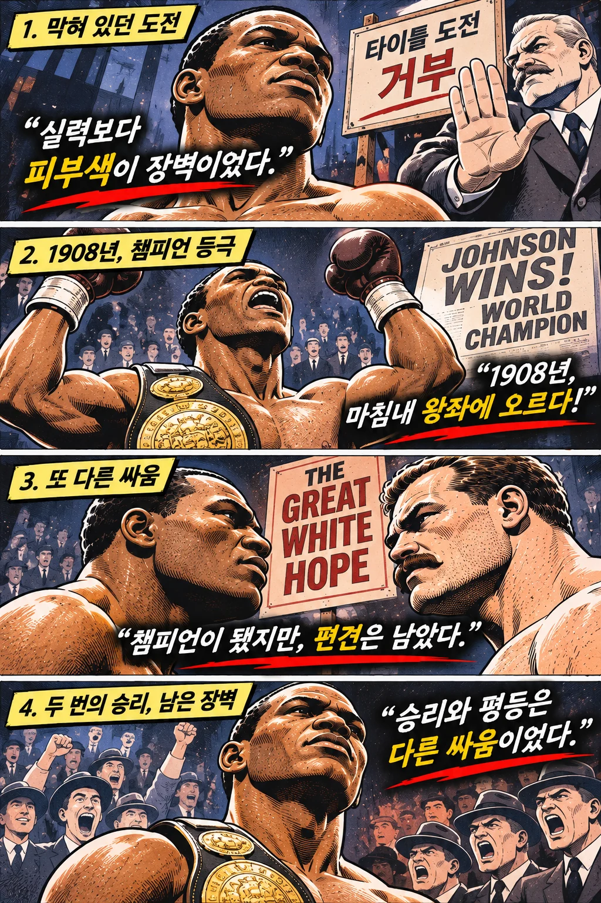

## 챔피언이 되면 장벽도 사라질까요?

1908년 12월 26일, 잭 존슨은 호주 시드니에서 토미 번스를 꺾고 최초의 흑인 세계 헤비급 챔피언이 됐습니다. 그러나 타이틀을 얻었다고 해서 그를 둘러싼 인종 차별까지 끝난 것은 아니었습니다. 오히려 그의 왕좌를 되찾을 백인 선수를 찾는 움직임이 뒤따랐습니다.

이 역사를 이해하려면 누가 더 강했는지만 물어서는 부족합니다. **누가 타이틀에 도전할 수 있었고, 누가 챔피언으로 받아들여졌는지**를 함께 살펴봐야 합니다.

## 실력만으로 도전 기회를 얻기 어려웠습니다

당시 복싱의 ‘컬러 라인’은 피부색을 기준으로 대결과 기회를 가르던 인종 장벽을 뜻합니다. 흑인 선수가 실력을 갖췄더라도 백인 챔피언이 대결을 거부하면 타이틀을 겨룰 길이 막힐 수 있었습니다. 모든 체급의 상황이 같았다는 뜻은 아닙니다. 여기서는 존슨이 세계 헤비급 왕좌에 접근하던 과정을 살펴봅니다.

스미스소니언 국립 흑인 역사문화박물관은 존슨이 1903년 당시 인종별로 분리돼 있던 ‘월드 컬러드 헤비웨이트’ 타이틀을 얻었다고 설명합니다. 그 경력과 1908년의 세계 헤비급 타이틀은 구분해야 합니다. 흑인 선수들 사이에서 정상에 올랐다는 기록만으로 세계 왕좌에 도전할 기회가 보장되지는 않았습니다.

PBS의 다큐멘터리 소개에 따르면 이전 챔피언 짐 제프리스는 흑인 복서와 싸우기를 거부한 채 무패로 은퇴했습니다. 이후 챔피언 번스가 존슨과 호주에서 맞붙으면서 타이틀을 건 대결이 성사됐습니다. 존슨의 우승은 결과표의 이름을 바꾼 동시에, 대결을 가로막던 경계가 절대적인 것이 아님을 보여줬습니다.

## 우승 뒤에는 왜 백인 도전자를 찾았을까요?

PBS의 역사 해설은 존슨의 우승 뒤 ‘그레이트 화이트 호프’라는 이름으로 왕좌를 되찾을 백인 선수를 찾기 시작했다고 설명합니다. 이는 선수의 기량을 평가하는 표현을 넘어, 챔피언의 인종을 문제 삼던 당시의 시선을 담은 말입니다.

그 배경에는 흑인의 패배를 당연하게 여기고 백인의 우월성을 스포츠 결과에서도 확인하려던 인종주의가 있었습니다. 박물관은 존슨의 우승과 활동이 그런 통념에 도전했다고 해설합니다. 그의 승리는 한 선수의 성취였지만, 차별적인 시선은 이를 인종 전체의 우열을 겨루는 사건으로 바꿔 놓았습니다. 경기 결과로 인종의 우열을 판단할 수 있다는 전제 자체가 잘못된 것입니다.

1910년에는 은퇴했던 제프리스가 존슨과의 대결에 나섰습니다. 왕좌를 차지한 뒤에도 존슨은 단순한 타이틀 방어 이상의 인종적 기대와 적대 속에 놓여 있었던 셈입니다. 여기서 주목할 변화는 특정 펀치나 전술보다, 흑인 챔피언의 존재를 받아들이지 못한 사회의 반응입니다.

## 존슨의 승리가 남긴 것은 무엇일까요?

존슨의 사례를 ‘강하면 차별을 모두 이길 수 있다’는 교훈으로 읽으면 중요한 부분을 놓치게 됩니다. 우승은 실제로 일어났지만, 그 우승을 대하는 편견도 계속됐기 때문입니다. 타이틀이라는 성취와 동등한 대우는 저절로 함께 오지 않았습니다.

그렇다고 승리의 의미가 작아지는 것은 아닙니다. 존슨은 흑인 선수가 세계 헤비급 챔피언이 될 수 없다는 기대를 실제 결과로 무너뜨렸습니다. 다만 그것이 복싱 전체의 기회와 대우를 한 번에 평등하게 만들었다고 볼 수는 없습니다.

처음의 질문에 답하자면, 존슨이 넘은 것은 챔피언에게 도전하고 이겨야 하는 장벽이었고, 우승 뒤에도 남은 것은 흑인 챔피언을 동등하게 받아들이지 않던 사회의 장벽이었습니다. 그의 역사는 스포츠의 공정함을 결과표뿐 아니라 **출전 기회와 승자를 대하는 태도**에서도 살펴보게 합니다.

## 참고 자료

- [스미스소니언 국립 흑인 역사문화박물관: 잭 존슨의 삶과 유산](https://nmaahc.si.edu/explore/stories/jack-johnson-heavyweight-boxer-defied-america) — 1903년 타이틀, 1908년 우승, 1910년 대결의 인종적 맥락을 참고했습니다.
- [PBS: Unforgivable Blackness 작품 소개](https://www.pbs.org/kenburns/unforgivable-blackness/about-the-film) — 제프리스의 대결 거부와 번스와의 경기 성사 배경을 참고했습니다.
- [PBS American Experience: Boxing the Color Line](https://www.pbs.org/wgbh/americanexperience/features/fight-black-boxers-and-idea-great-white-hope/) — 우승 이후 백인 도전자를 찾던 움직임을 참고했습니다.

---

1908년 12월 26일, 호주 시드니. **잭 존슨**은 세계 헤비급 챔피언 토미 번스를 꺾었습니다. 세계 헤비급 왕좌에 오른 최초의 흑인 복서가 탄생한 순간이었습니다. [스미스소니언 국립 흑인 역사문화박물관의 잭 존슨 기록](https://nmaahc.si.edu/explore/stories/jack-johnson-heavyweight-boxer-defied-america)

그런데 이상한 일이 벌어졌습니다. 새로운 챔피언의 기량을 인정하기보다, **그에게서 타이틀을 되찾을 백인 선수를 찾는 목소리**가 커졌습니다. 존슨은 어렵게 챔피언이 됐지만, 챔피언이라는 사실만으로 동등한 인정을 받을 수는 없었습니다.

존슨이 맞서야 했던 장벽은 하나가 아니었습니다. **첫 번째는 챔피언에게 도전할 기회를 막는 장벽, 두 번째는 챔피언이 된 뒤에도 그를 받아들이지 않는 사회의 장벽**이었습니다.

## 첫 번째 장벽: 강해도 도전할 수 없는 링

당시 복싱에서 말하는 **'컬러 라인(color line)'**은 피부색에 따라 대결과 기회를 구분하던 인종적 장벽을 뜻합니다. 흑인 선수가 실력을 증명해도 백인 챔피언이 대결을 거부하면 세계 타이틀에 도전하기 어려웠습니다.

존슨에게도 이런 벽이 있었습니다. 스미스소니언 국립 흑인 역사문화박물관에 따르면 그는 1903년 **월드 컬러드 헤비웨이트(World Colored Heavyweight)** 타이틀을 차지했습니다. 하지만 당시 인종적으로 구분된 타이틀의 챔피언이 됐다는 사실과, 세계 헤비급 챔피언에게 도전할 기회를 얻는 일은 달랐습니다. [스미스소니언의 경력 해설](https://nmaahc.si.edu/explore/stories/jack-johnson-heavyweight-boxer-defied-america)

PBS의 다큐멘터리 소개는 앞선 챔피언 **짐 제프리스**가 흑인 복서와의 대결을 거부한 채 무패로 은퇴했다고 설명합니다. 존슨이 넘어야 할 것은 상대의 주먹만이 아니라, 대결 자체를 성사시키기 어려운 현실이었습니다. [PBS 《Unforgivable Blackness》 소개](https://www.pbs.org/kenburns/unforgivable-blackness/about-the-film)

그러다 1908년, 당시 세계 챔피언이었던 토미 번스와의 대결이 성사됐습니다. 존슨은 시드니에서 번스를 꺾고 마침내 세계 헤비급 타이틀을 차지했습니다.

그 순간 첫 번째 장벽에는 분명한 균열이 생겼습니다. **흑인 복서도 세계 헤비급 챔피언이 될 수 있다는 사실을 링 위의 결과로 보여 준 것**입니다.

하지만 이야기는 거기서 끝나지 않았습니다.

## 두 번째 장벽: 챔피언이 됐는데도 인정받지 못하다

존슨이 세계 챔피언이 된 뒤, 그의 왕좌를 되찾을 백인 선수를 바라는 움직임이 나타났습니다. 이때 등장한 표현이 **'그레이트 화이트 호프(Great White Hope)'**, 곧 백인 사회가 기대를 거는 도전자였습니다.

스미스소니언 박물관은 작가 **잭 런던**이 존슨의 챔피언 지위를 받아들이기 어려워하며 짐 제프리스에게 이 표현을 사용했다고 설명합니다. 박물관은 당시 복싱을 인종적 우열의 관점으로 바라보는 시선도 기록합니다. 백인 선수가 흑인 선수를 이기면 백인 우월성의 증거처럼 받아들이고, 흑인 선수가 이기면 그 통념이 흔들린다고 여긴 것입니다. [스미스소니언의 1910년 대결 해설](https://nmaahc.si.edu/explore/stories/jack-johnson-heavyweight-boxer-defied-america)

물론 **복싱 경기의 승패로 인종의 우열을 증명할 수 있다는 전제 자체가 잘못됐습니다.** 그러나 당시의 인종주의적 시선은 한 선수의 타이틀 방어를 피부색에 따른 집단적 대결로 바꾸어 놓았습니다.

여기서 존슨이 마주한 두 번째 장벽이 드러납니다. 세계 챔피언이라는 결과가 이미 나왔는데도, 일부 사람들은 그 결과를 인정하기보다 자신들이 받아들일 수 있는 챔피언을 다시 찾으려 했습니다.

**그는 챔피언이 될 자격을 링 위에서 증명했지만, 사회의 편견은 여전히 그 자격을 문제 삼았습니다.**

## 1910년, 은퇴한 전 챔피언이 돌아왔습니다

존슨에게 도전한 대표적인 인물이 바로 짐 제프리스였습니다. 한때 흑인 복서와 싸우기를 거부했던 전 챔피언이 은퇴를 끝내고 돌아왔습니다. 두 선수의 대결은 1910년 7월 4일 미국 네바다주 리노에서 열렸습니다. [스미스소니언의 경기 기록](https://nmaahc.si.edu/explore/stories/jack-johnson-heavyweight-boxer-defied-america)

이 경기는 단순한 헤비급 타이틀전 이상으로 주목받았습니다. 스미스소니언 박물관은 당시 미국의 인종분리와 백인 우월주의가 경기를 둘러싼 분위기에 깊게 작용했다고 설명합니다.

경기 결과는 다시 존슨의 승리였습니다. **15라운드에서 제프리스 측이 경기를 중단시켰고, 존슨은 챔피언 자리를 지켰습니다.** [스미스소니언의 1910년 경기 해설](https://nmaahc.si.edu/explore/stories/jack-johnson-heavyweight-boxer-defied-america)

1908년에는 현역 챔피언을 꺾었습니다. 1910년에는 자신의 왕좌를 되찾으러 돌아온 전 챔피언까지 물리쳤습니다. 두 경기 모두 복싱에서는 명확한 승리였습니다.

그러나 **링 위에서 두 번 이겼다고 해서 링 밖의 차별까지 끝난 것은 아니었습니다.**

## 챔피언 벨트가 평등을 보장하지는 않았습니다

존슨은 단지 경기에서 이겼다는 이유만으로 논란의 중심에 선 인물이 아니었습니다. 스미스소니언 박물관은 그가 부를 드러내고, 백인 여성과 관계를 맺고, 당시 흑인에게 요구되던 사회적 관습에 순응하지 않았다는 점도 강한 반발을 불러왔다고 설명합니다. 그의 삶을 둘러싼 논쟁에는 스포츠 바깥의 인종차별이 깊게 얽혀 있었습니다. [스미스소니언의 생애 해설](https://nmaahc.si.edu/explore/stories/jack-johnson-heavyweight-boxer-defied-america)

따라서 존슨의 이야기를 '실력만 있으면 차별을 이겨 낼 수 있다'는 단순한 교훈으로 정리하기는 어렵습니다. 실력으로 챔피언에 오를 수는 있었지만, **챔피언이 됐다는 사실만으로 사회가 그를 동등하게 대우한 것은 아니기 때문**입니다.

그의 성취가 작아지는 것은 아닙니다. 오히려 존슨의 승리는 당시의 편견이 얼마나 근거 없는 것이었는지 드러냈습니다. 동시에 그 편견이 경기 결과 하나로 사라지지 않을 만큼 깊었다는 사실도 보여 줬습니다.

## 존슨이 넘은 장벽, 그리고 남아 있던 장벽

잭 존슨은 1908년 세계 헤비급 챔피언이 됐습니다. 그리고 1910년, 자신을 쓰러뜨리기 위해 돌아온 전 챔피언 짐 제프리스마저 꺾었습니다.

그는 링 위에서 자신에게 주어진 도전을 이겨냈습니다. 하지만 그를 둘러싼 사회의 편견까지 주먹으로 쓰러뜨릴 수는 없었습니다.

**잭 존슨이 증명한 것은 흑인도 세계 헤비급 챔피언이 될 수 있다는 사실이었습니다. 그러나 그의 시대가 보여 준 것은 챔피언이 되는 것과 챔피언으로 동등하게 인정받는 것이 전혀 다른 싸움이라는 사실이었습니다.**

## 참고 자료

- [스미스소니언 국립 흑인 역사문화박물관 — 잭 존슨의 삶과 유산](https://nmaahc.si.edu/explore/stories/jack-johnson-heavyweight-boxer-defied-america): 1903년 월드 컬러드 헤비웨이트 타이틀, 1908년 12월 26일 우승, 잭 런던의 '그레이트 화이트 호프' 표현, 1910년 제프리스전과 인종적 배경을 확인했습니다.
- [PBS — 《Unforgivable Blackness》 소개](https://www.pbs.org/kenburns/unforgivable-blackness/about-the-film): 제프리스의 흑인 복서 상대 대결 거부와 존슨의 타이틀 도전 배경을 다룹니다.
- [PBS American Experience — Boxing the Color Line](https://www.pbs.org/wgbh/americanexperience/features/fight-black-boxers-and-idea-great-white-hope/): 존슨의 우승 뒤 '그레이트 화이트 호프'가 등장한 역사적 맥락을 다룹니다.
