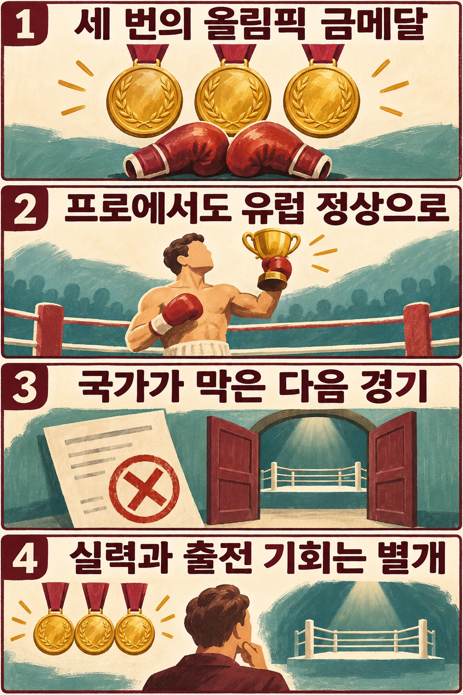

## 금메달 이후에도 열리지 않은 문이 있었습니다

라슬로 파프는 올림픽 복싱에서 세 차례 금메달을 딴 헝가리 선수입니다. 이후 프로에서도 유럽 정상에 올랐지만, 세계 타이틀에 도전하는 경기는 치르지 못했습니다. 그 이유를 경기력이나 패배에서만 찾으면 그의 역사를 놓치게 됩니다. 다음 경기를 허용할 권한이 선수 자신에게만 있지 않았기 때문입니다.

## 올림픽의 정상은 프로 경력의 출발점이었습니다

파프는 1948년 런던에서 미들급, 1952년 헬싱키와 1956년 멜버른에서 라이트미들급 금메달을 땄습니다. 체급은 몸무게에 따라 나눈 경기 구분입니다. 세 대회 우승을 모두 같은 체급에서 거둔 것은 아닙니다. [올림피디아의 파프 항목](https://www.olympedia.org/athletes/3832)은 그를 복싱 최초의 올림픽 금메달 3회 수상자로 소개합니다.

그는 1957년 프로로 전향했습니다. 올림픽 우승과 프로 세계 타이틀은 서로 다른 경력입니다. 올림픽 금메달을 세 번 받았다고 프로 세계 챔피언이 되는 것은 아니며, 프로 무대에서는 별도의 대결과 타이틀 도전이 필요했습니다.

## 왜 헝가리 선수가 빈에서 홈경기를 치렀을까요?

올림피디아에 따르면 파프는 헝가리에서 프로 경기를 할 수 없어 오스트리아 빈의 슈타트할레에서 자신의 ‘홈경기’를 치렀습니다. 고국을 대표해 올림픽에서 우승한 선수와, 고국에서 프로 경기를 열 수 있는 선수는 같은 조건이 아니었던 셈입니다.

그렇다고 프로에서 성과를 내지 못한 것도 아닙니다. 그는 1962년 프로 유럽 챔피언이 됐고 타이틀을 여섯 차례 방어했습니다. [파프 복싱 아카데미의 약력](https://papplaszloakademia.hu/english)은 프로 전적을 29경기 27승 2무로 기록합니다. 유럽 챔피언은 세계 챔피언과 구분되는 타이틀이지만, 파프가 프로 무대에서도 경쟁력을 보였다는 점은 분명합니다.

해외에서 경기를 이어 가며 성적을 쌓아도, 그 경력을 계속할 허가는 별개의 문제로 남아 있었습니다.

## 경력을 멈춘 것은 다음 경기의 허가였습니다

올림피디아는 1964년 말 헝가리 공산 정권의 체육 당국이 파프의 선수 경력을 끝내도록 했다고 설명합니다. 파프 복싱 아카데미는 조금 다른 행정적 경계를 짚습니다. 1965년 1월 프로 계약이 만료됐고, 헝가리 체육 당국이 세계선수권을 포함한 추가 경기의 허가를 내주지 않았다고 기록합니다.

두 설명은 경력 중단과 계약 만료·추가 경기 불허를 각각 강조합니다. 이를 하나의 정확한 날짜에 벌어진 사건으로 합쳐 쓰기보다는, **1964년까지 이어진 프로 경력이 더 이상의 경기 허가를 받지 못하며 끝났다는 흐름**으로 이해할 수 있습니다.

이 기록만으로 당국자 개인의 속내나 구체적인 결정 과정을 단정할 수는 없습니다. 다만 파프의 세계 타이틀 도전 기회가 링에서의 패배가 아니라 국가 체육 행정의 결정으로 닫혔다는 점은 두 자료가 공통으로 전합니다.

## 남긴 유산은 따지 못한 벨트만으로 설명되지 않습니다

파프는 이후 지도자로 활동했습니다. 파프 복싱 아카데미는 그가 지그몬드 아들레르와 함께 헝가리 대표팀을 지도한 시기를 소개하고, 지도한 선수들의 올림픽·세계선수권 금메달도 기록합니다. 선수로서 막힌 경력 뒤에 다른 선수들을 가르치는 경력이 이어진 것입니다. 이를 근거로 강제된 중단이 좋은 일이었다고 바꿔 말할 수는 없습니다.

그가 세계 타이틀전을 치렀다면 이겼을지는 기록에 없는 가정입니다. 무패 전적이 그 승리를 보장하지는 않습니다. 반대로 세계 챔피언 벨트가 없다는 이유로 도전할 실력조차 없었다고 평가하는 것도, 기회가 닫힌 사정을 지워 버립니다.

파프에게는 올림픽과 프로 유럽 무대의 성취가 있었지만, 그것이 다음 경기의 허가를 보장하지 않았습니다. 그의 역사는 한 선수의 성적표를 읽을 때 **무엇을 이겼는지와 어떤 경기에 나설 수 있었는지를 함께 보게 합니다.**

## 참고 자료

- [올림피디아 — 라슬로 파프](https://www.olympedia.org/athletes/3832): 올림픽 연도·체급, 프로 전향, 빈의 경기장, 유럽 타이틀과 1964년 말 경력 중단.
- [파프 복싱 아카데미 — 영문 약력](https://papplaszloakademia.hu/english): 프로 전적, 1965년 1월 계약 만료와 추가 경기 허가 거부, 대표팀 지도 경력.
