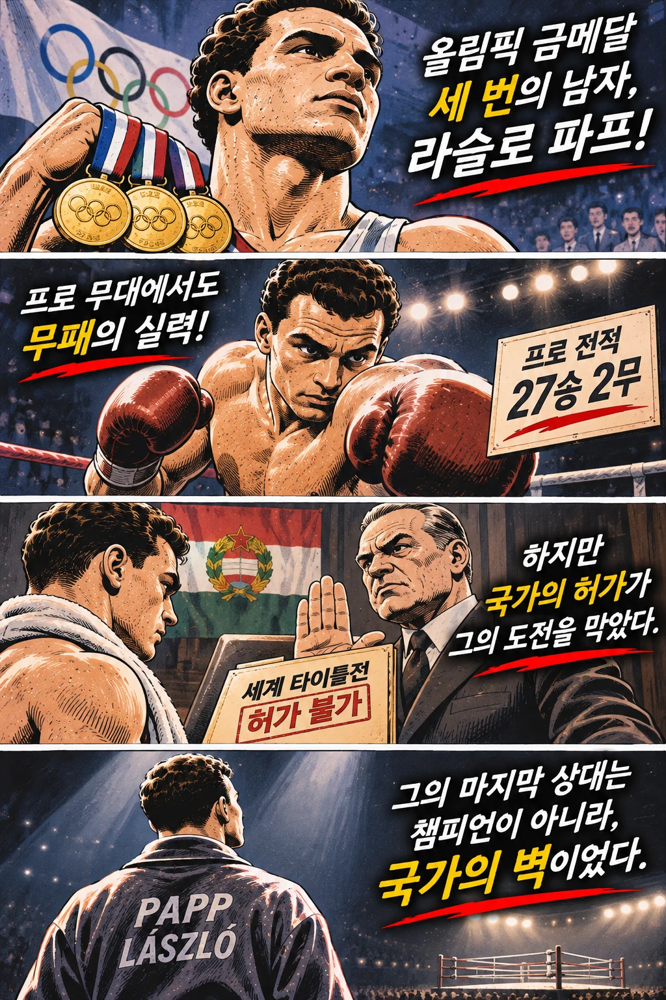

올림픽 금메달 세 개. 프로 무대에서는 27승 2무로 단 한 번도 패하지 않았고, 유럽 챔피언에도 올랐습니다.

이 정도 기록을 가진 복서라면 세계 챔피언에 도전하는 모습을 기대할 만합니다. 하지만 헝가리의 전설적인 복서 **라슬로 파프(László Papp)**는 끝내 세계 타이틀전을 치르지 못했습니다.

그가 세계 챔피언에게 패했기 때문이 아닙니다. **그를 멈춰 세운 것은 상대의 주먹이 아니라, 국가 체육 당국의 결정이었습니다.**

## 올림픽에서 세 번 정상에 오른 복서

파프는 1948년 런던 올림픽 미들급에서 첫 금메달을 목에 걸었습니다. 1952년 헬싱키에서는 라이트미들급으로 체급을 바꿔 다시 우승했고, 1956년 멜버른에서도 같은 체급의 금메달을 차지했습니다.

올림픽 복싱 역사에서 **금메달을 세 번 획득한 최초의 선수**가 된 것입니다. [올림피디아의 선수 기록](https://www.olympedia.org/athletes/3832)에서도 이 세 차례 우승과 체급을 확인할 수 있습니다.

그러나 올림픽 금메달과 프로 세계 챔피언 벨트는 서로 다른 성취입니다. 파프는 올림픽에서 이룬 성공을 뒤로하고 1957년 프로 무대로 향했습니다. 이제는 프로 세계 정상에 도전할 차례였습니다.

## 고국의 영웅은 왜 다른 나라에서 경기를 치렀을까요?

파프의 프로 경력에는 처음부터 특이한 장면이 있었습니다. 헝가리를 대표해 올림픽에서 세 번이나 우승했지만, 정작 **헝가리에서는 프로 복싱 경기를 치를 수 없었던 것**입니다.

올림피디아에 따르면 그는 오스트리아 빈의 슈타트할레에서 자신의 ‘홈경기’를 치렀습니다. 고국에서 국가대표로 싸울 수 있었던 선수에게 프로 선수로 활동하는 일은 전혀 다른 문제였던 셈입니다.

그런 제약 속에서도 파프는 승리를 쌓았습니다. 1962년 프로 유럽 챔피언에 올랐고, 이후 타이틀을 여섯 차례 방어했습니다. 최종 프로 전적은 **29전 27승 2무**였습니다.

올림픽에서 정상에 오른 실력은 프로에서도 사라지지 않았습니다. 하지만 그가 아무리 승리를 쌓아도, 다음 경기를 계속할 수 있는지는 온전히 자신의 뜻에 달려 있지 않았습니다.

## 세계 챔피언을 만나기 전에 경력이 끝났습니다

1964년 말, 파프의 경력은 예상치 못한 곳에서 멈췄습니다.

[올림피디아](https://www.olympedia.org/athletes/3832)는 당시 헝가리 공산 정권의 체육 행정 당국이 파프에게 선수 생활을 끝내도록 강제했고, 그 결과 세계 챔피언 타이틀을 획득할 기회를 잃었다고 설명합니다.

이 사건은 단순한 은퇴 이야기가 아닙니다. 복서가 경기를 치르고 승리하는 것과, **그 복서에게 다음 경기를 허용하는 권한**이 서로 다른 곳에 있었다는 이야기입니다.

파프가 세계 타이틀전을 치렀다면 승리했을지는 알 수 없습니다. 그가 무패였다는 사실만으로 세계 챔피언을 이겼을 것이라고 단정할 수는 없습니다. 하지만 적어도 링 위에서 승패를 가려 볼 기회조차 얻지 못했다는 사실은 남았습니다.

그의 경력을 끝낸 구체적인 정책 결정 과정이나 당국자 개인의 동기까지 확인된 것처럼 말할 수는 없습니다. 다만 당시 국가 체육 행정의 결정이 선수의 프로 경력을 중단시켰다는 점은 기록으로 확인됩니다.

## 링 밖의 결정이 선수의 미래를 바꿀 때

파프는 선수 생활을 마친 뒤 지도자로 활동했습니다. 올림피디아는 그가 헝가리 복싱 대표팀을 이끌며 후배 선수들의 국제대회 성과에도 기여했다고 기록합니다.

그렇다고 지도자로서의 성취가 선수 시절 잃어버린 기회를 되돌려 주는 것은 아닙니다.

라슬로 파프는 올림픽에서 세 번 정상에 올랐고, 프로 무대에서도 단 한 번도 패하지 않았습니다. 하지만 그의 경력에는 끝내 치르지 못한 경기가 남았습니다.

그가 세계 챔피언을 이길 수 있었는지는 누구도 알 수 없습니다. **링 위에서 겨뤄 보지 못했기 때문입니다.**

**그의 마지막 상대는 세계 챔피언이 아니었습니다. 그가 끝내 넘지 못한 장벽은 링 밖에 있었습니다.**

## 참고 자료

- [Olympedia — László Papp](https://www.olympedia.org/athletes/3832): 올림픽 우승 연도와 체급, 1957년 프로 전향, 빈에서의 프로 경기, 유럽 챔피언 경력, 1964년 말 헝가리 체육 당국에 의한 경력 중단, 이후 지도자 활동.
