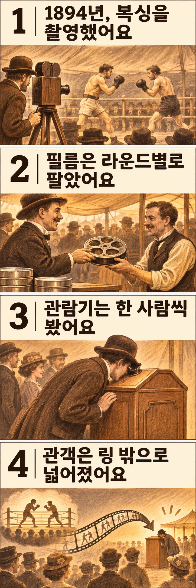

복싱을 보려면 반드시 경기가 열리는 자리에 있어야 할까요? 지금은 쉽게 답할 수 있지만, 움직이는 영상을 상품으로 팔기 시작하던 시기에는 새로운 질문이었습니다. 1894년의 **레너드–커싱 복싱 필름**은 복싱이 링 밖의 관객을 만나는 방법을 보여줍니다.

이 이야기를 여는 단서는 승패보다 판매 문구입니다. 당시 에디슨 필름 카탈로그는 이 작품을 **라운드별로 판매한다**고 소개했습니다. 복싱의 움직임을 필름 상품으로 다루던 초기의 모습입니다. [AFI 작품 기록](https://catalog.afi.com/Film/41261-LEONARD--CUSHING-FIGHT)

## 경기장이 아니라 촬영소에 들어간 복싱

미국영화연구소 AFI는 미국 의회도서관 자료를 인용해, 마이크 레너드와 잭 커싱의 복싱 필름이 **1894년 6월 14일 뉴저지주 웨스트오렌지의 블랙 마리아 촬영소**에서 키네토스코프용으로 촬영됐다고 설명합니다. 거대한 경기장에 카메라를 가져갔다는 이야기와는 출발점이 다릅니다. [AFI 작품 기록](https://catalog.afi.com/Film/41261-LEONARD--CUSHING-FIGHT)

블랙 마리아는 에디슨의 웨스트오렌지 연구소 근처에 세워져 1893년 2월 완공된 영화 제작 시설입니다. 복싱은 이 촬영소에서 필름에 담을 소재가 됐습니다. [럿거스대학교 에디슨 문서 프로젝트](https://edison.rutgers.edu/research/motion-picture-catalogs/catalogs-and-the-early-motion-picture-industry/the-peephole-kinetoscope)

이 사례를 오늘날의 경기 생중계와 똑같이 생각하면 중요한 차이를 놓칩니다. 관객에게 전달되는 것은 그 순간 벌어지는 승부가 아니라, 미리 촬영해 필름에 담은 움직임이었습니다. 관람 시점과 촬영 시점이 분리된 셈입니다.

## 큰 스크린 대신 상자 안을 들여다봤습니다

**키네토그래프는 촬영 카메라, 키네토스코프는 영상을 보는 장치**입니다. 이름이 비슷하지만 역할은 달랐습니다. 당시 키네토스코프는 관객 한 사람이 들여다보는 개인 관람 방식이었습니다. 럿거스대학교 자료에 따르면 뉴욕의 첫 키네토스코프 관람장은 1894년 4월 14일 문을 열었습니다. [에디슨 문서 프로젝트](https://edison.rutgers.edu/research/motion-picture-catalogs/catalogs-and-the-early-motion-picture-industry/the-peephole-kinetoscope)

초기 복싱 영상을 떠올릴 때 오늘날 영화관처럼 여러 사람이 한 화면을 바라보는 모습부터 상상할 필요는 없습니다. 같은 촬영물을 보더라도, 관객이 영상과 만나는 방식은 지금과 달랐습니다.

현장에서는 선수와 관객이 같은 시간을 공유합니다. 필름 관람에서는 관객이 촬영된 움직임을 나중에 만납니다. 이 차이에서 읽을 수 있는 역사적 의미는, 복싱을 보는 자리가 실제 링의 주변에만 묶여 있지 않게 됐다는 점입니다.

## ‘라운드별 판매’는 누구에게 파는 것이었을까요?

AFI가 옮긴 당시 카탈로그는 여섯 라운드의 대결을 소개하면서, 각 라운드의 필름 길이를 150피트로 적었습니다. 이 판매 설명은 **필름 상품의 구성**을 말합니다. 그 문구만으로 관객이 얼마를 내고 몇 라운드를 봤는지까지 확정할 수는 없습니다. [당시 카탈로그를 인용한 AFI 기록](https://catalog.afi.com/Film/41261-LEONARD--CUSHING-FIGHT)

필름을 구입해 보여주는 사람과 영상을 구경하는 관객은 구분해야 합니다. 에디슨 문서 프로젝트는 장치와 필름을 판매하는 대리상들의 고객으로 전문 관람장뿐 아니라 오락장·호텔·바·식당의 운영자들도 설명합니다. 이들은 관객을 즐겁게 할 촬영 소재를 필요로 했습니다. [에디슨 문서 프로젝트](https://edison.rutgers.edu/research/motion-picture-catalogs/catalogs-and-the-early-motion-picture-industry/the-peephole-kinetoscope)

이 구조로 보면 복싱 필름의 의미가 선명해집니다. 선수의 움직임이 촬영물을 만들고, 촬영물은 유통되며, 다른 장소의 관객이 이를 봅니다. 오늘날의 유료 중계와 연결해 생각할 지점은 있지만, 같은 요금 체계나 사업 모델이었다고 단정할 수는 없습니다.

## 남은 한 조각과 전체 경기는 구분해야 합니다

AFI는 의회도서관의 필름 사본이 한 라운드의 일부로 보인다고 설명합니다. **당시 여섯 라운드로 소개됐다는 기록과 남은 사본의 범위는 별개**입니다. 카탈로그만으로 모든 라운드의 전개나 선수들의 전술을 재구성해서는 안 됩니다. [AFI 작품 기록](https://catalog.afi.com/Film/41261-LEONARD--CUSHING-FIGHT)

그 대신 이 사례는 관람 문화의 변화를 읽게 합니다. 복싱은 현장에서 치르는 승부인 동시에, 기록해 다른 장소에서 보여줄 수 있는 영상 소재가 됐습니다. 의회도서관은 초기의 개인 관람 장치가 이후 여러 관객을 위한 영사 방식으로 자리를 내주었다고 설명합니다. 영상을 보는 방식 역시 한 번에 완성되지 않았습니다. [미국 의회도서관의 에디슨 영화사](https://www.loc.gov/collections/edison-company-motion-pictures-and-sound-recordings/articles-and-essays/history-of-edison-motion-pictures/)

1894년의 사례가 남긴 유산은 특정 펀치나 승리의 비결보다 **복싱을 보는 사람이 선수와 같은 장소에 있지 않아도 된다는 변화**에 있습니다. 작은 개인 관람기와 라운드별 필름은 링 밖에서 복싱을 만나는 문화가 만들어지던 초기 모습을 보여줍니다.

## 참고 자료

- [AFI, Leonard–Cushing Fight](https://catalog.afi.com/Film/41261-LEONARD--CUSHING-FIGHT): 촬영 날짜·장소, 당시 카탈로그 문구와 남은 사본의 범위.
- [럿거스대학교 에디슨 문서 프로젝트, The Peephole Kinetoscope](https://edison.rutgers.edu/research/motion-picture-catalogs/catalogs-and-the-early-motion-picture-industry/the-peephole-kinetoscope): 촬영·관람 장치, 블랙 마리아와 개인 관람장, 장치·필름의 판매 구조.
- [미국 의회도서관, History of Edison Motion Pictures](https://www.loc.gov/collections/edison-company-motion-pictures-and-sound-recordings/articles-and-essays/history-of-edison-motion-pictures/): 개인 관람에서 다수 관객을 위한 영사로 이어진 변화.
