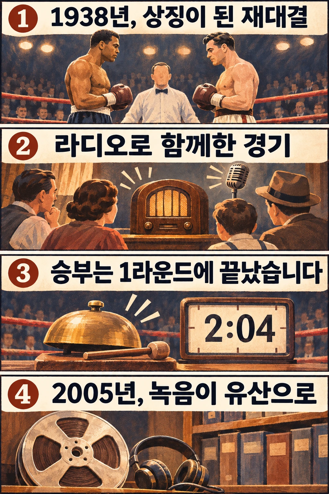

오래 남는 복싱 경기가 반드시 긴 접전인 것은 아닙니다. 조 루이스와 막스 슈멜링의 1938년 재대결은 1라운드에 끝났지만, 그날의 라디오 중계는 미국의 국가녹음등록부에 올랐습니다. 주먹이 오간 시간과 사람들이 그 경기를 기억하는 시간 사이에는 어떤 차이가 있을까요?

## 재대결에는 어떤 의미가 실렸을까요?

두 사람은 1936년에 먼저 만났고, 그때는 슈멜링이 이겼습니다. 이후 루이스가 1937년 세계 헤비급 챔피언이 되면서 재대결의 구도도 달라졌습니다. 헤비급은 무거운 체중대의 선수들이 겨루는 체급입니다. 1938년 6월 22일, 뉴욕 양키 스타디움에서 열린 두 번째 대결에서는 루이스가 챔피언으로 슈멜링을 맞았습니다.

그러나 사람들의 관심은 타이틀에만 머물지 않았습니다. 나치 독일의 선전은 슈멜링의 앞선 승리를 인종적 우월성 주장에 이용했습니다. 미국의 흑인 선수 루이스에게는 차별 속에서 그를 응원하는 사람들의 기대가 실렸고, 재대결은 국가와 정치 체제의 대결이라는 의미까지 떠안았습니다. [PBS의 경기 역사 자료](https://www.pbs.org/wgbh/americanexperience/features/fight-louis-schmeling-fights-1936-and-1938/)가 설명하는 중요한 맥락입니다.

여기서 선수 개인과 그를 둘러싼 선전을 구분해야 합니다. 슈멜링은 나치당원이 아니었습니다. 독일 선수라는 이유만으로 그의 생각을 정권의 주장과 같다고 쓰면, 당시의 복잡한 상황을 놓치게 됩니다. 루이스를 미국의 대표로 응원했다고 해서 미국 사회의 인종차별이 사라진 것도 아니었습니다.

## 링 밖에서는 어떻게 경기를 함께했을까요?

오늘날 화면으로 경기를 보는 관객은 선수 위치와 심판의 몸짓을 직접 살필 수 있습니다. 라디오 청취자에게는 그 장면을 설명하는 목소리가 필요합니다. 누가 공격하는지, 선수가 쓰러졌는지, 경기가 계속되는지를 말로 전달해야 하기 때문입니다.

이 재대결을 중계한 사람은 클렘 매카시였습니다. 미 의회도서관이 공개한 제럴드 젬스의 해설은 중계가 영어·독일어·스페인어·포르투갈어로 세계에 전해졌다고 설명합니다. 관중석에 있지 않은 사람들도 진행 중인 같은 승부에 귀를 기울일 수 있었습니다. 정확한 청취자 규모를 한 숫자로 고정하지 않더라도, 여러 언어로 전달된 경기였다는 사실은 그 무대가 경기장보다 넓었음을 보여 줍니다.

이 글에서 주목하는 점은 라디오가 승패를 바꾸었다는 것이 아닙니다. **한 장소에서 열린 경기가 멀리 떨어진 사람들의 동시적인 관심사가 되었다는 점**입니다. 이미 사회적 상징이 된 두 선수의 대결이 방송을 통해 여러 생활 공간으로 들어간 셈입니다.

## 너무 짧은 경기는 중계에도 숙제를 남겼습니다

결과는 루이스의 1라운드 KO승이었습니다. 경기 시간은 2분 4초, 124초였습니다. 젬스의 해설은 매카시가 빠르게 상황을 전했지만, 당시 현장 기자들이 일부 타격과 다운을 충분히 전달하지 못했다고 비판한 사실도 소개합니다. 중계가 큰 관심을 모았다는 것과 모든 동작을 빠짐없이 설명했다는 것은 별개의 문제였습니다.

이 대목은 라디오 중계의 성격을 생각하게 합니다. 소리는 사건을 실시간으로 전하지만, 말하는 속도와 설명할 수 있는 정보의 양에는 한계가 있습니다. 녹음에 남은 말만으로 링 안의 모든 동작을 복원하려 하면 빈틈을 추측으로 채우기 쉽습니다. 반대로 그 목소리는 당시 청취자가 어떤 설명을 통해 경기를 접했는지 알려 주는 자료가 됩니다.

따라서 경기 기록과 방송 기록에는 서로 다른 질문을 던질 수 있습니다. 전자는 누가 언제 이겼는지를 알려 주고, 후자는 그 승부가 사람들에게 어떤 방식으로 전달됐는지를 살피게 합니다. 이것이 이 경기를 기술 해설뿐 아니라 미디어의 역사로 읽을 수 있는 이유입니다.

## 승부가 끝난 뒤에는 무엇이 남았을까요?

이 중계 녹음은 2005년 미국 국가녹음등록부에 등재됐습니다. [미 의회도서관의 해설 자료](https://www.loc.gov/static/programs/national-recording-preservation-board/documents/JoeLouisMaxSchmelingFight.pdf)는 등재 연도와 함께 경기의 정치적·사회적 배경을 다룹니다. 여기서 남은 유산은 승자의 이름만이 아닙니다. 복싱이 방송을 통해 사회적 사건으로 경험된 방식도 보존 대상이 된 것입니다.

1938년 재대결이 라디오 중계로도 기억되는 이유는 짧은 승부에 큰 기대와 갈등이 모였고, 방송이 그 순간을 경기장 밖으로 전했기 때문이라고 볼 수 있습니다. 이 승리 하나가 차별이나 국제적 갈등을 해결했다고 과장할 필요는 없습니다. 오히려 그 문제가 남아 있었기에, 사람들은 같은 결과에 서로 다른 무게를 실었습니다. 124초의 승부와 오래 남은 녹음의 차이는 바로 그곳에서 이해할 수 있습니다.

## 참고 자료

- [PBS American Experience — 두 차례 루이스·슈멜링 대결](https://www.pbs.org/wgbh/americanexperience/features/fight-louis-schmeling-fights-1936-and-1938/): 첫 대결과 재대결의 관계, 타이틀 변화, 정치적 상징과 선수 개인의 구분을 참고했습니다.
- [미 의회도서관 — 조 루이스·막스 슈멜링 경기 중계 해설](https://www.loc.gov/static/programs/national-recording-preservation-board/documents/JoeLouisMaxSchmelingFight.pdf): 제럴드 젬스가 쓴 해설로, 중계 언어·종료 시간·중계에 대한 당시 비판·녹음 등재 연도를 참고했습니다.
