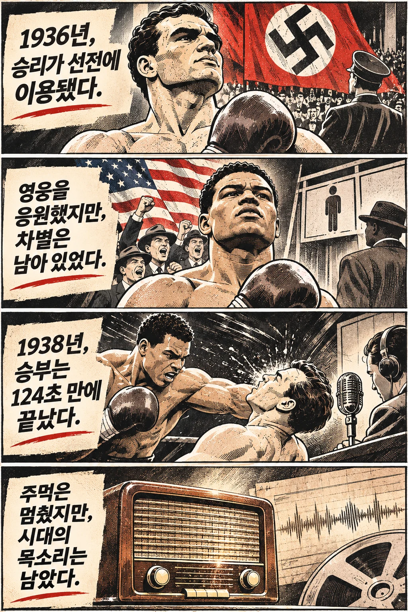

1938년 6월 22일, 뉴욕 양키 스타디움. 세계 헤비급 챔피언 **조 루이스**와 독일의 도전자 **막스 슈멜링**이 링에 올랐습니다. 두 선수는 복싱 경기를 치르러 왔지만, 그들을 바라보는 세상의 시선은 복싱에만 머물지 않았습니다.

누군가에게 이 경기는 2년 전 패배를 설욕할 기회였습니다. 또 다른 누군가에게는 국가의 자존심을 건 승부였고, 어떤 이들에게는 인종차별 속에서 흑인 선수가 이뤄 낼 승리의 의미가 걸려 있었습니다.

그토록 많은 기대가 쏠린 승부는 **단 2분 4초, 124초** 만에 끝났습니다. 그런데 그날 경기를 전한 라디오 중계는 수십 년 뒤 미국 국가녹음등록부에 등재됐습니다.

**두 복서의 짧은 승부는 어떻게 한 시대의 갈등과 희망을 담은 기록이 되었을까요?**

## 1936년, 링 위의 승리를 정치가 가져갔습니다

루이스와 슈멜링이 처음 맞붙은 것은 1936년이었습니다. 당시 루이스는 강력한 기대를 받던 미국의 흑인 복서였고, 슈멜링은 독일 출신의 전 세계 헤비급 챔피언이었습니다. 첫 대결에서는 슈멜링이 승리했습니다. [PBS의 두 차례 대결 기록](https://www.pbs.org/wgbh/americanexperience/features/fight-louis-schmeling-fights-1936-and-1938/)

문제는 그다음이었습니다. 나치 독일의 선전은 독일 선수의 승리를 정권이 내세우던 인종적 우월성 주장에 이용했습니다. 링 위에서는 두 선수가 싸웠지만, 링 밖에서는 그 결과가 정치적 메시지로 재해석된 것입니다. [PBS의 역사 해설](https://www.pbs.org/wgbh/americanexperience/features/fight-louis-schmeling-fights-1936-and-1938/)

그렇다고 슈멜링을 나치 정권과 동일시해서는 안 됩니다. **슈멜링은 나치당원이 아니었습니다.** 독일 선수라는 이유만으로 그가 정권의 선전이나 인종주의적 주장을 지지했다고 단정할 수는 없습니다.

바로 이 구분이 중요합니다. **선수는 자신의 경기를 치렀지만, 권력은 그 결과에 자신에게 유리한 의미를 부여할 수 있었습니다.** 1936년의 승리는 슈멜링 개인의 복싱 성적이면서 동시에 나치 정권이 활용한 선전 소재가 됐습니다.

## 흑인 챔피언을 응원하던 미국의 모순

1937년 루이스는 세계 헤비급 챔피언에 올랐습니다. 이듬해 슈멜링과의 재대결을 앞두고, 미국에서는 루이스의 승리를 바라는 기대가 커졌습니다. 독일의 나치 정권과 대립하는 상징적 승부로 받아들이는 분위기도 형성됐습니다. [PBS의 경기 역사 자료](https://www.pbs.org/wgbh/americanexperience/features/fight-louis-schmeling-fights-1936-and-1938/)

하지만 당시 미국은 흑인에게 평등한 사회가 아니었습니다. 인종차별과 분리가 존재하던 나라에서, 흑인 복서 루이스는 국가를 대표하는 영웅으로 응원받았습니다.

이 장면에는 쉽게 지나칠 수 없는 모순이 있습니다. **한 흑인 선수의 승리는 미국의 자부심이 될 수 있었지만, 그 사실이 미국 사회의 인종차별을 없애 주지는 않았습니다.**

물론 루이스를 응원한 모든 사람이 같은 이유로 그를 지지한 것은 아닙니다. 흑인 공동체가 루이스에게 걸었던 기대와, 나치 독일을 상대로 미국의 승리를 바랐던 사람들의 기대는 겹치면서도 서로 달랐습니다. 그 차이를 하나의 구호로 뭉뚱그리면 당시의 복잡한 현실을 놓치게 됩니다.

1938년 재대결은 그래서 단순한 복수전이 아니었습니다. **서로 다른 사람들이 각자의 희망과 정치적 의미를 한 복싱 경기에 실어 보낸 사건**이었습니다.

## 라디오는 그 대결을 경기장 밖으로 옮겼습니다

오늘날 우리는 복싱 경기를 화면으로 봅니다. 하지만 1938년, 경기장에 가지 못한 사람들은 라디오 중계자의 목소리를 통해 링을 상상해야 했습니다.

그날 영어 중계를 맡은 사람은 **클렘 매카시**였습니다. 미국 의회도서관이 공개한 제럴드 젬스의 해설에 따르면, 재대결은 영어뿐 아니라 독일어·스페인어·포르투갈어로도 방송됐습니다. 같은 경기를 서로 다른 언어와 장소에서 듣고 있었던 것입니다. [미국 의회도서관의 중계 해설](https://www.loc.gov/static/programs/national-recording-preservation-board/documents/JoeLouisMaxSchmelingFight.pdf)

라디오 앞의 청취자는 선수의 표정도, 주먹의 궤적도 직접 볼 수 없었습니다. 누가 공격하고 누가 밀리는지, 선수가 쓰러졌는지, 승부가 끝났는지를 모두 목소리로 전달받았습니다.

그렇게 라디오는 뉴욕의 한 링에서 벌어지는 일을 경기장 밖 사람들의 동시적인 경험으로 바꿨습니다. **정치적 상징이 된 경기가 방송을 통해 더 넓은 사회의 사건으로 전해진 것**입니다.

그리고 사람들이 기다린 승부는 중계자가 따라가기에도 벅찰 만큼 빠르게 전개됐습니다.

## 124초, 주먹이 끝낸 것은 경기였습니다

경기가 시작되자 루이스가 주도권을 잡았습니다. 슈멜링은 1라운드에서 KO로 패했고, 승부는 **2분 4초** 만에 끝났습니다. [미국 의회도서관의 경기 기록](https://www.loc.gov/static/programs/national-recording-preservation-board/documents/JoeLouisMaxSchmelingFight.pdf)

오랜 시간 쌓여 온 기대와 긴장은 단 124초의 복싱 경기로 결말을 맞았습니다. 나치 독일이 선전에 활용했던 1936년의 결과는 1938년 링 위에서 뒤집혔습니다.

그러나 **복싱 경기의 승패와 사회 문제의 해결은 같은 일이 아니었습니다.** 루이스의 승리로 나치 정권의 인종주의가 사라진 것도, 미국의 인종차별이 끝난 것도 아니었습니다. 정치와 사회가 경기 결과에 의미를 부여했을 뿐, 두 선수의 주먹이 그 모든 문제를 해결할 수는 없었습니다.

라디오 중계에도 한계는 있었습니다. 의회도서관의 해설은 매카시가 빠른 공방의 일부를 놓쳤다고 설명합니다. 그렇지만 무엇을 모두 전달했는지보다 더 오래 남은 사실이 있습니다. **그날의 승부를 사람들이 어떤 목소리로 들었는지 기록됐다는 점**입니다.

경기 기록에는 '루이스, 1라운드 KO승'이라는 결과가 남습니다. 중계 녹음에는 그 결과가 전해지던 순간의 속도와 긴박함이 남습니다.

## 링 위의 승부는 끝났지만, 시대의 목소리는 남았습니다

1938년의 라디오 중계 녹음은 **2005년 미국 국가녹음등록부**에 등재됐습니다. 미국 의회도서관은 이 녹음을 소개하면서 두 선수의 대결을 둘러싼 사회적·정치적 배경도 함께 설명합니다. [미국 의회도서관의 해설 자료](https://www.loc.gov/static/programs/national-recording-preservation-board/documents/JoeLouisMaxSchmelingFight.pdf)

그 녹음은 유명한 KO 장면의 소리만 남긴 것이 아닙니다. 스포츠가 정치적 선전의 재료가 되기도 하고, 차별받던 이들에게 희망의 상징이 되기도 하며, 방송을 통해 사회 전체의 관심사가 되는 모습을 돌아보게 합니다.

1938년 6월 22일, 링 위에 오른 사람은 두 명의 복서였습니다. 하지만 그들의 어깨에는 두 나라를 둘러싼 정치적 갈등과 인종 문제, 수많은 사람의 기대가 함께 실려 있었습니다.

승부는 단 124초 만에 끝났습니다. 나치 독일의 선전이 그 결과로 정당화된 것도, 미국 사회의 인종차별이 그날 사라진 것도 아니었습니다.

그러나 그 짧은 순간은 라디오를 타고 여러 나라의 청취자들에게 전해졌고, 마침내 역사의 기록으로 남았습니다.

**링 위에서는 두 복서가 싸웠지만, 그들의 주먹에 의미를 부여한 것은 시대였습니다. 그리고 그 시대의 목소리를 오늘날까지 전해 준 것은 라디오였습니다.**

## 참고 자료

- [PBS American Experience — 루이스와 슈멜링의 1936년·1938년 대결](https://www.pbs.org/wgbh/americanexperience/features/fight-louis-schmeling-fights-1936-and-1938/): 두 경기의 결과와 정치적 상징, 나치 독일의 선전 및 미국 사회의 인종차별을 다룬 역사 자료입니다.
- [미국 의회도서관 — 조 루이스·막스 슈멜링 경기 중계 해설](https://www.loc.gov/static/programs/national-recording-preservation-board/documents/JoeLouisMaxSchmelingFight.pdf): 중계 언어, 경기 시간, 라디오 중계의 특징과 2005년 국가녹음등록부 등재를 설명합니다.
