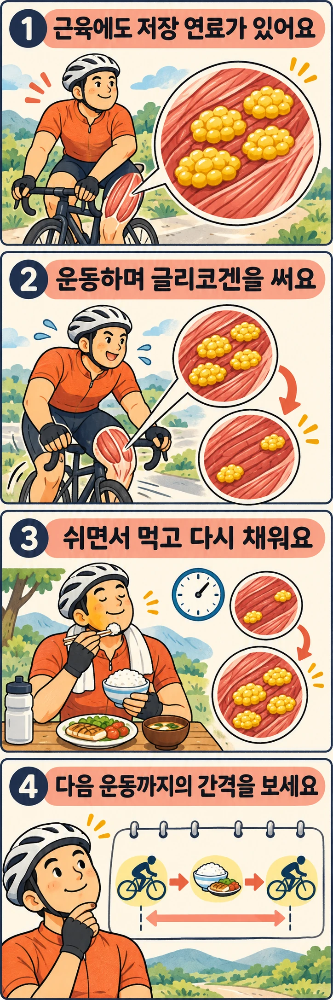

오전에 오래 운동하고 오후에 다시 움직일 때, 몇 시간을 쉬었다면 근육의 연료도 충분히 돌아왔을까요? **글리코겐은 쉬는 동안 다시 합성되지만, 시간과 공급할 재료가 함께 필요합니다.** 세트 사이 숨을 고르는 것과는 다른 규모의 회복입니다.

## 근육은 당을 가까운 곳에 저장합니다

글리코겐은 포도당이 가지를 치며 연결된 저장 물질입니다. 근육 안에서는 작은 알갱이로 존재하며 운동 중 분해되어 ATP를 다시 만드는 재료가 됩니다. ATP는 수축에 직접 쓰는 에너지 전달 물질입니다. 글리코겐 자체가 근육을 당기는 것은 아닙니다.

이 저장 방식은 연료를 사용할 장소 가까이에 두는 방법입니다. 근육은 혈액으로 들어오는 포도당과 함께 내부에 저장한 재료도 사용할 수 있습니다. 글리코겐에서 나온 당은 해당과정이라는 여러 단계의 분해 반응을 거쳐 ATP 생산에 기여하고, 이후 산소를 이용하는 산화적 대사와도 연결됩니다.

따라서 글리코겐은 산소 없이 운동할 때만 쓰는 연료가 아닙니다. 오래 지속하는 운동에서도 사용됩니다. 다른 연료가 몸에 남아 있더라도 필요한 속도로 에너지를 공급할 수 있느냐는 별개의 문제입니다. 저장 연료가 줄면 같은 강도를 유지하기 어려워질 수 있습니다.

## 쉬는 것과 다시 채우는 것은 어떻게 다를까요?

운동을 멈추면 수축에 쓰는 연료 수요가 줄고, 근육은 사용한 글리코겐을 다시 합성할 수 있습니다. 식사의 탄수화물은 소화·흡수를 거쳐 포도당 공급원이 됩니다. 근육에 들어온 포도당은 효소 반응을 통해 글리코겐으로 저장됩니다. 효소는 이런 화학 반응을 돕는 단백질입니다.

재료를 먹었다고 저장이 즉시 끝나지는 않습니다. 포도당이 근육에 들어가고 저장되는 데 시간이 필요하며, 앞선 운동에서 얼마나 사용했는지도 출발점을 바꿉니다. 휴식시간이 같아도 운동량과 식사가 다르면 다음 운동을 시작할 때의 연료 상태는 다를 수 있습니다.

회복을 하나의 스위치처럼 생각하지 않는 편이 좋습니다. 짧고 강한 움직임의 에너지 공급을 돕는 인산크레아틴의 회복과 저장 탄수화물을 다시 쌓는 과정은 같지 않습니다. 몇 분 쉬고 힘이 일부 돌아왔다는 느낌만으로 글리코겐까지 채워졌다고 판단할 수는 없습니다.

이런 저장·사용 원리는 [Ørtenblad 등의 종설](https://pmc.ncbi.nlm.nih.gov/articles/PMC3784189/)에서 다룹니다. 다만 피로는 글리코겐 하나로 설명되지 않습니다. 신경계와 근육의 수축 기능, 체온과 수분 상태도 수행에 관여합니다.

## 네 시간 뒤 다시 달린 연구에서는 무엇이 달랐을까요?

Alghannam 등의 2016년 연구에서는 지구력 훈련 경험이 있는 성인 10명이 두 조건을 모두 수행했습니다. 먼저 최대산소섭취량의 70%에 해당하는 강도로 더 지속할 수 없을 때까지 달렸습니다. 4시간 회복한 뒤 같은 강도로 다시 달렸습니다. 최대산소섭취량은 운동 중 몸이 산소를 이용할 수 있는 최대 능력의 지표입니다.

회복 중에는 탄수화물 공급량이 다른 음료를 30분 간격으로 마셨습니다. 비교한 공급률은 체중 1kg당 시간당 0.3g과 1.2g이었습니다. **고갈 운동 뒤 짧은 시간 안에 다시 달리는 실험의 조건이며, 일반인의 한 끼 섭취량 권장치가 아닙니다.**

더 많은 탄수화물을 공급한 조건에서는 회복 후 근육 글리코겐이 더 높았고, 두 번째 달리기도 더 오래 지속됐습니다. 근육 조직을 채취해 저장량을 확인하면서 실제 수행을 함께 비교했다는 점이 장점입니다. [연구 초록](https://pubmed.ncbi.nlm.nih.gov/26197030/)

다만 탄수화물 섭취 조건 전체를 바꿨으므로 수행 차이의 모든 원인을 근육 글리코겐만으로 확정할 수는 없습니다. 표본이 작고, 힘이 다할 때까지 지속 달리기를 반복한 실험입니다. 짧은 복싱 수업 뒤 누구나 같은 섭취량이 필요하다거나 펀치 수가 일정 비율로 늘어난다는 뜻은 아닙니다. 장기적인 체력 향상을 비교한 연구와도 구분해야 합니다.

## 다음 운동이 가까운 날에는 무엇을 살펴보면 좋을까요?

실전에서는 **앞선 운동량, 다음 운동까지의 간격, 그 사이 식사**를 함께 보는 것이 출발점입니다. 오래 달린 뒤 몇 시간 만에 다시 운동하는 날과 가볍게 움직이고 다음 날 운동하는 날은 같은 회복 상황이 아닙니다.

오전 지구력 운동 뒤 저녁 운동 후반이 유난히 버겁다면 다음 내용을 기록해 보세요.

- 오전 운동의 시간과 강도, 저녁 운동 시작까지의 간격을 적습니다.
- 그 사이 밥·빵·감자 등 탄수화물이 포함된 식사를 했는지와 식사 시각을 남깁니다.
- 저녁에는 익숙한 운동에서 평소 페이스를 유지할 수 있는지 관찰합니다.

반복 비교할 때는 앞선 운동량과 저녁 운동의 시작 강도를 비슷하게 두는 편이 해석하기 쉽습니다. 식사를 건너뛴 날에만 후반 수행이 흔들린다면 회복 식사의 역할을 살펴볼 단서가 됩니다. 그러나 이 기록은 글리코겐 측정이나 결핍 진단이 아닙니다. 수면과 더위처럼 함께 달라진 조건도 적어야 원인을 성급히 정하지 않을 수 있습니다.

처음 질문으로 돌아가면 몇 시간을 쉬었다고 저장 연료가 같은 수준으로 회복되는 것은 아닙니다. 다음 운동이 가까운 날에는 시계와 함께 그 사이의 식사, 앞선 운동량을 살펴보세요. 다음 운동에서 유지하고 싶은 페이스를 기준으로 회복을 이해하는 데 도움이 됩니다.

## 참고 자료

- Ørtenblad N, Westerblad H, Nielsen J. 2013. *Muscle glycogen stores and fatigue*. 저장 위치·에너지 공급과 피로 기전을 논의한 종설입니다. DOI: [10.1113/jphysiol.2013.251629](https://doi.org/10.1113/jphysiol.2013.251629). [공개 원문](https://pmc.ncbi.nlm.nih.gov/articles/PMC3784189/)
- Alghannam AF 외. 2016. *Impact of Muscle Glycogen Availability on the Capacity for Repeated Exercise in Man*. 지구력 훈련자 10명의 회복 중 탄수화물 공급과 반복 달리기를 비교한 원저 연구입니다. DOI: [10.1249/MSS.0000000000000737](https://doi.org/10.1249/MSS.0000000000000737). PMID: 26197030. [초록](https://pubmed.ncbi.nlm.nih.gov/26197030/)
