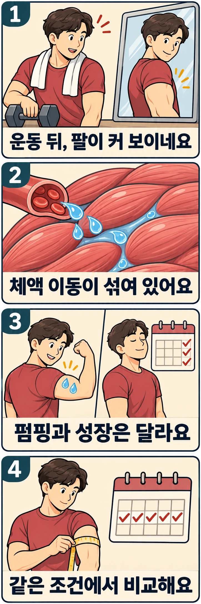

덤벨 운동을 마치고 거울을 보면 위팔이 평소보다 꽉 차 보일 때가 있습니다. 그런데 다음 날에는 다시 작아 보입니다. 하루 만에 생긴 근육을 잃은 것일까요?

운동 직후의 일시적인 팽창을 흔히 **펌핑**이라고 부릅니다. 이때 보이는 크기에는 혈류와 조직 수분의 변화가 섞여 있습니다. 사진에 잡힌 차이를 그대로 새로 만들어진 근육의 양으로 읽기는 어렵습니다.

## 근육의 크기에는 수분도 들어 있습니다

근육은 힘을 내는 단백질만으로 채워진 조직이 아닙니다. 근섬유 안에는 물과 여러 용질이 있고, 근섬유 사이에도 액체가 있습니다. 혈관 속 혈액까지 포함하면, 근육 부위의 부피는 고정된 한 가지 성분의 양이 아닙니다.

운동 중에는 근육에 공급되는 혈류와 대사 상태가 달라집니다. 혈관과 조직 사이에서는 압력 차이에 따라 물이 이동합니다. 세포 안팎에 녹아 있는 입자의 농도 차이도 물의 분포에 영향을 줍니다. **삼투**는 물을 통과시키는 막 양쪽의 용질 농도 차이와 관련된 물의 이동입니다. 반복 수축으로 대사 상태가 바뀌면 이런 체액 이동의 조건도 바뀝니다.

따라서 펌핑을 단순히 “피가 근육에 갇힌 것”으로만 설명하면 부족합니다. 혈관 안의 변화와 혈관 밖 조직의 수분 변화를 함께 봐야 합니다. 세포 안과 밖 중 어디에 얼마나 물이 늘었는지도 운동 조건과 측정법에 따라 구분해야 합니다. [Haddock 등의 인체 MRI 연구](https://journals.physiology.org/doi/full/10.1152/japplphysiol.01012.2020)는 운동 부하와 방식에 따라 체액 관련 반응이 달라짐을 보여 줍니다.

## 운동 직후 두꺼워졌다는 측정은 무엇을 뜻할까요?

Ploutz-Snyder 등의 1995년 연구는 바벨 스쿼트 전후에 MRI로 허벅지 근육의 단면적을 살피고 혈장의 부피 변화도 추정했습니다. 혈장은 혈액에서 혈구를 제외한 액체 부분입니다. 운동에 많이 참여한 근육군의 단면적은 직후 커졌고, 혈장 부피 감소와 근육 단면적 증가가 관련됐습니다. 연구진은 혈관에서 활동 근육 쪽으로 이동한 체액이 크기 증가의 주요 설명이라고 해석했습니다. [논문 초록](https://ntrs.nasa.gov/search.jsp?R=20050000155)

이 해석을 더 세분해 볼 수 있는 연구도 있습니다. Taniguchi 등의 2020년 논문에서는 근력훈련 경험이 없는 젊은 남성 18명이 무릎 펴기 운동을 했습니다. 한 번 들 수 있는 최대 무게의 80%로 더 반복하기 어려울 때까지 3세트를 수행했습니다. 초음파로 허벅지 앞 근육의 두께를, 생체전기 임피던스로 허벅지 구간의 세포 안팎 수분을 평가했습니다.

운동 뒤 근육 두께와 세포 안 수분에 대한 세포 밖 수분의 비율이 함께 증가했고, 두 변화 사이에 상관관계가 있었습니다. 저자들은 급성 크기 증가를 **상대적인 세포 밖 수분 증가로 적어도 일부 설명할 수 있다**고 결론 내렸습니다. 세포 밖 수분의 비율은 세포 안의 물이 전혀 늘지 않았다는 뜻이 아니며, 두께 증가량 전체가 무엇으로 이뤄졌는지 직접 분해한 측정도 아닙니다. [연구 초록](https://pubmed.ncbi.nlm.nih.gov/31299164/)

이처럼 초음파나 MRI에서 실제로 커진 모습이 관찰돼도, 측정 시점이 운동 직후라면 그 수치에 체액 반응이 포함될 수 있습니다. 육안으로 본 팔의 팽창감은 더더욱 근육 단백질의 증가량을 따로 알려 주지 않습니다.

## 펌핑이 큰 사람이 나중에도 더 자랄 수 있을까요?

급성 팽창과 장기 성장이 서로 다른 현상이라는 말이 둘 사이에 아무 관련도 없다는 뜻은 아닙니다. Hirono 등의 2022년 논문은 근력훈련 경험이 없는 젊은 남성 22명의 첫 운동 직후 두께 변화와 6주 훈련 뒤의 변화를 비교했습니다.

참가자들은 최대 무게의 80%로 무릎 펴기 8회씩 3세트를 주 3일 수행했습니다. 초음파로 허벅지 앞쪽 아홉 지점의 두께를 합산했습니다. 첫 운동 직후의 평균 증가는 8.3%, 6주 훈련 뒤의 평균 증가는 2.9%였고, 두 변화 사이에는 양의 상관관계가 있었습니다. 이 수치는 **특정 집단의 허벅지 두께 측정값**이며, 팔둘레나 전신 근육량의 변화율이 아닙니다. [논문 초록](https://doi.org/10.1519/JSC.0000000000003478)

이 연구는 펌핑을 크게 만드는 방법과 작게 만드는 방법을 무작위로 배정해 성장을 비교한 실험이 아닙니다. 같은 훈련에 크게 반응하는 사람이 두 측정에서 모두 큰 변화를 보였을 가능성과, 팽창 자체가 성장을 유발했다는 설명을 구분해야 합니다. 작은 표본의 젊은 남성·무릎 펴기 결과를 숙련자나 복싱 라운드 직후의 팔에 그대로 적용할 수도 없습니다.

따라서 “펌핑이 클수록 반드시 더 자란다”도, “펌핑은 성장과 전혀 무관하다”도 이 자료보다 앞서 나가는 결론입니다. 지금 확실히 구분할 수 있는 것은 **운동 직후의 크기와 훈련 뒤 남는 크기를 같은 측정으로 취급하면 안 된다**는 점입니다.

## 팔둘레를 기록한다면 운동 전끼리 비교해 보세요

다음은 성장률을 보장하는 처방이 아니라, 일시적인 팽창을 장기 변화로 오해하지 않기 위한 기록 예시입니다. 팔둘레를 남기고 싶다면 첫 기록을 운동 직후에 찍고 다음 기록을 쉬는 날 아침에 재는 방식부터 바꿔 보세요.

- 평소 운동을 시작하기 전처럼 반복할 수 있는 시간대를 정합니다. 직전 팔 운동으로부터 지난 시간도 함께 적습니다.
- 팔을 편 상태인지 힘을 준 상태인지 정하고, 매번 같은 위치에서 줄자를 수평으로 댑니다. 피부를 누르는 정도도 비슷하게 유지합니다.
- 사진은 같은 조명·거리·자세로 찍습니다. 직후 사진을 따로 찍고 싶다면 “운동 직후”로 표시해 별도 기록으로 둡니다.
- 한 번의 차이보다 여러 주에 걸친 같은 조건의 기록을 봅니다. 둘레에는 근육 외의 조직도 포함되므로 작은 차이 하나를 순수한 근육 증가로 환산하지 않습니다.

펌핑을 더 만들려고 원래 계획에 없던 마무리 세트를 계속 추가할 필요는 없습니다. 오늘의 꽉 찬 느낌은 운동 직후 반응으로 남기고, 크기를 비교할 사진과 둘레는 정해 둔 조건에서 다시 기록해 보세요. 내일 팔이 평소 모습으로 돌아왔다는 사실만으로 어제의 훈련 적응이 사라졌다고 판단하지 않아도 됩니다.

## 참고 자료

- Ploutz-Snyder LL, Convertino VA, Dudley GA, 1995. [Resistance exercise-induced fluid shifts: change in active muscle size and plasma volume](https://ntrs.nasa.gov/search.jsp?R=20050000155). 스쿼트 후 MRI 단면적·혈장 부피 연구. DOI: 10.1152/ajpregu.1995.269.3.R536.
- Taniguchi M, Yamada Y, Ichihashi N, 2020(온라인 공개 2019). [Acute effect of multiple sets of fatiguing resistance exercise on muscle thickness, echo intensity, and extracellular-to-intracellular water ratio](https://pubmed.ncbi.nlm.nih.gov/31299164/). 급성 두께·수분 분포 연구. DOI: 10.1139/apnm-2018-0813.
- Haddock B 외, 2021. [Exercise-induced fluid shifts are distinct to exercise mode and intensity: a comparison of blood flow-restricted and free-flow resistance exercise](https://journals.physiology.org/doi/full/10.1152/japplphysiol.01012.2020). 젊은 남성 10명의 급성 MRI 연구. DOI: 10.1152/japplphysiol.01012.2020.
- Hirono T 외, 2022. [Relationship Between Muscle Swelling and Hypertrophy Induced by Resistance Training](https://doi.org/10.1519/JSC.0000000000003478). 초기 팽창과 6주 두께 변화의 상관관계 연구. DOI: 10.1519/JSC.0000000000003478.
