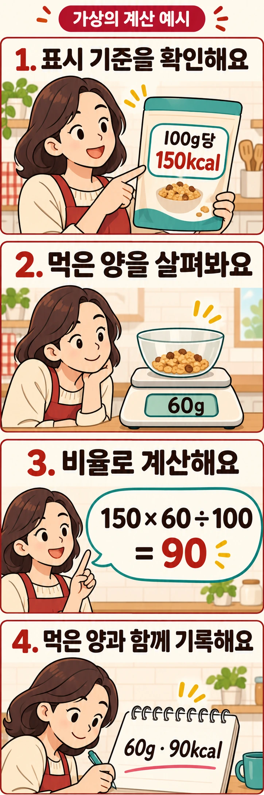

## 숫자보다 먼저 ‘무엇당’인지 확인하세요

식사 기록에 과자 한 봉지를 입력하려는데 포장에는 150kcal라고 적혀 있습니다. 이 숫자를 그대로 쓰면 될까요? **총 내용량당 열량이고 한 봉지를 모두 먹었다면 그대로 쓰시면 됩니다.** 100g당 또는 낱개당 수치라면 먹은 양에 맞춰 계산해야 합니다.

[식품안전나라의 영양성분표 활용법](https://www.foodsafetykorea.go.kr/portal/board/boardDetail.do?bbs_no=bbs420&menu_grp=MENU_NEW03&menu_no=3714&ntctxt_no=1069323)도 표시단위를 확인한 뒤 실제 먹은 양과 비교하도록 안내합니다. 포장의 크기나 큰 글씨만 보고 한 봉지의 열량이라고 판단하지 않는 것이 출발점입니다.

## 같은 150kcal라도 기록할 값은 달라집니다

아래 수치는 계산을 설명하기 위한 가상의 예시이며 실제 제품 정보가 아닙니다.

| 포장에 적힌 기준 | 실제 먹은 양 | 기록할 열량 |
| --- | --- | --- |
| 총 내용량 60g당 150kcal | 한 봉지 60g 전부 | 150kcal |
| 100g당 150kcal | 60g | 90kcal |
| 1개 30g당 150kcal | 같은 낱개 2개 | 300kcal |

둘째 줄은 150에 60을 곱하고 100으로 나눈 값입니다. 셋째 줄은 같은 크기의 낱개를 두 개 먹었으므로 두 배입니다. 다만 ‘총 내용량당 300kcal’라고 이미 전체 값이 표시되어 있다면 낱개 수를 다시 곱하지 않습니다.

계산은 한 문장으로 정리할 수 있습니다. **표시 열량 × 먹은 양 ÷ 표시 기준량**입니다. g으로 표시된 수치에는 먹은 양도 g을, mL로 표시된 수치에는 mL를 사용하세요. g과 mL를 임의로 같은 값으로 바꾸면 기준이 어긋납니다.

## 나눠 먹었다면 포장 전체와 내 몫을 구분하세요

총 내용량 240g에 전체 열량이 600kcal인 균일한 식품을 80g 먹었다고 가정해 보겠습니다. 전체의 3분의 1이므로 표시값을 기준으로 약 200kcal입니다. 이때 봉지 안의 개수를 셌는지, 덜어 낸 무게를 쟀는지 함께 남겨 두면 다음에 같은 제품을 기록할 때 이해하기 쉽습니다.

저울을 쓴다면 빈 그릇을 올려 영점을 맞춘 뒤 음식을 담아 보세요. 먹기 전에 덜어 놓은 양을 확인하면 봉지에 얼마 남았는지 나중에 추측하는 일을 줄일 수 있습니다. 모든 끼니를 재라는 뜻은 아닙니다. 자주 먹지만 양이 헷갈리는 제품 하나부터 확인해도 좋습니다.

견과와 건과일이 섞인 식품처럼 구성물이 고르지 않다면 전체 무게의 3분의 1을 먹었다고 열량까지 정확히 3분의 1이라고 단정하기 어렵습니다. 단순 비례 계산은 섭취한 부분의 구성이 전체와 비슷하다는 전제에서 활용하세요. 양을 재지 못한 날에는 ‘약 반 봉지’처럼 추정한 기준을 남기고, 실제로 측정한 기록과 구분하면 됩니다.

## 제품 비교와 내 식사 기록은 기준이 다릅니다

두 제품의 열량을 비교하려면 먼저 같은 양으로 맞춰야 합니다. 가상의 제품 가는 100g당 200kcal, 제품 나는 40g 한 봉지당 100kcal라면 어떨까요? 나는 100g으로 환산하면 250kcal입니다. 포장에 적힌 200과 100만 비교해서 나의 열량이 절반이라고 말할 수는 없습니다.

반대로 실제로 가를 60g, 나를 한 봉지 먹는 선택이라면 각각 120kcal와 100kcal를 비교해야 합니다. **같은 양의 식품을 비교하는 질문과, 내가 먹을 분량을 고르는 질문을 나눠 보세요.** 열량을 확인한 다음에는 관심 있는 단백질·식이섬유 등의 함량도 같은 기준량으로 살펴볼 수 있습니다. 열량 숫자 하나로 식품의 전체 가치를 결정할 필요는 없습니다.

## 표시된 한 번 분량이 내 식사량의 정답은 아닙니다

해외 제품에서 ‘Serving size’를 보더라도 정해진 만큼만 먹어야 한다는 뜻으로 받아들이지는 마세요. [미국 FDA는 미국 영양표시의 serving size가 섭취 권장량이 아니라고 설명합니다](https://www.fda.gov/food/nutrition-facts-label/serving-size-nutrition-facts-label). 국내 제품과 표시 형식이 같다고 가정하기보다, 해당 포장에서 열량이 어느 분량에 대응하는지 읽는 것이 우선입니다.

영양표시는 먹은 양을 파악하는 도구입니다. 이 계산만으로 자신의 하루 필요 열량이나 감량 결과까지 알 수 있는 것은 아닙니다. 우선 자주 먹는 간식이나 음료 하나의 표시 기준을 확인하고, 평소 먹는 분량과 연결해 보세요. 기록에는 ‘제품명·먹은 양·그 양의 열량’을 함께 남기면 됩니다. 다음번에도 같은 기준으로 비교할 수 있는 기록이 작은 숫자까지 빈틈없이 채운 기록보다 쓰기 편합니다.

## 참고 자료

- [식품안전나라: 가공식품 영양표시 — 영양성분표 활용법](https://www.foodsafetykorea.go.kr/portal/board/boardDetail.do?bbs_no=bbs420&menu_grp=MENU_NEW03&menu_no=3714&ntctxt_no=1069323): 표시단위와 실제 섭취량 비교 안내를 참고했습니다.
- [미국 FDA: Serving Size on the Nutrition Facts Label](https://www.fda.gov/food/nutrition-facts-label/serving-size-nutrition-facts-label): 미국 제품의 표시 분량과 섭취 권장량의 차이를 참고했습니다.
