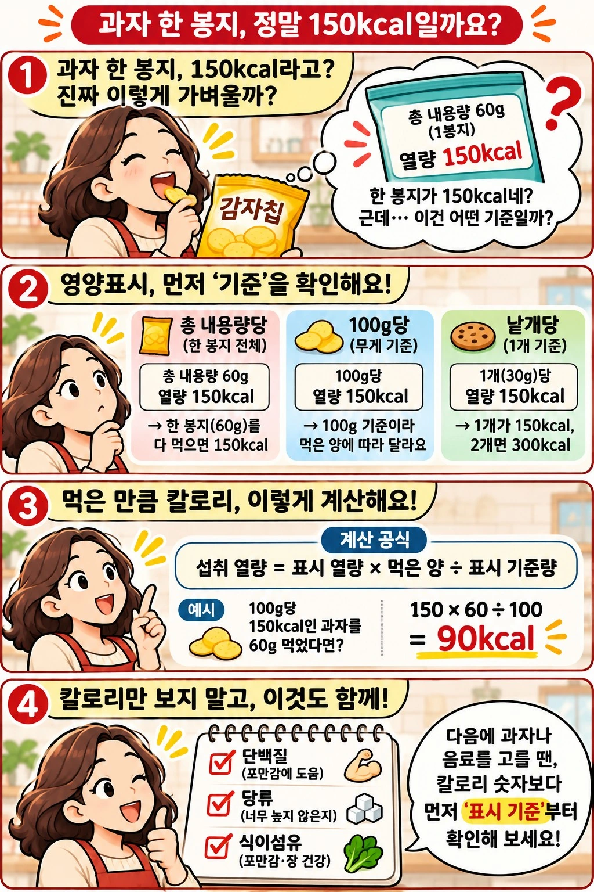

## 과자 한 봉지를 다 먹었는데 150kcal?

간식으로 과자 한 봉지를 먹고 포장을 보니 ‘150kcal’라고 적혀 있어요. 생각보다 적은 것 같아 안심했는데, 정말 한 봉지 전체가 150kcal일까요?

**정답은 영양표시에 적힌 기준량에 달려 있어요.** 150kcal가 한 봉지 전체의 열량일 수도 있고, 100g이나 낱개 하나의 열량일 수도 있거든요.

칼로리를 읽을 때는 숫자보다 먼저 **‘얼마만큼 먹었을 때의 숫자인지’** 확인하는 습관이 중요해요.

## 영양표시에서 가장 먼저 볼 것

식품 포장에 적힌 열량은 어떤 양을 기준으로 표시했는지 함께 읽어야 해요. [식품안전나라의 영양성분표 활용법](https://www.foodsafetykorea.go.kr/portal/board/boardDetail.do?bbs_no=bbs420&menu_grp=MENU_NEW03&menu_no=3714&ntctxt_no=1069323)에서도 표시 기준을 확인하도록 안내하고 있어요.

- **총 내용량당:** 포장 전체를 기준으로 한 열량이에요. 한 봉지를 다 먹었다면 그 숫자를 보면 돼요.
- **100g당 또는 100mL당:** 실제 먹거나 마신 양에 맞춰 계산해야 해요.
- **낱개당:** 표시된 낱개를 몇 개 먹었는지 확인하면 돼요.

예를 들어 같은 ‘150kcal’라도 한 봉지 전체가 150kcal인 제품과 100g당 150kcal인 제품은 다르게 계산해야 해요. 제품마다 표시 방식을 확인하는 게 첫걸음이에요.

## 먹은 만큼 칼로리를 계산하는 방법

계산법은 하나만 기억하면 돼요.

**섭취 열량 = 표시 열량 × 먹은 양 ÷ 표시 기준량**

가령 어떤 과자가 **100g당 150kcal**이고, 내가 **60g**을 먹었다면 이렇게 계산해요.

**150 × 60 ÷ 100 = 90kcal**

반대로 한 봉지 전체가 150kcal라고 적혀 있고 그 봉지를 전부 먹었다면, 별도 계산 없이 150kcal예요.

이때 무게는 무게끼리(g), 부피는 부피끼리(mL) 비교해야 해요. 매번 저울을 꺼낼 필요는 없지만, 자주 먹는 제품의 총 내용량과 표시 기준 정도는 확인해 두면 편리해요.

## 칼로리만 보지 마세요

영양표시를 읽는 이유는 단순히 가장 낮은 칼로리의 음식을 고르기 위해서만은 아니에요.

비슷한 제품을 비교할 때는 **같은 양을 기준으로** 열량을 살펴보고, 단백질이나 당류, 식이섬유처럼 관심 있는 영양성분도 함께 확인해 보세요.

예를 들어 열량이 조금 더 높더라도 단백질이나 식이섬유가 풍부한 식품이 내 식사 구성에는 더 잘 맞을 수 있어요. 반대로 포장이 작아 칼로리가 낮아 보이더라도 여러 봉지를 먹는다면 실제 섭취량은 늘어나겠죠.

**칼로리가 낮다는 이유만으로 무조건 더 건강한 음식이라고 판단할 필요는 없어요.** 영양성분과 실제 먹는 양을 함께 보는 게 좋아요.

## 다음 간식부터 이렇게 확인해 보세요

다음에 과자나 음료를 집어 들면 칼로리 숫자부터 보지 말고, 그 숫자가 **얼마만큼의 음식에 해당하는지** 먼저 확인해 보세요.

한 봉지 전체인지, 100g당인지, 낱개당인지 확인하는 것만으로도 영양표시를 훨씬 정확하게 읽을 수 있어요.

복잡한 계산을 매번 완벽하게 하려 하기보다 **표시 기준을 먼저 보는 작은 습관**부터 시작해 보세요.

## 참고 자료

- [식품안전나라: 가공식품 영양표시 — 영양성분표 활용법](https://www.foodsafetykorea.go.kr/portal/board/boardDetail.do?bbs_no=bbs420&menu_grp=MENU_NEW03&menu_no=3714&ntctxt_no=1069323)
- [미국 FDA: Serving Size on the Nutrition Facts Label](https://www.fda.gov/food/nutrition-facts-label/serving-size-nutrition-facts-label)
