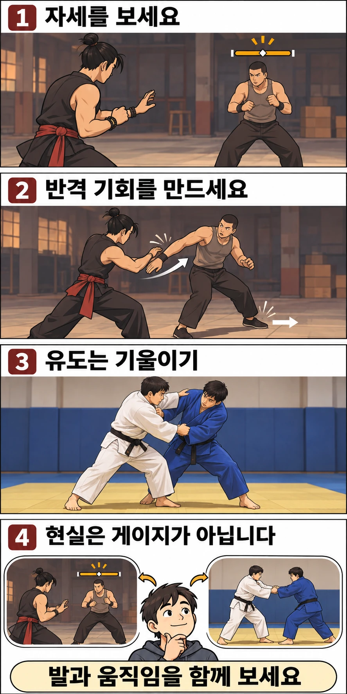

## 시푸는 상대를 쓰러뜨릴 기회를 따로 보여 줍니다

쿵후 액션 게임 《시푸》에는 상대의 자세가 무너지는 순간을 겨냥하는 재미가 있습니다. 개발사 슬로클랩의 설명에 따르면, 상대의 구조를 깨뜨리면 강력한 마무리 동작을 사용할 수 있습니다. 여기서 **구조(Structure)는 공격과 방어를 이어 갈 수 있는 자세의 안정성을 게이지로 표현한 게임 시스템**입니다.

왜 전투 게임에 이런 지표가 필요할까요? 상대를 계속 때리는 일뿐 아니라, 상대가 제대로 버티지 못하는 순간을 만드는 일에도 목표를 주기 때문입니다. 이 차이를 이해하면 마무리 동작보다 그 직전의 공방이 먼저 눈에 들어옵니다.

## 막아 냈다는 사실만으로 공방이 끝나지는 않습니다

슬로클랩은 구조 시스템을 상대의 자세와 공격·방어 능력을 무너뜨린다는 발상에서 설계했다고 설명합니다. 자신의 구조 게이지가 가득 차면 잠시 싸우거나 방어할 수 없어 취약해집니다. 개발사 안내에서는 단순히 공격을 막는 행동이 게이지를 빠르게 채운다고도 설명합니다.

이 설계에서 흥미로운 부분은 **방어의 성공과 다음 행동의 여유를 별개로 다룬다**는 점입니다. 당장의 공격을 받아 냈더라도 계속 같은 방식으로 버티기만 하면 불리해집니다. 플레이어는 공격을 막았는지만 볼 것이 아니라, 그 뒤에도 대응할 여유가 남았는지 살펴야 합니다.

개발사는 패링, 즉 타이밍을 맞춰 공격을 흘리는 동작이 상대의 균형을 흐트러뜨리고 반격이나 넘어뜨리기의 기회를 연다고 설명합니다. 이 글에서는 이를 방어 행동 자체에 다음 기회를 만드는 역할을 준 설계로 읽습니다. 특정 보스의 모든 공격에 같은 대응이 통한다는 공략과는 구분해서 이해해 주세요. [개발사의 전투 시스템 설명](https://blog.playstation.com/?p=356872)

## 실제 격투기에서는 유도의 기울이기와 비교해 볼 수 있습니다

실제 기술을 이해할 비교 대상으로는 유도의 **기울이기, 일본어로 쿠즈시(kuzushi)**가 있습니다. 상대의 균형을 무너뜨리는 것을 뜻합니다. 국제유도연맹 아카데미의 교육 안내는 기울이기, 기술에 들어갈 몸의 위치를 만드는 지읏기, 실제로 메치는 걸기를 구분해 다룹니다. [국제유도연맹 아카데미 교육 안내](https://academy.ijf.org/help)

이 구분을 관전 질문으로 바꾸면 이해하기 쉽습니다. 메치기가 나왔을 때 팔이나 다리가 어떻게 움직였는지만 보지 않고, 그 전에 상대가 어느 방향으로 기울었으며 공격자가 어디에 자리 잡았는지도 보는 것입니다. 넘어지는 마지막 모습에 앞서, 기술을 걸기 좋은 조건이 어떻게 생겼는지 살펴보게 됩니다.

예를 들어 상대가 다시 발을 옮겨 자세를 세우려는 순간과, 두 발로 안정적으로 버티는 순간을 구분해서 보세요. 화면을 멈춰 상대의 몸이 기울어 보인다는 이유만으로 기술의 원인을 확정할 필요는 없습니다. 전후 이동과 두 선수의 접촉을 함께 보면 무엇을 더 확인해야 하는지 질문이 구체적이 됩니다.

시푸와 유도를 연결하는 지점은 여기까지입니다. 상대가 버틸 조건에 관심을 두게 한다는 비교이지, 시푸가 유도의 기울이기를 공식 모티브로 삼았다는 뜻은 아닙니다. 쿵후 액션의 게임 시스템과 유도 기술을 같은 동작으로 취급해서도 안 됩니다.

## 현실의 균형은 누적 피해를 재는 막대가 아닙니다

게임의 게이지는 복잡한 공방을 한눈에 읽도록 만든 표시입니다. 실제 사람의 균형을 그 숫자로 환산할 수는 없습니다. 어느 방향으로 움직이는지, 발을 다시 디딜 수 있는지, 상대와 어떻게 접촉하고 있는지처럼 상황을 함께 봐야 합니다.

따라서 “여러 번 막았으니 이제 반드시 넘어진다”거나 “균형만 무너뜨리면 마무리는 자동으로 된다”는 식으로 현실에 옮기면 곤란합니다. 유도 교육이 기울이기뿐 아니라 몸의 위치와 걸기도 다룬다는 점을 떠올려 보세요. 조건을 만드는 일과 기술을 완성하는 일을 구분하면, 게임이 무엇을 선명하게 만들고 무엇을 단순화했는지 보입니다.

## 다음에는 마무리 직전의 선택을 보세요

시푸를 플레이하거나 전투를 볼 때, 마무리의 화려함에 앞서 어떤 행동이 상대의 자세를 흔들었는지 찾아보세요. 막으며 버티기와 타이밍을 맞춰 흘리기가 다음 공방을 어떻게 다르게 여는지도 비교해 볼 만합니다.

실제 유도 경기를 볼 때는 메치기 직전 두 선수의 이동과 위치를 살펴보세요. 게임에서는 게이지가 알려 주는 기회를, 경기에서는 선수들의 움직임 속에서 찾아보는 것입니다. 이 관점의 재미는 강한 한 방을 찾는 데서 한 걸음 더 나아가, 그 한 번이 가능해진 조건을 읽는 데 있습니다.

## 참고 자료

- [슬로클랩 — How Sifu’s kung fu combat works](https://blog.playstation.com/?p=356872): 구조 시스템의 설계 취지, 방어와 패링, 구조 붕괴 뒤의 행동에 관한 개발사 설명입니다.
- [국제유도연맹 아카데미 — Student Handbook](https://academy.ijf.org/help): 기술 교육 항목의 기울이기·지읏기·걸기 구분을 참고했습니다.
