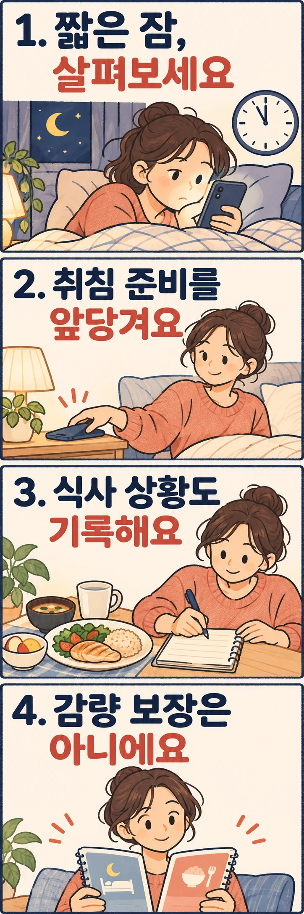

## 잠을 늘리는 것도 식사량 관리의 선택지가 될까요?

**평소 잠을 짧게 자는 사람에게는 도움이 될 가능성이 있습니다.** 다만 잠만 늘리면 누구나 살이 빠진다는 뜻은 아닙니다. 수면을 바꾼 뒤 먹는 양이 달라졌는지와, 장기간 체지방이 줄었는지는 서로 다른 질문입니다.

식단을 더 줄일지 고민하고 있다면, 먼저 식사와 잠을 함께 살펴보세요. 이미 충분히 자는 사람과 야근이나 휴대전화 사용으로 잠잘 시간이 계속 밀리는 사람이 같은 선택을 할 필요는 없습니다.

## 연구에서는 잠과 먹는 양이 어떻게 달라졌을까요?

2022년 발표된 타살리 연구진의 무작위시험은 평소 밤에 6시간 30분 미만 자는 21~40세 성인 80명을 분석했습니다. 체질량지수는 25.0~29.9였으며, 한 연구기관에서 진행했습니다. 체질량지수는 체중을 키의 제곱으로 나눈 지표로, 체지방을 직접 잰 값은 아닙니다.

연구진은 평소 수면을 관찰한 2주 뒤 참여자를 두 집단으로 나눴습니다. 한 집단은 침대에서 보내는 시간을 8시간 30분으로 늘리는 목표의 개별 수면 상담을 받았고, 다른 집단은 평소 수면을 유지했습니다. 별도의 식단이나 운동 처방은 하지 않았습니다.

이후 2주 동안 상담 집단은 대조 집단보다 수면 시간이 밤마다 평균 약 1시간 12분 늘었습니다. 에너지 섭취량의 변화는 대조 집단과 비교해 하루 약 270kcal 적었습니다. 이 수치는 **모든 참여자가 매일 같은 양을 덜 먹었다는 뜻이 아니라 집단 간 평균 차이**입니다. 총에너지 소비량에는 유의한 개입 효과가 없었습니다. [연구 초록과 측정 방법](https://pubmed.ncbi.nlm.nih.gov/35129580/)에서 해당 결과를 확인할 수 있습니다.

먹은 양은 식사일지만으로 계산하지 않았습니다. 특수하게 표시한 물을 이용해 측정한 에너지 소비량과 몸에 저장된 에너지의 변화를 합쳐 추정했습니다. 따라서 ‘간식 하나를 빼서 얻은 효과’처럼 특정 식품이나 행동 하나로 결과를 설명할 수는 없습니다.

## 왜 ‘잠만 자면 살이 빠진다’는 결론은 어려울까요?

이 시험이 직접 보여 준 것은 **특정한 조건의 짧은 수면을 바꿨을 때 나타난 단기 섭취량 변화**입니다. 이미 충분히 자는 사람에게 잠을 더 늘려도 같은 결과가 나오는지, 교대근무자나 다른 연령대에서도 같은지는 이 결과만으로 답하기 어렵습니다.

개입 기간도 2주였습니다. 그 차이가 몇 달, 몇 년 유지되는지 확인한 장기 감량 시험은 아닙니다. 하루 평균 차이에 날짜를 곱해 예상 감량을 계산하면, 지속 여부를 모르는 결과를 개인의 약속으로 바꾸게 됩니다. 단기간 체중계 변화 역시 그대로 체지방 감소량으로 읽어서는 안 됩니다.

또한 이 연구의 섭취량 결과만으로 ‘식욕 호르몬이 정상화됐다’거나 ‘야식이 줄어서 성공했다’고 단정할 수는 없습니다. 내 생활에서는 늦게까지 깨어 있는 동안 먹는 일이 많은지, 피곤한 날 끼니 선택이 달라지는지부터 구분해 보는 편이 실용적입니다.

## 식단을 더 줄이기 전에 무엇을 기록하면 좋을까요?

아래는 연구의 처방을 그대로 옮긴 감량법이 아니라, 자신의 상황을 알아보기 위한 기록 제안입니다. 열량을 완벽하게 계산하려고 하기보다 평일과 쉬는 날을 포함해 며칠간 다음 내용을 간단히 적어 보세요.

- **잠잘 기회와 실제 잠을 구분합니다.** 침대에 들어간 시간, 대략 잠든 시간, 일어난 시간을 적습니다. 누워서 휴대전화를 본 시간까지 수면으로 세지는 않습니다.
- **먹은 상황을 남깁니다.** 끼니를 거른 뒤 늦게 먹었는지, 배가 고팠는지, 일을 하며 무심코 집어 먹었는지 적습니다. 음식의 좋고 나쁨을 채점하는 기록은 필요하지 않습니다.
- **잠을 미룬 이유를 찾습니다.** 업무가 끝나지 않은 날과 영상 시청을 멈추기 어려웠던 날은 바꿀 수 있는 조건이 다릅니다. 조정 가능한 이유 하나부터 고릅니다.

예를 들어 자정 이후 영상 시청 때문에 취침이 밀린다면, 다음 날 기상 시각을 기준으로 취침 준비를 조금 앞당겨 보세요. 휴대전화를 침대 밖에 두는 것처럼 실제로 바꿀 행동을 정합니다. 반대로 늦은 퇴근이 원인이라면 무조건 일찍 누우라는 목표보다 귀가 후 해야 할 일을 줄일 수 있는지 살펴보는 편이 현실적입니다.

일정을 바꾼 뒤에는 ‘체중이 바로 내려갔나’만 보지 말고 실제로 더 잤는지, 늦은 시간 먹는 상황이나 다음 날 식사 선택이 달라졌는지 비교해 보세요. 변화가 없다고 수면을 실패한 다이어트로 평가하거나 끼니를 더 거를 필요는 없습니다. 기록에서 다른 조정 지점이 보이는지 확인하면 됩니다.

## 오래 누워 있어도 잠들기 어렵다면 어떻게 할까요?

잠잘 시간이 모자라는 상황과, 시간을 확보해도 잠들거나 잠을 유지하기 어려운 상황은 구분해야 합니다. 후자라면 침대에 있는 시간만 계속 늘리는 방식이 적절한지 의료진과 상의해 보세요. 이 글에서 다룬 수면 연장 시험은 모든 수면 문제를 해결하는 방법을 검증한 것이 아닙니다.

식사량 관리를 위해 수면을 돌아보는 목적은 새로운 숙제를 더하는 데 있지 않습니다. **평소 짧게 자고 있다면, 식단을 더 엄격하게 만들기 전에 잠잘 여건도 함께 조정할 수 있습니다.** 결과는 체중 하나로 판정하기보다 잠과 식사에서 실제로 달라진 점을 기준으로 살펴보세요.

## 참고 자료

- [Tasali 외, 수면 연장과 에너지 섭취량에 관한 무작위시험, JAMA Internal Medicine, 2022](https://pubmed.ncbi.nlm.nih.gov/35129580/): 짧게 자던 성인의 2주 수면 개입 결과와 측정 방법을 참고했습니다.
